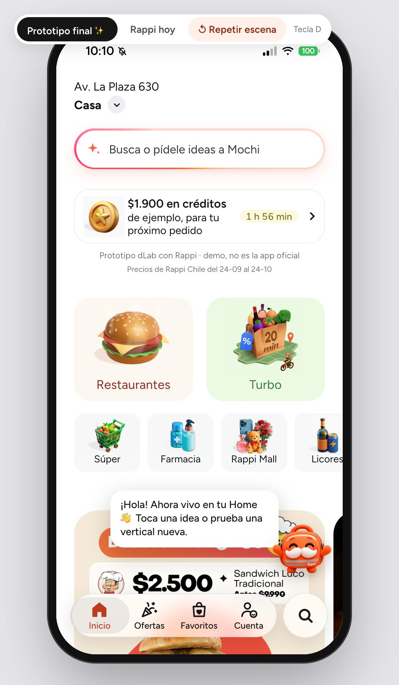
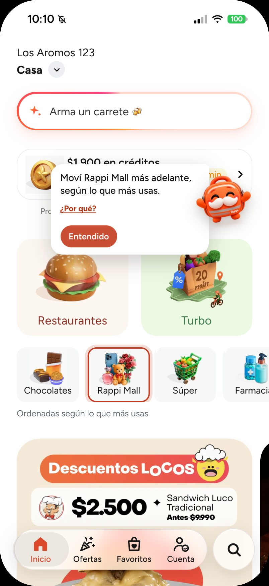
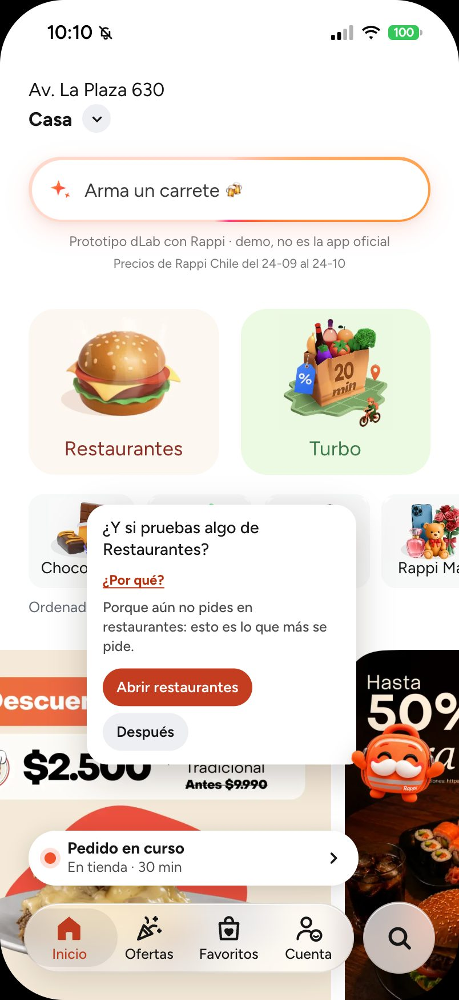
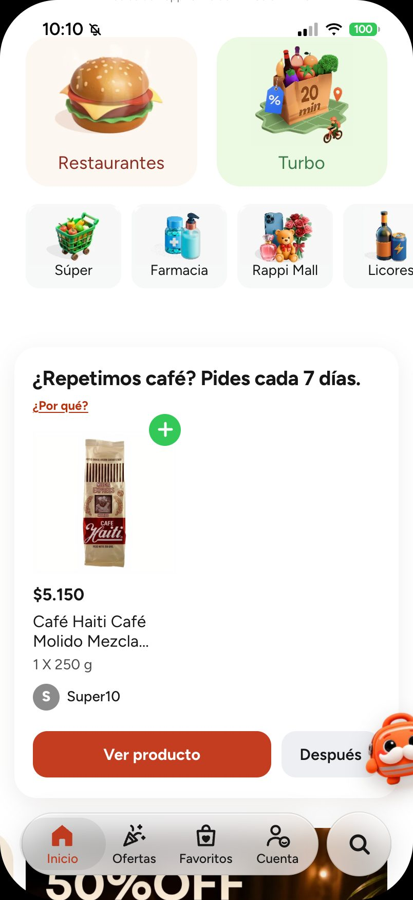
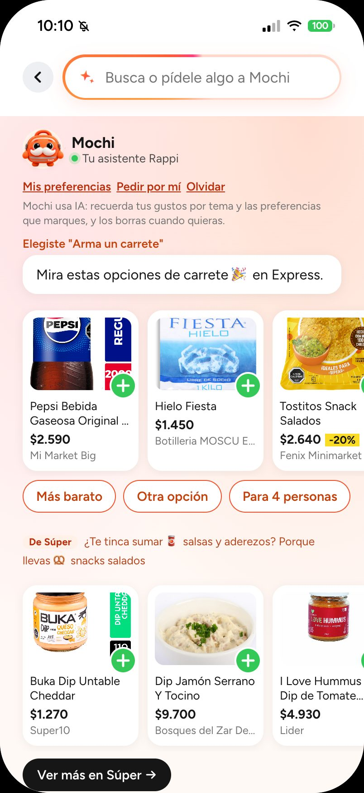
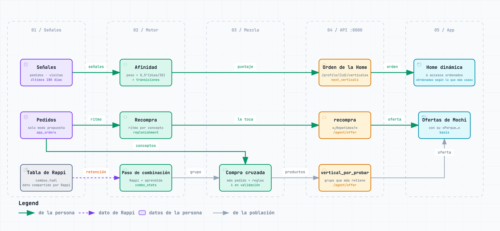
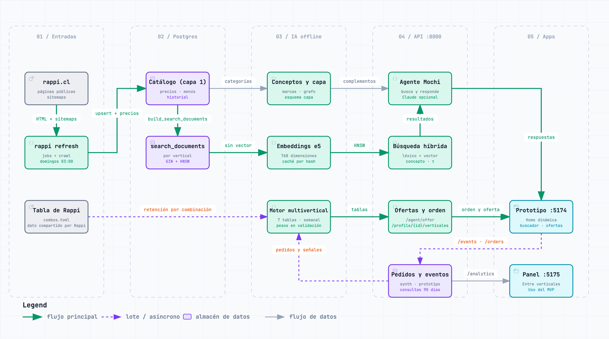

# rappi-dlab · Un motor que conecta las verticales de Rappi

Prototipo para Rappi Chile: un **motor multivertical** en la base de datos que aprende, de cada persona y de la población, qué verticales usa, cuál conviene sumarle y qué le toca pedir de nuevo, y un **prototipo navegable de la app** que lo muestra. La Home ordena sus accesos según el uso de cada persona, y Mochi, la mochila de Rappi con bigote, propone la siguiente vertical siguiendo la escalera Restaurantes → Turbo → Retail (que parte de la tabla de combinaciones que compartió el equipo de Rappi), recuerda lo que toca repetir y responde lo que se le pide desde el buscador. Detrás hay datos reales: el catálogo público de rappi.cl en Postgres + pgvector, una búsqueda híbrida evaluada y una capa de datos que entiende qué es cada producto. Un panel de negocio le muestra a la gerencia y a RappiAds qué decidir con eso.

Lo hizo Yung Chung con el equipo Rappitouille en el programa dLab, junto con Rappi Chile, entre septiembre y octubre de 2026. Es un prototipo con una demo cerrada, no un producto oficial de Rappi ni un sistema en producción: las personas, los pedidos y los pagos son simulados o de prueba.

[](https://github.com/yungzyx/rappi-dlab-mvp/actions/workflows/ci.yml)



*El prototipo final. El interruptor de arriba (tecla **D**) alterna con la app como es hoy.*

## Cómo revisarlo

Tres caminos, de lo más rápido a lo más completo:

1. **La demo en línea:** [dlab-mvp.com](https://dlab-mvp.com) (la app) y [dlab-mvp.com/panel/](https://dlab-mvp.com/panel/) (el panel de negocio). Pide un usuario y una clave, que el equipo entrega aparte. Corre sobre el catálogo real con personas de prueba; lo que se haga ahí queda como uso del prototipo.
2. **La presentación sin conexión:** "Mochi MVP - Presentación.html" (y su versión para iPhone y iPad), un solo archivo que el equipo entrega aparte. Trae la app, el panel de negocio, las personas de prueba y un recorrido automático por 9 capítulos, y abre sin internet. Cómo se arma: [presentacion/README.md](presentacion/README.md).
3. **El código.** Lo central, en este orden:
   - el motor multivertical: [`rappi-ia/src/rappi_ia/motor/`](rappi-ia/src/rappi_ia/motor/) (la tabla de combinaciones de Rappi, en [`combos.toml`](rappi-ia/src/rappi_ia/motor/combos.toml));
   - las ofertas de Mochi, cada una con su razón y sus guardias: [`rappi-ia/src/rappi_ia/offers/`](rappi-ia/src/rappi_ia/offers/);
   - la búsqueda híbrida: [`rappi-ia/src/rappi_ia/retrieval/`](rappi-ia/src/rappi_ia/retrieval/);
   - Mochi en la app: [`prototipo-app/src/components/assistant/`](prototipo-app/src/components/assistant/); el panel: [`dashboard-empresa/src/`](dashboard-empresa/src/);
   - por qué se decidió cada cosa: [docs/decisiones.md](docs/decisiones.md); qué se midió: [Resultados](#resultados).

   Para correrlo en un equipo: [Probarlo](#probarlo).

## En cinco minutos

- **Qué resuelve:** vista desde fuera, cada vertical de Rappi parece un silo, y la mayoría de las personas usa una sola; según la tabla de Rappi, quienes combinan verticales vuelven más. El proyecto conecta las verticales en la base y en la app para invitar a cada persona a la siguiente, con su razón visible.
- **Qué hay:** un scraper del catálogo público (`rappi-scraper/`), la capa de IA con la búsqueda, el motor, Mochi y la API (`rappi-ia/`), la app (`prototipo-app/`), el panel de negocio (`dashboard-empresa/`) y el despliegue en un servidor (`deploy/`). Mapa completo en [Dónde está cada cosa](#dónde-está-cada-cosa).
- **Stack:** Python 3.13 con FastAPI y un modelo local de embeddings (`intfloat/multilingual-e5-base`), Postgres 17 + pgvector, React 19 + Vite 8 (Node 22.22+ o 24.15+), y Docker Compose con Caddy en el servidor. Un LLM (Claude, por la API de Anthropic) es opcional y solo redacta.
- **Cómo verlo funcionando:** ver [Probarlo](#probarlo). Sin la base, `make mvp-check` recorre la app completa contra un catálogo inventado; con el respaldo de entrega, `make mvp` levanta la app, el panel y la API con el catálogo real.

## El problema

Vista desde fuera, como usuarios de la app, cada vertical de Rappi parece funcionar como un silo: lo que una persona compra o busca en el supermercado no parece cambiar lo que se le recomienda en licores, farmacia o restaurantes. La hipótesis: muchas personas usan una o dos verticales y no llegan a las demás.

La tabla que compartió el equipo de Rappi apunta en esa dirección. La mayoría usa una sola vertical en el mes, y quienes combinan más vuelven más al mes siguiente:

| Verticales usadas en el mes | % de usuarios | Pedidos por usuario | Vuelven al mes siguiente |
|---|---:|---:|---:|
| Solo Restaurantes | 62,6 % | 1,9 | 47 % |
| Restaurantes + Turbo | 6,6 % | 5,5 | 82 % |
| Restaurantes + Retail | 5,4 % | 4,7 | 76 % |
| Restaurantes + Turbo + Retail | 4,7 % | 10,5 | 93 % |
| Todo Chile | 100 % | 3,0 | 55 % |

*Dato compartido por Rappi: cohortes de enero a junio de 2026, agrupación gruesa de verticales. Tabla completa en [docs/contexto-y-problema.md](docs/contexto-y-problema.md#1-el-problema).*

Es una **correlación, no un efecto**: quien ya pide mucho usa más verticales y además vuelve más. No prueba que sumarle una vertical a alguien lo retenga; eso solo lo mide un experimento A/B con grupo de control. Más contexto en [docs/contexto-y-problema.md](docs/contexto-y-problema.md).

## La propuesta

**Buscar dentro de la vertical, entender a través de las verticales, e invitar a descubrir las que la persona no usa.**

- **Buscar dentro de la vertical:** la búsqueda responde en las verticales que corresponden a la consulta y muestra un grupo por vertical, sin mezclar sus índices.
- **Entender a través de las verticales:** los intereses se guardan como conceptos comunes a todas (cerveza, snacks salados, pañales…), y el motor suma lo que la persona hace en cada vertical.
- **Invitar a descubrir:** la tabla de Rappi es el punto de partida para elegir qué vertical sumar. Quien pide en Restaurantes ve primero Turbo; quien ya combina esas dos, Retail. El motor lo mezcla con lo que aprende de la población (hoy simulada) y cada sugerencia dice por qué.

### Lo que está construido

| Pieza | Qué hace |
|---|---|
| **Motor multivertical** | En la base de datos, siete tablas con vistas estables en el esquema `capa`. Guarda la afinidad de cada persona por cada vertical, las transiciones entre verticales y las combinaciones con su retención (la tabla de Rappi medida con los datos propios). Suma la compra cruzada entre verticales, lo más pedido y lo que sube, y la recompra (qué concepto pide cada persona con ritmo y cuándo le toca). Se evalúa por fechas (entrenar, validar, probar) y elige sus pesos en validación. Lo personal sale de los datos de cada persona; lo de la población, de una fuente declarada en cada oferta (hoy, personas simuladas). |
| **Home que aprende el orden** | Los seis accesos pequeños de la Home (Súper, Farmacia, Rappi Mall, Licores, Express y Chocolates) se ordenan según lo que cada persona pide y abre, con la leyenda "Ordenadas según lo que más usas". Quien no tiene historial ve el orden fijo. Restaurantes y Turbo no se mueven, Lealtad y Beneficios Pro quedan siempre al final y "Rappi hoy" no aprende. Nace de una conversación con el equipo de Rappi. |
| **Mochi en la Home, con recomendaciones conectadas** | Mochi de cuerpo entero vive en la Home. Saluda, acompaña el plan del día ("¿Qué plan tienes hoy?", un kit de varias verticales) y, al tocarlo, propone la siguiente vertical de la escalera con su porqué. Dentro de esa vertical ofrece lo más pedido ahí; cuando una regla aprendida lo justifica (hoy no, λ = 0), lo que suelen sumar quienes piden lo mismo. Cuando a la persona le toca, propone repetir ("¿Repetimos …? Pides cada N días."), y si dejó de pedir algo que pedía con ritmo, invita a volver ("¿Volvemos a …?"). |
| **Buscador con Mochi** | La barra de la Home abre el buscador de siempre con lo que Mochi sabe de la persona: lo aprendido (con "Olvidar"), su perfil de gusto con una escalera de verticales, ideas para tocar ("Arma un carrete"), búsqueda de tiendas y productos, y "Descubre con Mochi". El mismo buscador es la única entrada de texto: lo que parece un pedido ("¿qué llevo para un asado de 6?", "algo dulce y barato") se le pide a Mochi, que responde con una tarjeta con productos reales del catálogo y su razón. La respuesta se refina con chips de un toque ("Más barato", "Otra opción", "Sin carne", "Para N personas") y sus acciones son botones: no hay chat ni historial, y no da consejo médico. |
| **El pedido como en la app de Rappi** | Un pedido por tienda, con el envío y la compra mínima del catálogo (o supuestos rotulados "de ejemplo"), Rappi Pro por persona, créditos, cupón, confirmación de edad y "Deshacer pedido". Después: pasos por vertical, la barra "Pedido en curso", calificación con motivos, "Pídelo de nuevo", cancelar con rescate, cambios en vivo en el Súper, "Ayuda con este pedido" y programar. Con permiso, Mochi pide solo "lo de siempre" ("Pedir por mí"), con tope y las mismas guardias. Lo que en Rappi decide su servidor (costos, plazos, compensaciones) va como supuesto rotulado. |
| **Eventos con el sobre de Rappi** | Cada evento lleva id, hora y orden del cliente, la pantalla, el origen, la posición y el `request_id` de la respuesta que lo ordenó; las listas cuentan lo que quedó a la vista y hay experimentos declarados con grupo de control. `capa.v_eventos_amplitude` los traduce al plan de tracking de la app de Rappi ([comparación con la app](docs/investigacion/app-rappi-2026-10-25.md)). |
| **Panel de negocio** | Tres vistas para la gerencia y RappiAds alrededor de cuatro preguntas: dónde está la venta cruzada, a quién estamos perdiendo, si funciona lo que ofrece Mochi y qué buscan y no encuentran (ver [Panel de negocio](#panel-de-negocio)). |

| La Home que aprende | Mochi propone una vertical | "¿Repetimos?" | El buscador con Mochi |
|:---:|:---:|:---:|:---:|
|  |  |  |  |
| Alguien abrió dos veces Chocolates y una vez Rappi Mall: esos accesos suben. | Esa persona solo abrió accesos y nunca pidió: Mochi le propone el súper y dice por qué. | Ejemplo armado con la respuesta de muestra de la API y un café real del catálogo; no es un hábito medido. | "Arma un carrete" junta snacks y bebidas para la ocasión, sin alcohol porque no se pidió. |

### Cómo cruza las verticales

Una recomendación cruzada sigue tres pasos: concepto → complemento → búsqueda en la otra vertical. Algunos ejemplos:

| Lo que hace la persona | Concepto | Complemento | Dónde se busca | Qué ve |
|---|---|---|---|---|
| Pide cerveza bajo $3.000 en Licores | cerveza | snacks salados | la vertical donde el concepto es más típico entre las que tienen oferta suficiente, sin contar la actual (Express) | "De Express ¿Te tinca sumar 🥨 snacks salados? Porque llevas 🍺 cerveza", con "Ver más en Express →" |
| Pide pizza en Restaurantes | pizza | bebidas gaseosas (su primer complemento, la cerveza, Mochi no lo ofrece) | Express (Licores no se ofrece) | "De Express ¿Te tinca sumar 🥤 bebidas gaseosas? Porque llevas 🍕 pizza" |
| Busca pañales | pañales | — | — | Ninguna sugerencia: sus complementos son de bebé y salud, que Mochi nunca ofrece por su cuenta |

**La escalera.** Para elegir qué vertical sumarle a cada persona, el motor parte de la tabla de Rappi y la mezcla con la retención aprendida de la población, vertical por vertical, con RappiFavor y RappiTravel al final. Dentro de la vertical elegida, la compra cruzada mezcla lo más pedido con las reglas aprendidas ("quien pide A en una vertical pide B en otra"), con un peso λ que se elige en validación (hoy quedó en 0, así que se ofrece lo más pedido). Si la persona compra una marca, esa marca gana a la combinación en un empate. Cada oferta dice en su `basis` de qué fuente salió, y el texto no afirma lo que hace la población ("Porque pides …. Para acompañar: …, en ….").

Las sugerencias siguen reglas para no perder la confianza del cliente: como máximo una sugerencia cruzada por respuesta, con su razón visible; nunca productos sensibles por iniciativa propia (medicamentos, salud sexual, tabaco y vapeo). Farmacia y Licores solo suben en la Home por señales de la propia persona y nunca se proponen por iniciativa propia. Mochi nunca ofrece alcohol por su cuenta: solo aparece en el kit de una ocasión que la persona eligió, o si la persona lo pide, siempre con el aviso +18. Lo aprendido se ve y se borra ("Olvidar").

## Cómo funciona



*El motor: lo de la persona (verde) ordena la Home y decide la recompra; la tabla de Rappi (punteada) y lo aprendido de la población (gris) eligen la vertical por probar y sus productos. [Versión interactiva](docs/diagramas/motor-flujo.html).*

1. **Descarga (semanal).** `rappi refresh` lee las páginas públicas de rappi.cl y guarda catálogo, menús y precios con historial.
2. **Postgres + pgvector.** El catálogo (capa 1) y `search_documents`, una partición por vertical.
3. **IA offline.** Cada producto y plato recibe un concepto (capa 2), y los conceptos se enlazan con sus complementos. Una capa de datos suma atributos, medidas, marcas, un grafo de conocimiento y segmentos, y al final el **motor multivertical** (`make layers`, también dentro de `make post-refresh`), todo expuesto en el esquema `capa` ([docs/capa-de-datos.md](docs/capa-de-datos.md#motor-multivertical)). Cada documento recibe un embedding de un modelo local multilingüe (e5), con un índice vectorial por vertical. Opcionalmente, y solo en este proceso semanal, Jev (el modelo "System One" de TypeSafe) etiqueta las categorías nuevas y suma un juez a la evaluación; viene apagado hasta que se ponga una clave y un piloto lo apruebe ([docs/jev.md](docs/jev.md)).
4. **Consulta.** Búsqueda híbrida por vertical: por palabras y por significado, combinadas por posición (RRF) y reforzadas por el concepto pedido. Si nada calza, corrige los errores de tipeo con el vocabulario del catálogo. Mochi arma la respuesta y la sugerencia cruzada.
5. **API y prototipo.** La API (FastAPI, puerto 8000) atiende al prototipo (5174) y al panel (5175). El orden de la Home sale de `GET /profile/{id}/verticales`, las ofertas de Mochi de `POST /agent/offer` (vertical por probar, recompra, "¿Volvemos a…?", carro, próximo pedido…) y lo que se le pide a Mochi, de `POST /agent/ask`. Después de cada pedido, la API recalcula la afinidad y la recompra de esa persona. Las verticales, las tiendas con sus pasillos, los restaurantes con su menú, Turbo, Ofertas y Favoritos leen el catálogo real (`/catalog`). El prototipo no abre sin la API: muestra "Sin conexión con Mochi".



**Mochi** en la API responde por texto (`POST /agent/ask`); el prototipo lo usa como buscador, para responder lo que se le pide y con ofertas. Su nombre visible sale de `AGENT_NAME` (rappi-ia) y de `prototipo-app/src/agent/name.js`. Reconoce servicios sin catálogo (un viaje lleva a **RappiTravel**, un envío o trámite a **RappiFavor**). También arma perfiles de gusto (el sushi abre "Amante de lo asiático") y ofrece lo de ese gusto en otras verticales, de a un peldaño; el buscador con Mochi muestra el perfil y su escalera. Entender la consulta son reglas y datos, sin LLM. Sin clave de API responde con plantillas; con clave, el LLM solo redacta sobre lo que el código ya recuperó y verificó. Diseño completo: [docs/diseno-ia.md](docs/diseno-ia.md).

### Diagramas y mapas

| Qué | Para qué | Dónde |
|---|---|---|
| Motor multivertical | De las señales y pedidos de la persona, y de la tabla de Rappi, a la Home dinámica y las ofertas de Mochi | [PNG](docs/diagramas/motor-flujo.png) · [interactivo](docs/diagramas/motor-flujo.html) |
| Flujo de datos | Del catálogo a la respuesta de Mochi, con el motor | [PNG](docs/diagramas/rag-datos.png) · [interactivo](docs/diagramas/rag-datos.html) |
| Arquitectura por carriles | Qué hace cada pieza de la IA | [PNG](docs/diagramas/arquitectura-ia.png) · [interactivo](docs/diagramas/arquitectura-ia.html) |
| Mapa multivertical | Qué productos y conceptos comparten las verticales, con complementos, sustitutos y "nunca junto" | [docs/mapas/mapa-multivertical.html](docs/mapas/mapa-multivertical.html) (descargar y abrir; se regenera con `rappi-ia multivertical`) |
| Mapa de conceptos | Cada concepto junto a la vertical donde es más típico (la regla de Mochi) | [docs/mapas/mapa-conceptos.jpg](docs/mapas/mapa-conceptos.jpg) |
| Scraper | Cómo se descarga el catálogo | [PNG](docs/diagramas/scraper-flujo.png) · [interactivo](docs/diagramas/scraper-flujo.html) |
| Despliegue | El MVP en un servidor: Caddy con la puerta, la API, Postgres y los respaldos | [PNG](docs/diagramas/despliegue.png) · [interactivo](docs/diagramas/despliegue.html) |

## Resultados

Cada cifra dice qué tipo de dato es. El detalle, con los reportes de cada fecha, está en [docs/resultados/](docs/resultados/README.md).

| Qué | Cifra | Tipo de dato |
|---|---|---|
| Catálogo | 253.945 documentos de búsqueda (84.024 productos, 165.623 platos y 4.298 tiendas), todos con embedding | Real (catálogo público): contado el 05-10 sobre la descarga del 04-10-2026; las descargas posteriores no se recontaron |
| Búsqueda | nDCG@10: híbrido 0,905 · sin refuerzo por concepto 0,842 · vectorial 0,835 · léxico 0,765 | Evaluación automática: 131 consultas en las 8 verticales ([22-10-2026](docs/resultados/busqueda-2026-10-22.md)) |
| Búsqueda: juicio LLM | 95 % de los 3 primeros resultados sirven o sirven a medias (66 % "sirve"); el juez por concepto coincide en el 70 % (κ 0,32) | Juicio LLM doble ciego de 200 pares, no humano ([25-10-2026](docs/resultados/juicio-llm-busqueda-2026-10-25.md)) |
| Búsqueda: juez de tres niveles | Lo que ve la persona, nDCG@10 0,906 → 0,952 y P@3 "sirve" 0,75 → 0,81; necesidades ("algo para la once") 0,80 → 0,91 y Rappi Mall 0,83 → 0,96 | Juicio LLM, no humano: 88 consultas con todo lo mostrado juzgado, antes y después de los cambios del 25-10 ([25-10-2026](docs/resultados/busqueda-2026-10-25.md)) |
| "Sin resultado" | precisión 1,00 (0 falsas alarmas) · recall 0,93 (54 de 58 negativas) | Evaluación automática ([22-10-2026](docs/resultados/busqueda-2026-10-22.md)) |
| Errores de tipeo | 53 de 53 recuperados en la búsqueda de la app (37 sin corregir) y 52 por vertical | Evaluación automática ([25-10-2026](docs/resultados/busqueda-2026-10-25.md)) |
| Seguimientos de Mochi (chips) | 25 conversaciones de 2 o 3 turnos: 21 bien, 4 a medias, 0 mal (antes 7, 8 y 10); las 40 preguntas libres, bien | Juicio propio sobre una copia de la base, no humano externo, medido el 25-10 con el campo de seguimiento; desde el 26-10 los mismos seguimientos van por chips, con la misma API ([25-10-2026](docs/resultados/mochi-conversacion-2026-10-25.md)) |
| Guardias de ofertas | 0 casos de alcohol, Farmacia, bebé, salud o sensibles en 2.851 productos ofrecidos | QA sobre el catálogo real con personas simuladas ([16-10-2026](docs/resultados/qa-motor-2026-10-16.md)) |
| Motor: próxima vertical | nDCG@8 0,978 frente a 0,918 del orden fijo | Simulado: prueba la mecánica, no el efecto ([17-10-2026](docs/resultados/simulados-2026-10-17.md)) |
| Conceptos | 86 a 88 % de precisión en la asignación de conceptos | Estimación con jueces LLM ([06-10-2026](docs/resultados/capas-precision-2026-10-06-nueva-muestra.md)) |
| Tests | rappi-ia 3.288 (y 2 omitidos) · scraper 280 · prototipo 942 · panel 122 | Al 26-10-2026: CI de main en `ee51c2e`; no se recontaron con los PR posteriores |

> [!IMPORTANT]
> **Qué no es evidencia**
>
> - **Usuarios y eventos simulados.** El motor, los segmentos y las métricas de negocio usan personas simuladas (`source = 'synthetic'`): muestran la mecánica, no un resultado.
> - **La tabla de Rappi** es una correlación: no dice que sumar una vertical retenga.
> - **La ventaja del híbrido.** La relevancia se juzga por concepto y el híbrido recibe un refuerzo por ese mismo concepto; sin él, no se distingue del vectorial (0,842 frente a 0,835). Un juicio LLM doble ciego (25-10) muestra que ese juez es generoso: da por relevante lo que solo sirve a medias, así que el nDCG es optimista ([reporte](docs/resultados/juicio-llm-busqueda-2026-10-25.md)). Desde el 25-10 lo que ve la persona se mide también con un juez de tres niveles hecho de ese juicio ([reporte](docs/resultados/busqueda-2026-10-25.md)), que tampoco es humano. Falta el juicio humano.
> - **Las precisiones de la capa 2 y de la capa de datos** son estimaciones con jueces LLM.
> - **Lo que Mochi aprende de la persona y sus pedidos** es de demo: se guardan en el servidor bajo un id seudónimo del navegador, sin cuenta; la persona los borra con "Borrar mis datos" (Cuenta).
> - **"No está en el catálogo"** no significa "Rappi no lo vende": en tiendas el catálogo es una muestra.

## Probarlo

Requisitos (el detalle, en [docs/instalacion.md](docs/instalacion.md)): Python 3.13, Node 22.22+ o 24.15+ y Postgres 17 con pgvector, con Homebrew (`make db`) o con Docker (`make db-docker`).

```bash
make install                                    # desde la raíz: los .venv de rappi-scraper y rappi-ia (con el lock), la app y el panel
cd rappi-scraper && make db && cd ..            # Postgres 17 + pgvector con Homebrew (o `make db-docker`, con Docker)
cd rappi-ia && make install-ml db-test && cd .. # los modelos de IA (~1 GB) y la base rappi_ia_test
```

### Sin la base: `make mvp-check`

```bash
make mvp-check    # desde la raíz: siembra un catálogo inventado en rappi_ia_test y recorre el MVP con Chrome (9 revisiones)
```

Levanta una API liviana (:8010), la app (:5184) y el panel (:5185) sobre un catálogo de prueba inventado y revisa la Home dinámica, una compra, el kit de Mochi, un pedido a Mochi y su chip "Más barato", la escalera, el panel y la app sin API. Termina con "MVP check: 9 de 9 bien" y no toca la base `rappi`. Qué revisa cada paso: [docs/instalacion.md](docs/instalacion.md#5-el-mvp).

### Con el catálogo real: `make mvp`

La API lee la base `rappi`. La forma rápida de tenerla es el **respaldo de entrega**: un `.dump` de Postgres que arma el equipo del proyecto con `make dump-entrega` y se entrega por un canal acordado, nunca por git. Trae el catálogo descargado, la capa de IA, el motor y las personas simuladas, sin el uso del MVP. Para restaurarlo y dejar la base al día, ver [docs/instalacion.md §3](docs/instalacion.md#3-base-de-datos). Sin el respaldo, el scraper descarga todo desde cero, pero tarda días.

```bash
make mvp          # desde la raíz: API (:8000), app (:5174) y panel (:5175); Ctrl-C detiene los tres
make mvp LAN=1    # abre la API, la app y el panel a la red local, para probar en un celular (solo en una red de confianza)
```

`make mvp` revisa las dependencias, los puertos y la base (`rappi-ia doctor`, solo lectura), aplica las migraciones pendientes (no las de una rama sin fusionar: `MIGRATE=1` lo fuerza, ver [docs/instalacion.md](docs/instalacion.md#5-el-mvp)), arranca los tres con sus registros prefijados y avisa cuando responden. La API tarda en estar lista porque carga los modelos. No descarga nada de rappi.cl. **La app no corre sin la API:** si no responde, muestra "Sin conexión con Mochi" con un botón "Reintentar".

La tecla **D** (o Cuenta → Configuración → Modo demo en el celular) alterna "Prototipo final" y "Rappi hoy". Guion de demo, con la Home que aprende y la escalera: [docs/demo.md](docs/demo.md).

En local la API no tiene puerta de acceso (los datos de cada persona sí piden su token de sesión) y por defecto escucha solo en el equipo local. `make schedule` en `rappi-scraper/` programa la actualización semanal (domingos 03:00) seguida de `make post-refresh` en rappi-ia: va en un solo equipo, para no duplicar las descargas sobre rappi.cl.

### Demos sin conexión

La app y el panel también se arman en un solo archivo HTML, con una API simulada o con respuestas guardadas, que abre sin internet ni base. Para armarlos hace falta una copia de la base con la API corriendo: ver [prototipo-app/README.md](prototipo-app/README.md#demo-sin-conexión-prototipo-mvphtml) y [dashboard-empresa/README.md](dashboard-empresa/README.md#panel-en-un-solo-html).

Con los dos armados, `make presentacion` los junta en una presentación de un solo archivo (escritorio, y iPhone y iPad): la app al centro, sus personas y su vista a los lados, el panel de negocio encima y un recorrido automático por capítulos. Ver [presentacion/README.md](presentacion/README.md).

### En un servidor

Una demo cerrada en un servidor Linux con Docker Compose: Caddy con TLS y una puerta de usuario y clave sobre todo el sitio, la API con identidad firmada y la base con roles separados, migraciones con respaldo y respaldos fuera del equipo. Paso a paso, en [docs/despliegue.md](docs/despliegue.md).

## Qué es real y qué es simulado

- **Real:** el catálogo, los precios y los menús (de rappi.cl), los conceptos, la capa de datos, la búsqueda y las respuestas de Mochi con la API. Las tiendas, productos, precios, menús y ofertas que muestran las pantallas del prototipo salen de la API; su diseño (títulos, categorías, banners) sigue siendo de recortes de capturas de la app. El envío y la compra mínima salen del catálogo cuando la descarga los trae (`GET /catalog/terms`); si no, son supuestos rotulados "de ejemplo". La nota de un producto no se muestra.
- **Simulado:** el pago, el seguimiento del pedido (llega a los 20 s) y las personas, eventos y pedidos de los que el motor aprende la población y con los que se calculan segmentos y métricas.
- **Supuestos rotulados "de ejemplo"** (`prototipo-app/src/screens/checkout/pricing.js` y `screens/tracking/`): Rappi Pro (envío gratis sobre un mínimo y 20 % menos de tarifa), los créditos y los cupones, los montos de los tipos de entrega, el costo de cancelar, la garantía de Turbo, el atraso, el agotado en vivo y los plazos de la ayuda. Ninguno es una tarifa ni una política de Rappi.
- **Compartido por Rappi:** la tabla de combinaciones de verticales y su retención (cohortes de enero a junio de 2026), en `rappi-ia/src/rappi_ia/motor/combos.toml`. Es una correlación, no un efecto.
- **Uso del MVP:** lo que hicieron en la app las pocas personas que la probaron (`source = 'prototype'`). El panel lo rotula "uso del MVP, pocas personas: no es evidencia".
- **Uso responsable:** solo páginas públicas sin barreras técnicas, sin APIs internas ni inicio de sesión, una descarga a la vez con pausas de 1,5 a 3 s y una actualización por semana. El scraper se presenta con su propio User-Agent y respeta robots.txt: si una página no está permitida, la descarga se detiene. Sin datos personales: los usuarios son simulados o del prototipo (id seudónimo). Los datos descargados no se versionan: llegan en un respaldo de la base. Las páginas de prueba del scraper (`rappi-scraper/tests/fixtures/`) son copias reducidas de páginas públicas. Fines de investigación y demostración; un uso comercial requeriría autorización de Rappi.

## Límites

- **El motor aprende de una población simulada:** sin pedidos reales, las transiciones, las combinaciones, la compra cruzada y lo más pedido salen de personas simuladas (`MOTOR_POBLACION`; con datos de Rappi se cambia la fuente, no el mecanismo). Como en validación λ quedó en 0, la razón "Porque pides …. Para acompañar: …" no aparece en la demo: Mochi ofrece lo más pedido ("Porque aún no pides en …: esto es lo que más se pide."). Ver [docs/decisiones.md](docs/decisiones.md).
- **La escalera parte de una correlación:** la tabla de Rappi no prueba que sumar una vertical retenga, y la agrupación en `rest`, `turbo` y `retail` es un supuesto propio, como el rendimiento decreciente de la escalera fina. El efecto (frecuencia, retención, verticales por persona) solo se mide con datos de Rappi y un grupo de control.
- **Cobertura parcial en tiendas:** hasta 24 productos por sub-pasillo y una sucursal por marca o formato. No se listan las tiendas sin ofertas vigentes en un pasillo de primer nivel, ni Mascotas (la base no tiene esa vertical).
- **Mochi no ofrece por su cuenta alcohol, farmacia, bebé ni salud:** solo el kit de una ocasión que la persona elige, o lo que la persona pide, puede traer alcohol, con +18. Consecuencia aceptada: hay menos complementos (por ejemplo, "playa" ya no sugiere protector solar). Ver [docs/decisiones.md](docs/decisiones.md).
- **Pedidos a Mochi:** los entiende con reglas, no con un LLM, así que lo que las reglas no cubren se busca por palabras. No es un chat: la API no guarda historial ni sesión; un chip sigue la respuesta anterior con el estado que manda la app (`previous`), y un refinamiento sin chip (un tope de precio, "sin palta") se escribe en el buscador.
- **Opciones de los platos:** las opciones obligatorias de un plato ("Elige 1 salsa") no están: la descarga solo sabe si un plato las tiene, no cuáles son.
- **Turbo sin actualizar:** sus tiendas ya no aparecen como Turbo en los listados públicos que recorre el scraper; sus precios son del 27-09-2026.
- **Evaluación automática:** no hay juicio humano (solo uno LLM, el 25-10, que muestra que el juez por concepto es generoso), y el refuerzo por concepto favorece al híbrido. "Sin resultado" detecta 54 de 58 negativas, con un umbral calibrado sobre ese mismo set; el [reporte](docs/resultados/busqueda-2026-10-22.md) explica las demás.
- **Demo cerrada:** sin cuentas ni lanzamiento abierto. En local la API no tiene puerta de acceso y la tarea semanal local es de macOS (launchd; en Linux, los timers de systemd de `deploy/`); en un servidor, todo el sitio va detrás de usuario y clave.
- **Cambios del sitio:** si rappi.cl cambia su frontend, hay que ajustar los parsers; el reporte de cada corrida marca las respuestas anómalas.

## Panel de negocio

[`dashboard-empresa/`](dashboard-empresa/) es el panel para la empresa y forma parte del MVP: lee las métricas de la API (`/analytics`) y `make mvp` lo levanta junto a la app. Está pensado para la gerencia general y RappiAds, en tres vistas alrededor de cuatro preguntas, cada una con su cifra, su comparación y una acción sugerida: **Resumen** (dónde está la venta cruzada, a quién estamos perdiendo, si funciona lo que ofrece Mochi y qué buscan y no encuentran, más cómo va el negocio), **Retención y venta cruzada** (la escalera de la tabla de Rappi y a quién invitar a volver) y **Mochi y búsquedas** (ofertas por momento, sugerencias entre verticales, el motor contra una regla simple, qué se ve y qué se toca en las listas y la demanda no satisfecha). Una cuarta, **Experimentos**, muestra cada experimento del MVP por variante y dice cuál mide un efecto (el grupo de control de las ofertas, al azar) y cuál solo describe (el modo de la app). Retención compara además a las personas Pro y sin Pro, y ningún pedido cancelado cuenta. Se elige la fuente de los datos y nunca se mezclan:

- **Simulados** (por defecto): usuarios, eventos y pedidos de un generador con semilla. Muestran la mecánica del panel, no un resultado. La tabla de Rappi y los ítems del catálogo sí son reales.
- **Prototipo**: lo que la gente hizo en la app del MVP: las ofertas de Mochi por momento (plan, carro, antes de pagar, próximo pedido, sin resultado, vertical por probar, recompra, volver a pedir, perfil de gusto, OnTop de Turbo, pregunta y "Para ti"; los pedidos de "Pedir por mí" se cuentan aparte), a quién invitar a volver ("¿Volvemos a …?") y las búsquedas sin resultado por vertical y concepto. Es uso de pocas personas y el panel lo rotula "uso del MVP, pocas personas: no es evidencia" en cada sección. Sin nombres ni textos: personas contadas, nunca nombradas.

```bash
make mvp   # panel en http://localhost:5175/?vista=mochi&fuente=prototipo (sin la API, lo del prototipo no muestra cifras: dice "La API no responde")
```

La misma carpeta trae una página de presentación de la propuesta (`http://localhost:5175/presentacion.html`).

## Dónde está cada cosa

```text
.
├── prototipo-app/          el prototipo final (Vite + React): la Home que aprende, Mochi y el buscador con Mochi
├── rappi-ia/               conceptos, embeddings, búsqueda, capa de datos, motor multivertical, Mochi y API (comando `rappi-ia`)
├── rappi-scraper/          descarga del catálogo público → Postgres + pgvector (comando `rappi`; migraciones de toda la base)
├── dashboard-empresa/      panel de negocio, parte del MVP (Vite + React; lee la API), y la página de presentación
├── presentacion/           la presentación del MVP sin conexión (app, panel y recorrido automático en un solo HTML)
├── docs/                   propuesta, diseño, decisiones, demo, instalación, despliegue y resultados (índice en docs/README.md)
│   ├── diseno/             especificaciones de las piezas grandes (capa de perfiles, MVP, perfiles de gusto, motor y la conversación con Mochi)
│   ├── diagramas/          diagramas (PNG e interactivos) y sus fuentes en diagramas-fuente/
│   ├── historial/          decisiones que ya no rigen
│   ├── investigacion/      la app de Rappi frente al MVP y el plan por fases del 25-10
│   ├── mapas/              mapa multivertical y mapa de conceptos
│   └── resultados/         reportes de evaluación versionados (fuente de las cifras)
├── deploy/                 despliegue en un servidor: compose, Caddy, Dockerfiles, roles de la base, respaldos y timers;
│                           macos/, la demo desde un Mac con Cloudflare Tunnel
├── Makefile, scripts/      `make mvp` y `make mvp-check` (levantan y recorren el MVP) y revisiones del repositorio
├── .github/                CI (scraper y rappi-ia contra Postgres + pgvector; app y panel con lint, formato, tests y build; `make mvp-check`, los scripts y el stack de Docker), Dependabot y plantillas
└── CLAUDE.md               convenciones del repositorio (útiles también para asistentes de código)
```

**Fuera del repositorio:** la base Postgres `rappi`, `rappi-scraper/data/` y `rappi-ia/data/`. Los datos descargados no se versionan.

## Cambios desde el 25-10-2026

El repositorio de la entrega partió de un solo commit y siguió con PR revisados, uno por cambio. El 25 y el 26-10 el MVP se comparó con la app de Rappi para iPhone ([investigación](docs/investigacion/app-rappi-2026-10-25.md)) y de ahí salieron diez fases. Al final, una revisión de todo el repositorio dejó sus correcciones en cuatro PR más. Del 26-10 al 01-11 siguieron la documentación al día, la presentación sin conexión, Mochi en la Home, la búsqueda en frío y lo que hace falta para probar con personas.

| Fase o cambio | Qué cambió | PR | Migración |
|---|---|---|---|
| 1. Sobre de eventos | Id, hora y orden del cliente sin duplicados; pantalla, origen, posición y `request_id` en cada evento; sesiones (`app_sessions`) | [#9](https://github.com/yungzyx/rappi-dlab-mvp/pull/9) | 043 |
| 2. Recompra y después del pedido | "Pídelo de nuevo", calificación con motivos (una mala pausa la recompra), pasos por vertical, "Pedido en curso", propina después, código de entrega y el OnTop de Turbo | [#12](https://github.com/yungzyx/rappi-dlab-mvp/pull/12) | 044 |
| 3. Carro y checkout | Un pedido por tienda; envío, mínimo y tarifa del catálogo (`GET /catalog/terms`) o de ejemplo; Pro por persona, créditos, cupón, edad +18, receta y "Deshacer pedido" | [#10](https://github.com/yungzyx/rappi-dlab-mvp/pull/10) | 046 |
| 4. Descubrimiento | Filtros de restaurantes, abierto o cerrado según el horario publicado, búsquedas recientes y "Lo más buscado", tiendas en la búsqueda, comparar entre tiendas, promos, "Pocas unidades", "Lo que sea" y "Para ti" en la tienda | [#15](https://github.com/yungzyx/rappi-dlab-mvp/pull/15) | — |
| 5. Mochi como el agente de Rappi | Resumen antes de pagar, preferencias que persisten (la dieta y las alergias solo filtran), atajos, estado del pedido y aviso de IA | [#11](https://github.com/yungzyx/rappi-dlab-mvp/pull/11) | 045 |
| 6. Impresiones y experimentos | Lo que cada lista deja a la vista, experimentos declarados con grupo de control (apagado) y vistas de `capa`: embudo, CTR por posición y el puente con Amplitude | [#16](https://github.com/yungzyx/rappi-dlab-mvp/pull/16) | 047 y 048 |
| 7. Pedir por mí | Con permiso, Mochi repite solo lo de siempre en las tiendas elegidas, con tope, guardias, ventana para deshacer y una segunda revisión en la API | [#17](https://github.com/yungzyx/rappi-dlab-mvp/pull/17) | 049 |
| 8. Flujos del pedido | Un pedido por tienda en la app, cancelar con rescate, cambios en vivo en el Súper, atraso, "Ayuda con este pedido" y programar | [#20](https://github.com/yungzyx/rappi-dlab-mvp/pull/20) | 050 |
| 9. Pendientes de las fases 1 a 7 | El buscador con la dieta y las alergias, Pro y sin Pro en el panel y el sobre en las pantallas que faltaban | [#19](https://github.com/yungzyx/rappi-dlab-mvp/pull/19) | — |
| 10. Mochi sin chat | El buscador es la única entrada de texto; la respuesta se refina con chips y las acciones son botones | [#18](https://github.com/yungzyx/rappi-dlab-mvp/pull/18) | — |
| Revisión del repositorio | Un pedido cancelado deja de contar también en el panel; correcciones de montos, créditos, estados y textos en la app; el kit con menos tiendas; dependencias | [#21](https://github.com/yungzyx/rappi-dlab-mvp/pull/21) · [#22](https://github.com/yungzyx/rappi-dlab-mvp/pull/22) · [#23](https://github.com/yungzyx/rappi-dlab-mvp/pull/23) · [#24](https://github.com/yungzyx/rappi-dlab-mvp/pull/24) | 051 |
| Documentación y demos al día | La documentación describe el estado final de las fases; las capturas salen del script; la demo de un solo HTML, bajo 15 MB | [#25](https://github.com/yungzyx/rappi-dlab-mvp/pull/25) · [#26](https://github.com/yungzyx/rappi-dlab-mvp/pull/26) · [#27](https://github.com/yungzyx/rappi-dlab-mvp/pull/27) | — |
| Buscador con Mochi como en el Comité 2 | Con un perfil de gusto: "Tu perfil" con "Olvidar" y "¿Por qué?", un solo saludo y la escalera dentro de la tarjeta | [#28](https://github.com/yungzyx/rappi-dlab-mvp/pull/28) | — |
| Presentación del MVP en un solo HTML | Escritorio e iPhone/iPad, sin API ni internet, con recorrido automático por capítulos, perfiles de gusto primero y "Simular" ([presentacion/](presentacion/README.md)) | [#29](https://github.com/yungzyx/rappi-dlab-mvp/pull/29) · [#30](https://github.com/yungzyx/rappi-dlab-mvp/pull/30) · [#32](https://github.com/yungzyx/rappi-dlab-mvp/pull/32) · [#34](https://github.com/yungzyx/rappi-dlab-mvp/pull/34) | — |
| Mochi mueve los accesos y "Ocultar a Mochi" | Mochi dice qué acceso de la Home movió y por qué (`vertical_reorder_shown`); "Ocultar a Mochi" en su menú y en Cuenta (`agent_visibility`); el panel cuenta quién lo ocultó ("¿Mochi molesta?", `GET /analytics/presencia`) | [#31](https://github.com/yungzyx/rappi-dlab-mvp/pull/31) · [#33](https://github.com/yungzyx/rappi-dlab-mvp/pull/33) | 052 |
| Textos del repositorio | "Cómo revisarlo" al inicio del README, comillas rectas en lugar de angulares y el proyecto "desarrollado junto con Rappi Chile", no oficial | [#35](https://github.com/yungzyx/rappi-dlab-mvp/pull/35) · [#37](https://github.com/yungzyx/rappi-dlab-mvp/pull/37) · [#38](https://github.com/yungzyx/rappi-dlab-mvp/pull/38) | — |
| Búsqueda en frío | Con el modelo fuera de memoria, `/search` tarda pero no responde 500 (el vector antes de abrir la transacción, también con `user_id`); búsquedas de mantención cada 5 minutos en la demo desde un Mac; el saludo con perfil no espera "Para ti" | [#39](https://github.com/yungzyx/rappi-dlab-mvp/pull/39) · [#40](https://github.com/yungzyx/rappi-dlab-mvp/pull/40) | — |
| Prueba con usuarios | Guion de 6 tareas, consentimiento y cuestionario ([prueba-usuarios.md](docs/prueba-usuarios.md)), `rappi-ia resumen-prueba` por persona y la plantilla del reporte | [#41](https://github.com/yungzyx/rappi-dlab-mvp/pull/41) | — |
| Experimentos en el panel | Pestaña "Experimentos" y `GET /analytics/experimentos`: por variante, personas asignadas, con pedido y verticales por persona | [#42](https://github.com/yungzyx/rappi-dlab-mvp/pull/42) | — |
| El "¿Por qué?" en los eventos | La oferta mostrada dice de qué sale su razón (`payload.basis`) y abrir el "¿Por qué?" es un evento (`offer_why_open`) | [#43](https://github.com/yungzyx/rappi-dlab-mvp/pull/43) | 053 |

Antes de las fases, el 25-10: la búsqueda de necesidades medida con un juez de tres niveles ([#6](https://github.com/yungzyx/rappi-dlab-mvp/pull/6)), los seguimientos de Mochi ([#7](https://github.com/yungzyx/rappi-dlab-mvp/pull/7); desde la fase 10, con chips), la app instalable en el teléfono ([#5](https://github.com/yungzyx/rappi-dlab-mvp/pull/5)), el juicio LLM de la búsqueda ([#2](https://github.com/yungzyx/rappi-dlab-mvp/pull/2)) y la demo desde un Mac ([#3](https://github.com/yungzyx/rappi-dlab-mvp/pull/3) · [#4](https://github.com/yungzyx/rappi-dlab-mvp/pull/4) · [#8](https://github.com/yungzyx/rappi-dlab-mvp/pull/8)). El porqué de cada cambio está en [docs/decisiones.md](docs/decisiones.md).

## Documentación

Índice, con qué leer según lo que buscas: [docs/README.md](docs/README.md). Decisiones con su porqué: [docs/decisiones.md](docs/decisiones.md). Para contribuir (tests, convenciones y commits): [CONTRIBUTING.md](CONTRIBUTING.md). Para reportar un problema de seguridad: [SECURITY.md](SECURITY.md).

## Autor y licencia

Yung Chung ([yungzyx](https://github.com/yungzyx)) y el equipo Rappitouille, programa dLab (2026).

Todos los derechos reservados, con permiso de uso, copia y modificación internos para Rappi S.A.S. y sus filiales: ver [LICENSE](LICENSE). El repositorio incluye capturas, marcas y contenido de Rappi y de sus comercios, que pertenecen a sus dueños.
