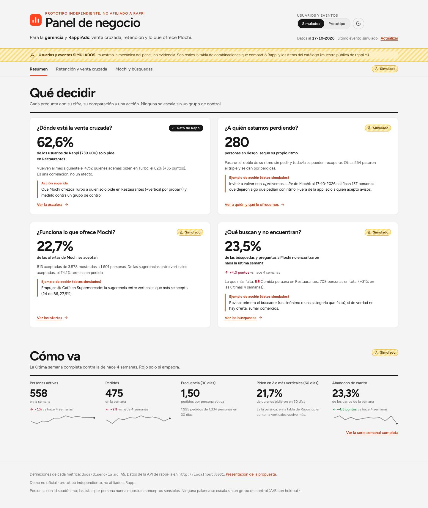
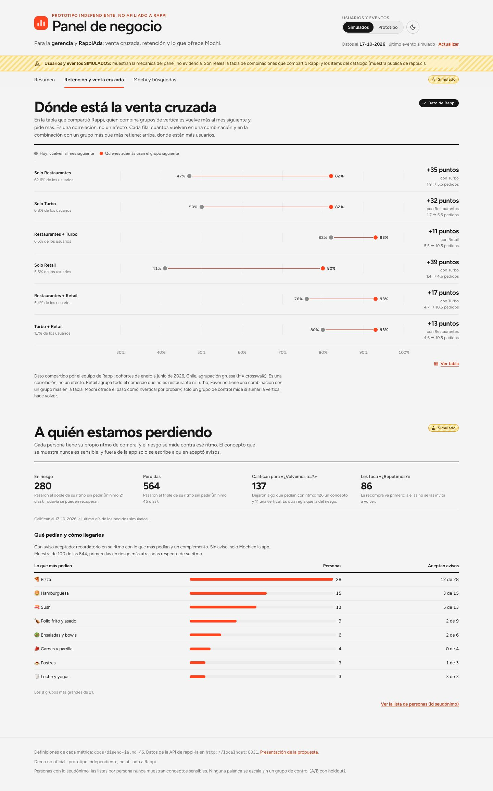
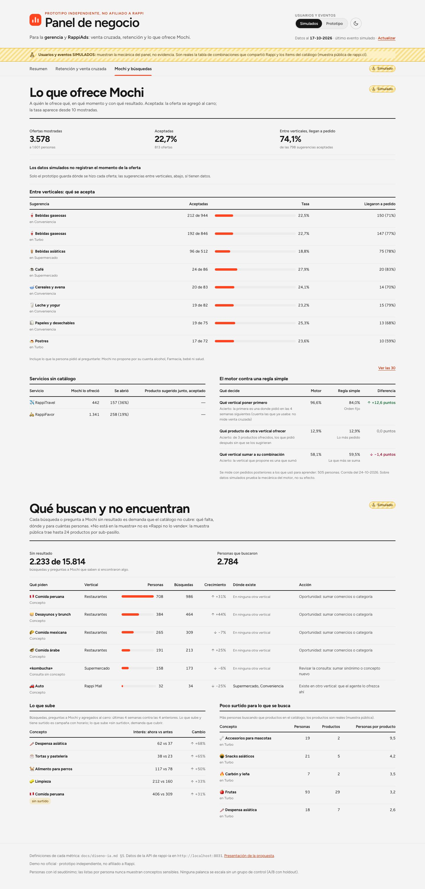
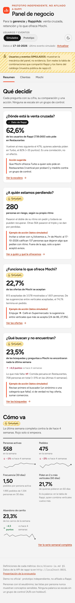
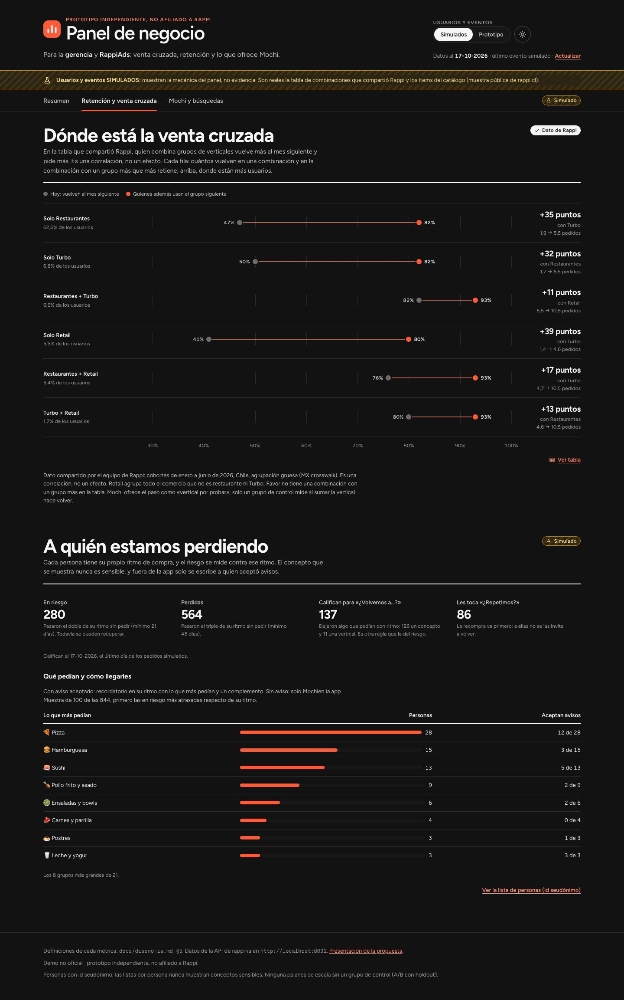

# Panel de negocio (demo)

> **Parte del MVP.** `make mvp` lo levanta junto a la API y la app, y lee la API (`/analytics`). Con la fuente **Simulados** muestra la mecánica del panel; con la fuente **Prototipo**, lo que la gente hizo en la app (ofertas de Mochi por momento, búsquedas sin resultado, a quién invitar a volver), siempre rotulado «uso del MVP, pocas personas: no es evidencia».

> Prototipo independiente del programa dLab: no está afiliado a Rappi ni cuenta con su respaldo, y el encabezado del panel lo dice. Las marcas pertenecen a sus dueños.

Panel para dos públicos de Rappi: la **gerencia general** (crecimiento, retención y venta cruzada entre verticales) y **RappiAds** (a quién ofrecer qué, en qué momento y con qué resultado). Se ordena en cuatro preguntas, cada una con su cifra, su comparación y una acción sugerida:

1. **¿Dónde está la venta cruzada?** La tabla de combinaciones que compartió Rappi: cuántos usuarios están en cada combinación de verticales y cuánto más vuelve la combinación con un grupo más.
2. **¿A quién estamos perdiendo?** Personas en riesgo y perdidas según su propio ritmo, a cuántas invitar a volver y qué pedían.
3. **¿Funciona lo que ofrece Mochi?** Ofertas por momento, sugerencias entre verticales, servicios sin catálogo y el motor contra una regla simple.
4. **¿Qué buscan y no encuentran?** Búsquedas sin resultado con su tendencia, la demanda agrupada con su acción, lo que sube y dónde hay poco surtido.

Lo que no responde a una de esas preguntas no está en el panel; el porqué del diseño está en [docs/decisiones.md](../docs/decisiones.md#datos-simulados-y-panel). Las definiciones de cada métrica vienen de [docs/diseno-ia.md §5](../docs/diseno-ia.md#5-panel-para-la-empresa-vale-la-pena). Los datos salen de la API de [`rappi-ia`](../rappi-ia/).

> **Usuarios, eventos y pedidos SIMULADOS.** Se generan con `rappi-ia/src/rappi_ia/events/synth.py` (3.000 usuarios × 26 semanas, semilla 7, `source = 'synthetic'`) y supuestos explícitos. El panel **muestra la mecánica, no evidencia**. Por ejemplo, el simulador asume que quien usa más verticales se va menos, así que esa relación aparece por construcción. La tabla de Rappi sí es un dato real (agregado, cohortes de enero a junio de 2026), y es una correlación, no un efecto.

El panel lo dice siempre:

- un aviso fijo arriba que nunca se oculta;
- una insignia de procedencia en cada sección y en cada pregunta del Resumen («Simulado», «Prototipo» o «Dato de Rappi»);
- con la fuente del prototipo, el rótulo «uso del MVP, pocas personas: no es evidencia» en cada sección que la usa.

Las fuentes nunca se mezclan: cada respuesta se valida contra la fuente pedida.

La carpeta trae además una página de presentación de la propuesta (`presentacion.html`, en la misma raíz de Vite): problema, propuesta, la red que el catálogo ya comparte entre verticales (`public/presentacion/mapa-multivertical.html`, copia de `docs/mapas/` tras correr `rappi-ia multivertical`), arquitectura y resultados, pensada para abrirla antes del panel. Con el servidor de desarrollo arriba está en `http://localhost:5175/presentacion.html`.

## Cómo correrlo

Desde la raíz del repositorio:

1. Levantar la API de `rappi-ia` y esperar a «Application startup complete» (carga los modelos al arrancar). El panel la busca por defecto en el mismo host desde el que se abrió la página, puerto 8000 (`http://localhost:8000`):

   ```bash
   cd rappi-ia
   make serve
   ```

2. En otra terminal, levantar el panel:

   ```bash
   cd dashboard-empresa
   npm ci
   npm run dev          # http://localhost:5175
   ```

La URL de la API se cambia con `VITE_API_URL`, por ejemplo `VITE_API_URL=http://localhost:8001 npm run dev` o en `.env.local`. La API ya acepta peticiones desde `localhost:51xx` (CORS). Desde el iPhone (`make mvp LAN=1`) no hace falta configurar nada: busca la API en el mismo host. En el build de producción, sin `VITE_API_URL`, la busca en `/api` (el mismo origen); `PANEL_BASE=/panel/` lo construye para servirlo bajo una subruta. En un servidor el panel es opcional: se construye en `/panel/` con `WITH_PANEL=1` y necesita `API_ENABLE_ANALYTICS=1`, porque en producción `/analytics` viene apagado ([docs/despliegue.md](../docs/despliegue.md)).

**Sin la API** el panel funciona con datos **simulados**: cada consulta que falla, o que tarda más de 30 s, cae a la respuesta guardada en `src/fixtures/sin-conexion/`. Son todas de una misma foto de la API (`npm run fixtures`, ver abajo): hoy, la del 24-10-2026 sobre `rappi_staging`, con las 3.000 personas simuladas, así que las cifras calzan entre sí y con este README. Cada archivo trae su `guardado` (`origen` y `fecha`), y el aviso «Modo sin conexión (datos guardados)» lo cita, además de decir qué consultas fallaron y por qué. La tabla de Rappi viene en la misma respuesta de combinaciones, así que también se ve sin conexión. Con la fuente **Prototipo** no hay respaldo: el uso del MVP solo se ve con la base viva, y sin la API cada bloque dice «La API no responde» (las cifras guardadas serían de un recorrido de prueba, no de nadie). Trae un botón *Reintentar*.

**Datos nuevos.** Cada consulta se pide una vez por fuente y queda en memoria mientras la página esté abierta (`/analytics/weekly` tarda varios segundos). El botón *Actualizar*, junto a la fecha de corte, vuelve a pedir solo la fuente elegida: así se ve lo que se acaba de hacer en el prototipo sin recargar la página.

| Comando | Qué hace |
|---|---|
| `npm run dev` | Servidor de desarrollo en el puerto 5175 |
| `npm test` | Tests (Vitest + Testing Library, sin red: usan `src/fixtures/`) |
| `npm run lint` | ESLint (reglas de React Hooks 7) |
| `npm run format:check` | Revisa el formato con Prettier sin cambiar nada (lo que corre el CI); `npm run format` lo arregla |
| `npm run build` | Build de producción en `dist/` |
| `npm run fixtures` | Guarda en el repo las respuestas simuladas de la última foto de `npm run panel:snapshot`: las de `src/fixtures/sin-conexion/` (lo que se ve sin la API) y los ejemplos `*.synthetic.json` de los tests. Correrlo tras `make synth` o una actualización del catálogo, después de grabar la foto. El uso del prototipo no se guarda (lleva lo que hizo la gente). Los ejemplos de ofertas por momento, a quién invitar a volver, búsquedas sin resultado, combinaciones y motor de `src/fixtures/` no pasan por aquí: los escribe `make contract` en `rappi-ia/` (con su simulación chica) y el CI falla si quedan desactualizados |
| `npm run screenshots` | Regenera `docs/screenshots/` con el Chrome instalado y un Vite propio en el 5198 (con `VITE_API_URL`, contra otra API: las de este README se tomaron el 24-10-2026 contra una API sobre `rappi_staging`) |
| `npm run panel:snapshot` | Graba las respuestas que lee el panel (solo GET) desde una API sobre una copia de la base, en `snapshot/panel.json` (ignorada en git). La usan `npm run fixtures` y el [panel en un solo HTML](#panel-en-un-solo-html) |
| `npm run panel:html` | Arma `dist-html/Panel de negocio (demo).html`: el panel con esas respuestas adentro, que abre con doble clic sin la API ni internet |

Tests: las cifras vigentes están en [README.md#resultados](../README.md#resultados) (fila «Calidad»). CI en GitHub Actions: lint, tests y build.

## Vistas

Arriba se elige la fuente de usuarios y eventos: **Simulados** o **Prototipo** (lo hecho en `prototipo-app`). La vista y la fuente quedan en la URL (`?vista=clientes&fuente=prototipo`), así que un enlace abre exactamente lo mismo; una vista que no existe abre el Resumen.

### 1. Resumen

**Qué decidir:** las cuatro preguntas como tarjetas. Cada una trae su procedencia, la cifra que se mira primero, su contexto (una comparación o la tendencia de 4 semanas), una acción sugerida que sale de los datos y el enlace a su detalle:

- **Venta cruzada** (dato de Rappi): la combinación donde están más usuarios (hoy, solo Restaurantes) y cuánto más vuelve quien suma el grupo siguiente. Acción: que Mochi lo ofrezca como «vertical por probar» y medirlo contra un grupo de control.
- **A quién estamos perdiendo:** las personas en riesgo según su propio ritmo, con las perdidas como comparación. Acción: «¿Volvemos a…?» a quienes califican; fuera de la app, solo con consentimiento.
- **Mochi:** la aceptación de sus ofertas, con sus cuentas y el momento que más y el que menos acepta (o, en simulados, cuánto de lo aceptado llega a pedido). Acción: revisar el momento que no convierte, dar espacio al que más acepta o empujar la sugerencia que más se acepta (solo entre las de 50 o más mostradas: con menos gana el azar).
- Con la fuente del prototipo la acción se llama «Para revisar en el MVP»: esos datos no son evidencia.
- **Búsquedas:** el % sin resultado de la última semana contra 4 semanas antes y lo que más falta. Acción: la que da la API para esa demanda; si es «sumar comercios», primero revisar el buscador (un sinónimo o una categoría que falta).

**Cómo va:** cinco indicadores. Personas activas, pedidos y abandono de carrito con su cambio contra 4 semanas antes y la tendencia de 12 semanas (la línea aparece desde 5 semanas completas); frecuencia (30 días) y el % que pide en 2 o más verticales (60 días), con lo que los explica. La serie semanal completa queda a un clic. Las diferencias de tasas van en «puntos» (puntos porcentuales).



*Datos simulados, salvo la tarjeta de venta cruzada (dato de Rappi): muestran la mecánica, no evidencia.*

### 2. Retención y venta cruzada

Para la gerencia.

- **Dónde está la venta cruzada:** la tabla de Rappi como gráfico de pesas. Cada fila es una combinación (Solo Restaurantes, Restaurantes + Turbo…), con la parte de los usuarios que está ahí, cuántos vuelven al mes siguiente, cuántos vuelven entre quienes además usan el grupo siguiente que más retiene, la diferencia en puntos y los pedidos por usuario de una y otra. *Ver tabla* muestra la tabla completa de Rappi con su total. Es una correlación, no un efecto: quien pide mucho usa más verticales y además vuelve más.
- **A quién estamos perdiendo:** en riesgo (el doble de su ritmo sin pedir, mínimo 21 días), perdidas (el triple, mínimo 45), cuántas califican para «¿Volvemos a…?» (por un concepto o por una vertical que dejaron) y a cuántas les toca «¿Repetimos?». Debajo, las personas que entrega la API (hasta 100, primero las en riesgo más atrasadas) agrupadas por lo que más pedían, con cuántas aceptan avisos; la lista con id seudónimo queda a un clic. El concepto top nunca es sensible.



*La escalera es el dato de Rappi; lo demás, simulado.*

### 3. Mochi y búsquedas

Para RappiAds.

- **Lo que ofrece Mochi:** ofertas mostradas, la tasa de aceptación y cuánto de lo aceptado entre verticales llega a pedido. Debajo, lado a lado: las **ofertas por momento**, cada una con una línea que dice dónde se hace (en un plan, con el carro armado, antes de pagar, para el próximo pedido, cuando una búsqueda no encontró nada, para probar otro vertical, en la recompra, al volver a pedir, en un perfil de gusto, al preguntarle o en «Para ti»), las **sugerencias entre verticales** que más se muestran («212 de 944» aceptadas, la tasa y cuántas llegaron a pedido; incluyen lo que la persona pidió al preguntarle, y Mochi no propone alcohol por su cuenta), los **servicios sin catálogo** (RappiTravel y RappiFavor: ofrecidos, abiertos y el gancho del catálogo aceptado) y **el motor contra una regla simple** (próximo vertical contra el orden fijo, compra cruzada contra lo más pedido y el paso de la escalera contra la vertical que más se suma, en el tramo de prueba de su evaluación por fechas). Aceptada: la oferta se agregó al carro (también en la recompra, aunque su botón sea «Ver producto»). La tasa aparece desde 10 mostradas, o desde 10 aceptadas para lo que llega a pedido; antes, solo las cuentas. El simulador no guarda el momento de la oferta: con los simulados el panel lo dice en una línea y las sugerencias ocupan todo el ancho.
- **Qué buscan y no encuentran:** la demanda no satisfecha agrupada por concepto y vertical (5 o más personas), con su crecimiento, dónde existe y la acción sugerida; si ninguna llega a ese mínimo (lo normal con el prototipo), las búsquedas sin resultado por vertical y concepto, nunca con el texto que escribió cada persona. Al lado, **lo que sube** (señales de interés, 4 semanas contra las 4 anteriores, con «sin oferta» si además es demanda no satisfecha) y **poco surtido** (más personas buscando que ítems en la muestra pública).

`make mvp-check` abre esta vista con la fuente del prototipo (puerto 5185) y comprueba que «Ofertas del agente por momento» muestra lo que dejaron las revisiones anteriores (qué revisa, en [docs/instalacion.md](../docs/instalacion.md#5-el-mvp)).



*Datos simulados: muestran la mecánica, no evidencia.*

Todas las vistas tienen versión móvil (sin scroll horizontal; las tablas pasan a tarjetas) y tema claro y oscuro: sigue al sistema y se puede fijar con el botón.

<p>
  
  
</p>

*Resumen en móvil y Retención y venta cruzada en tema oscuro.*

## Panel en un solo HTML

«Panel de negocio (demo).html» es el panel en un archivo que abre con doble clic, sin la API ni internet, y funciona como el de verdad: las tres vistas, las dos fuentes, los enlaces del Resumen, las tablas con «Ver tabla» y «Ver las N», y el tema claro u oscuro, todo con las respuestas de la API grabadas adentro (con las fuentes y los íconos). Se arma en dos pasos, desde una API propia sobre una **copia** de la base (`rappi_staging`), nunca sobre `rappi` ni en el puerto 8000:

```bash
cd rappi-ia
DATABASE_URL=postgresql:///rappi_staging HF_HUB_OFFLINE=1 API_PREWARM=0 .venv/bin/python -m uvicorn rappi_ia.api.app:app --host 127.0.0.1 --port 8020
```

```bash
cd dashboard-empresa
PANEL_API_URL=http://127.0.0.1:8020 npm run panel:snapshot
PANEL_HTML_COPY="$HOME/Desktop/Panel de negocio (demo).html" npm run panel:html
```

`panel:snapshot` solo pide (GET) las métricas de `src/lib/metrics.js` con las dos fuentes y se niega al puerto 8000 y a hosts de otro equipo. La API no dice sobre qué base corre: el nombre que muestra el archivo es el que declara `PANEL_SNAPSHOT_BASE` (por defecto, `rappi_staging`), y quien graba responde por él. `panel:html` construye el modo `panel-html` (las respuestas llegan por el módulo `virtual:panel-snapshot` de `vite.config.js`; en la app normal ese módulo vale `null`, así la foto nunca entra en `dist/`) y mete el JS, el CSS, el tema y el ícono en el HTML (~0,5 MB).

Se ve todo lo del panel con las dos fuentes, los rótulos de procedencia de siempre y un aviso fijo «Foto sin conexión» con la fecha y la base de donde salió.

**«Ver cómo funciona».** Un botón abajo a la derecha abre un recorrido corto de una persona nueva en el prototipo: Mochi le ofrece el kit «Carrete» (momento «Plan»), lo acepta, paga el pedido y busca algo que no hay. Cada paso suma ese evento a las respuestas grabadas de la fuente del prototipo, en memoria (`src/demo/tour.js`), y lleva a la sección que cambia: «Plan» suma una mostrada y después una aceptada, la frecuencia de 30 días cuenta el pedido y «Qué buscan y no encuentran» suma una búsqueda sin resultado. La tarjeta dice siempre «Demostración: eventos de ejemplo sobre la foto grabada, no son datos reales», y al cerrarla todo vuelve a la foto. Mientras dura, cada sección del prototipo dice además «con eventos de ejemplo de la demostración: no son datos reales». Solo entra en este armado (se decide por el modo `panel-html`, como `VITE_OFFLINE_DEMO` en la app): el panel con la API no la trae. Escape la cierra.

No se puede: actualizar (no hay API; el botón no aparece), ver la presentación de la propuesta (no viaja en el archivo) ni ver nada más nuevo que la foto.

## Cómo se lee

- **Cada número con su contexto.** Una comparación (la combinación siguiente, las perdidas, la regla simple), la tendencia de 4 semanas o lo que lo explica. Las tasas aparecen desde 10 casos en su denominador; antes, solo las cuentas. Rojo solo para lo que empeora y verde para lo que mejora, siempre con flecha y texto; la demanda que crece va en gris, porque no es un resultado bueno ni malo.
- **Color con significado.** El naranja Rappi para magnitud y para lo que se propone; el gris para el contexto (en la escalera, la retención de hoy), con contraste de 3:1 con el fondo y separable del naranja con daltonismo; el ámbar rayado marca lo simulado.
- **Todo valor se puede leer sin el gráfico.** La escalera tiene su tabla (*Ver tabla*) y su descripción para lectores de pantalla; la serie semanal, su tabla.
- **Accesibilidad.** Pestañas accesibles (← → Inicio Fin; en el teléfono, con nombres cortos: Resumen, Clientes y Mochi); los enlaces del Resumen llevan el foco al título de la sección; bajo 900 px las tablas pasan a tarjetas; respeto de `prefers-reduced-motion`.

## Estructura

```text
src/
├── App.jsx                 pestañas, fuente, aviso de procedencia, enlaces a una sección
├── presentacion.js         página de presentación de la propuesta (con presentacion.html y public/presentacion/)
├── lib/                    api.js (API, respaldo y foto), metrics.js (lo que lee el panel), agentName.js (el nombre visible del agente), format.js (es-CL), labels.js, hooks
├── components/             tabla, insignias, cifras, estados vacío/carga/error
│   ├── charts/             chispa de tendencia (SVG propio, sin librerías)
│   └── shell/              encabezado, selector de fuente, tema, pestañas
├── views/
│   ├── overview/           Resumen: las 4 decisiones (decisions.js) y cómo va (weekly.js)
│   ├── customers/          Retención y venta cruzada: la escalera (ladder.js) y el rescate (audiences.js)
│   └── mochi/              Mochi y búsquedas: ofertas (offers.js), motor (motor.js) y demanda (demand.js)
├── demo/                   «Ver cómo funciona» (solo en el panel en un solo HTML): el recorrido (tour.js) y su tarjeta
├── fixtures/               respuestas de ejemplo de la API para los tests; sin-conexion/, las que se ven sin la API
├── styles/                 estilos
└── test/                   API falsa para los tests de render
scripts/                    panel-snapshot.mjs (la foto de la API), update-fixtures.mjs, screenshots.mjs y panel-html.mjs (el HTML suelto)
docs/screenshots/           capturas (en git solo las 5 que usa este README, comprimidas)
```

## Límites conocidos

**Datos simulados.** Los gráficos de usuarios, eventos y pedidos confirman los supuestos del simulador. No sirven para decidir hasta tener datos reales.

**La tabla de Rappi es una correlación.** Quien combina verticales vuelve más, pero no dice si sumarle una vertical a alguien lo hace volver: eso solo lo mide un A/B con grupo de control (holdout).

**Catálogo como muestra.** El surtido es la muestra pública: hasta 24 productos por sub-pasillo. «No está» no significa «Rappi no lo vende».

**La lista de riesgo llega con máximo 100 filas**, primero las personas en riesgo (las más fáciles de recuperar) y después las perdidas; las audiencias se arman con esas filas y lo dicen. Si en una respuesta no viniera ninguna persona en riesgo habiendo alguna, el panel lo avisa en vez de esconderlo.

**La API no entrega todo lo que pide §5.** Faltan los cambios de precio del catálogo y el abandono de búsqueda.
