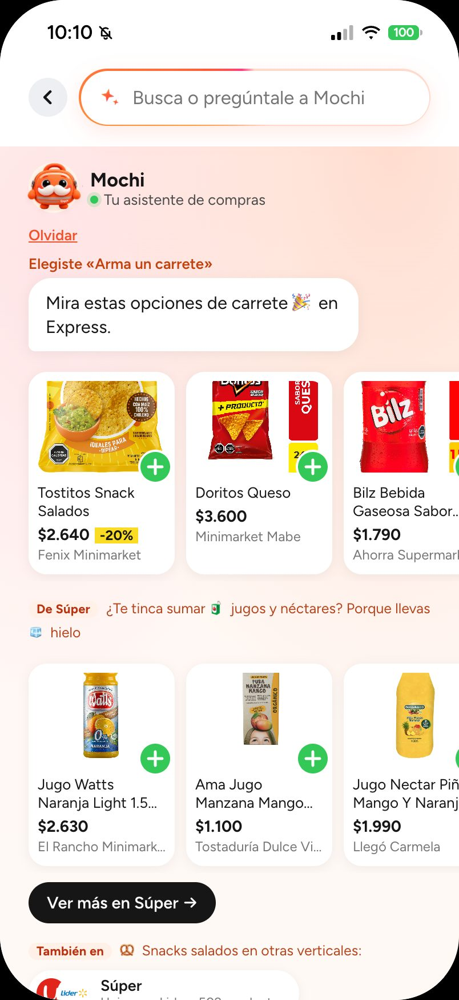

# Contexto y problema

> Por qué existe este proyecto, qué queremos responder y qué decisiones salen de eso.
> Última actualización: 24-10-2026. Ecosistema y modelo de datos: [ecosistema-rappi.md](ecosistema-rappi.md) · Diseño del RAG, el agente y el panel: [diseno-ia.md](diseno-ia.md) · Registro de decisiones: [decisiones.md](decisiones.md) · Resultados: [README → Resultados](../README.md#resultados).

## 1. El problema

**Desde fuera, cada vertical de Rappi parece funcionar como un silo: lo que un usuario hace en uno no parece mejorar lo que se le recomienda en los otros.** Lo que alguien compra o mira en supermercado no parece cambiar lo que se le sugiere en restaurantes, farmacia o Rappi Mall.

Es una observación hecha desde fuera, como usuarios de la app. No hay información pública que la confirme o la desmienta (ver [ecosistema-rappi.md](ecosistema-rappi.md#cómo-se-conectan)). Con sus datos internos, Rappi puede medirla directamente.

**Lo que compartió Rappi (16-10-2026).** El equipo de Rappi compartió una tabla de Chile con las combinaciones de verticales que usa cada persona en un mes y su retención al mes siguiente (cohortes de enero a junio de 2026). El 62,6 % de los usuarios usa solo Restaurantes y vuelve el 47 %; quienes combinan Restaurantes, Turbo y Retail son el 4,7 % y vuelven el 93 % (todo Chile: 55 %). La tabla convierte la hipótesis del silo en una **correlación con datos de Rappi**: la mayoría se queda en una vertical, y quienes usan más verticales vuelven más. No prueba el efecto: quien ya pide mucho usa más verticales y además vuelve más. Sumarle una vertical a alguien solo se sabe si lo retiene con un experimento con grupo de control.

| Combinación en el mes base (M0) | Usuarios | % usuarios | % pedidos | Pedidos/usuario | Retención M+1 | Gasto/usuario |
|---|---:|---:|---:|---:|---:|---:|
| Rest | 739k | 62,6 % | 39,8 % | 1,9 | 47 % | 42 |
| Turbo | 80k | 6,8 % | 3,9 % | 1,7 | 50 % | 35 |
| Rest + Turbo | 78k | 6,6 % | 12,2 % | 5,5 | 82 % | 123 |
| Retail | 66k | 5,6 % | 2,5 % | 1,4 | 41 % | 34 |
| Rest + Retail | 64k | 5,4 % | 8,4 % | 4,7 | 76 % | 116 |
| Rest + Turbo + Retail | 56k | 4,7 % | 16,4 % | 10,5 | 93 % | 257 |
| Turbo + Retail | 20k | 1,7 % | 2,6 % | 4,6 | 80 % | 108 |
| Favor | 18k | 1,5 % | 1,0 % | 2,0 | 44 % | 11 |
| Todo Chile | 1,18M | 100 % | 100 % | 3,0 | 55 % | 68 |

*Dato compartido por Rappi: cohortes de enero a junio de 2026, agrupación gruesa de verticales. El gasto va en la moneda de la fuente, que la tabla no dice. Cómo la usa el motor: [diseño del motor](diseno/2026-10-16-motor-multivertical-design.md#3-dato-de-partida-chile--verticals-used-together) y `rappi-ia/src/rappi_ia/motor/combos.toml`.*

Para trabajar sobre esa observación (entenderla, medir su efecto o construir algo que la aproveche) falta lo más básico: **no existe una fuente estructurada que diga qué contenido hay en cada vertical**, cuánto se repite entre verticales y en qué se diferencian. Esa información está repartida en miles de páginas públicas de rappi.cl, no en un formato que se pueda consultar.

Sin ese mapa de contenido no se puede:

- saber qué ofrece realmente cada vertical (productos, marcas, categorías, platos, precios);
- ver dónde se cruzan los verticales (el mismo producto en supermercado, Turbo y licores);
- darle a un agente LLM una base confiable para buscar y responder dentro de cada vertical.

## 2. Qué queremos lograr

1. **Mapa de contenido por vertical:** una base de datos con el contenido público de Rappi Chile, organizada por vertical.
2. **Análisis inicial y cruce de información:** cuánto contenido hay por vertical, qué se repite entre verticales, cómo varían los precios entre cadenas y en el tiempo.
3. **Base para un RAG / búsqueda semántica:** que un agente LLM pueda buscar por significado ("algo liviano para almorzar", "pañales talla G baratos") **dentro de un vertical a la vez**.
4. **Romper el silo en las recomendaciones:** que lo que alguien hace en un vertical informe las sugerencias de los otros, sin mezclar los índices de búsqueda.

### Cómo lo aborda este prototipo

**Buscar en las verticales de la consulta; entender al usuario a través de los verticales.**

- La búsqueda va a las verticales que corresponden a la consulta (las de su concepto o su ocasión; sin ninguno, a todas, y quedan solo las que calzan las palabras o se parecen mucho) y muestra un grupo por vertical, con la de la pantalla primero.
- Los intereses del usuario se guardan como **conceptos** comunes a todos los verticales (cerveza, snacks, pañales).
- La recomendación cruzada va de concepto → complemento → búsqueda en el índice del otro vertical. Por ejemplo, quien lleva cerveza en Licores ve snacks de Express, marcados "De Express" y con su razón visible.
- Un **motor multivertical** en la base aprende de cada persona y de la población qué verticales usa, cuál conviene sumarle (la escalera Restaurantes → Turbo → Retail, con la tabla de Rappi como punto de partida) y qué le toca pedir de nuevo. Con eso, la Home ordena sus accesos según el uso de cada persona y Mochi propone la siguiente vertical con su porqué ([capa-de-datos.md](capa-de-datos.md#motor-multivertical)).

Detalle en [diseno-ia.md](diseno-ia.md#0-la-regla-que-ordena-todo).

*Prototipo con el MVP corriendo: Mochi recomienda cuando se le pide. En el buscador con Mochi, «Arma un carrete» junta productos y tiendas para la ocasión; además suma en un bloque aparte un complemento de otra tienda, marcado y con su razón.*

## 3. Preguntas que la base debe poder responder

- ¿Qué contenido hay en cada vertical? (tiendas, productos únicos, marcas, categorías, platos)
- ¿Qué productos aparecen en más de un vertical y en cuáles?
- ¿Cómo cambia el precio del mismo producto entre cadenas, ciudades y corridas?
- Dada una necesidad en lenguaje natural, ¿qué opciones existen **en este vertical**?

## 4. Decisiones que salen del problema

| Decisión | Por qué |
|---|---|
| **Búsqueda e índices aislados por vertical** (una partición por vertical; toda búsqueda exige `vertical`) | Precisión: quien está en Licores quiere resultados de Licores. Es una **regla de búsqueda**, no un límite del modelo: los intereses del usuario sí cruzan verticales, a través de conceptos ([diseno-ia.md](diseno-ia.md)). |
| **Catálogo compartido para análisis** (un producto = un `master_product_id` en todo Rappi) | Permite cruzar verticales en SQL sin romper el aislamiento de la búsqueda. |
| **Catálogo separado de precios** | En la primera prueba (scraper CSV, sep-2026), 88.627 filas eran solo 7.458 productos únicos: las sucursales repiten el catálogo. El contenido (lo que se busca) es único; el precio es por tienda. |
| **Una sucursal por marca/formato** | Suficiente para saber *qué hay*; bajar todas las sucursales multiplica el tiempo sin aportar contenido nuevo. |
| **Corridas semanales con historial** | Detectar productos nuevos, retirados y cambios de precio. |
| **Uso responsable de fuentes públicas** | Solo páginas públicas sin barreras técnicas, sitemaps públicos y el JSON público de metadatos de tiendas. Sin APIs internas, login ni evasión de protecciones. Detalle en §7. |
| **Postgres + pgvector** | Una sola base para análisis (SQL) y búsqueda semántica (vectores). |
| **Solo Rappi Chile** | Otras apps de delivery quedan fuera de alcance ([ecosistema-rappi.md](ecosistema-rappi.md#4-alcance-solo-rappi)). |

Registro completo, con fechas: [decisiones.md](decisiones.md).

## 5. Lo que ya sabemos del contenido

> Snapshot del 26-09-2026 (descubrimiento, antes de la descarga completa); estado actual en [README → Resultados](../README.md#resultados).

- **8 verticales activos:** supermercado, conveniencia, Turbo, Rappi Mall (tecnología, belleza, hogar, deportes, librería, moda…), farmacia, licores, chocolatería y restaurantes.
- **Tiendas descubiertas** (14 ciudades): supermercado 463, Rappi Mall 506, licores 90, conveniencia 84, farmacia 66, chocolatería 51, Turbo 17. Una misma tienda puede aparecer en varios verticales.
- **Restaurantes:** 3.157 locales de 722 cadenas (se descarga una sucursal por cadena) y 4.133 independientes: 4.855 restaurantes en la cola de descarga.
- **Cobertura en tiendas:** las páginas públicas muestran hasta 24 productos por sub-pasillo; en las pruebas se obtuvo entre 8% y 58% de lo que declara cada tienda. Los restaurantes sí muestran el menú completo.
- **Jumbo y Tottus** no estaban activos en Rappi en septiembre de 2026.

## 6. Fases

Estado al 16-10-2026:

| Fase | Qué es | Estado |
|---|---|---|
| **1. Datos** | Scraper → Postgres: catálogo, menús, precios e historial por vertical (`rappi-scraper/`) | **Hecha.** Primera descarga completa del 24 al 27-09-2026, recuperación de fallidos el 28-09 y primera descarga semanal automática el 29 y 30-09 (`make schedule`). Cifras en [README → Resultados](../README.md#resultados) |
| **Prototipo** | App navegable: la Home que aprende el orden, Mochi en la Home, buscador con Mochi y ofertas entre verticales (`prototipo-app/`) | **Listo para demo.** Necesita la API (`make mvp`) y usa el catálogo real; sin ella muestra «Sin conexión con Mochi». Ver [decisiones.md](decisiones.md#agente-mochi) |
| **2. RAG** | Conceptos (capa 2), embeddings de texto, búsqueda híbrida por vertical y evaluación (`rappi-ia/`) | **Construido.** Todos los documentos de búsqueda con embedding de texto. Evaluación en [README → Resultados](../README.md#resultados) |
| **3. Agente** | Mochi en el backend y API: herramientas de búsqueda, reglas de conducta; LLM opcional | **Construido.** Responde solo por texto (`POST /agent/ask`) y hace ofertas (`/agent/offer`, `/agent/plans`) |
| **4. Panel empresa** | Venta cruzada, retención, ofertas de Mochi y demanda no satisfecha, para la gerencia y RappiAds | **Construido** (`dashboard-empresa/`) y conectado a la API como parte del MVP; rediseñado el 22-10-2026 en 3 vistas alrededor de 4 preguntas. Usuarios simulados, salvo la tabla de Rappi (real) y lo hecho en la app con la fuente del prototipo (pocas personas: no es evidencia) |
| **5. Motor multivertical** | Afinidad, transiciones, combinaciones y retención, compra cruzada, tendencias y recompra en la base; la Home dinámica y las ofertas conectadas en la app; la tabla de Rappi como punto de partida ([especificación](diseno/2026-10-16-motor-multivertical-design.md)) | **Construido** (16-10-2026, en 6 etapas). Aprende la población de personas simuladas; evaluación en [resultados/motor-2026-10-16.md](resultados/motor-2026-10-16.md) y QA sobre el catálogo real en [resultados/qa-motor-2026-10-16.md](resultados/qa-motor-2026-10-16.md) |
| **Cierre** | CI, documentación y validación final (etapa 8 de [diseno-ia.md](diseno-ia.md#7-etapas)) | **Hecha.** CI en verde y corrida post-refresh sobre el catálogo completo (30-09-2026) |

## 7. Límites y riesgos

- **Cobertura parcial en tiendas:** las páginas públicas muestran hasta 24 productos por sub-pasillo. Por eso "no está en el catálogo" no significa "Rappi no lo vende".
- **Uso responsable de los datos:**
  - **Fuentes:** solo páginas públicas sin barreras técnicas, los sitemaps públicos y el JSON público de metadatos de tiendas. Sin APIs internas, sin login y sin evadir protecciones.
  - **Ritmo:** una descarga a la vez, con pausas de 1,5 a 3 s entre solicitudes, y actualización semanal.
  - **Sin datos personales.**
  - **Fines:** investigación y demostración. Las descripciones, imágenes y marcas pertenecen a Rappi y a los comercios; un uso comercial requeriría autorización.
  - **Proyecto independiente:** no está afiliado a Rappi ni cuenta con su respaldo. Las marcas pertenecen a sus dueños.
- **Métricas con salvedades:** la relevancia de la búsqueda se juzga automáticamente por concepto, y sin el refuerzo por concepto el híbrido no se distingue del vectorial (nDCG@10 0,842 frente a 0,835, con el set del 22-10-2026). Falta el juicio humano. La precisión de los conceptos es una estimación con jueces LLM sobre una muestra versionada del catálogo completo (06-10-2026). Detalle en [README → Resultados](../README.md#resultados).
- **Datos simulados:** el motor (lo que aprende de la población), los segmentos y las métricas de negocio usan usuarios, eventos y pedidos simulados. Muestran la mecánica, no son evidencia.
- **La tabla de Rappi es una correlación:** el motor la usa como punto de partida, no como promesa de efecto. La agrupación en `rest`, `turbo` y `retail` es un supuesto propio.
- **Cambios del sitio:** si rappi.cl cambia su frontend, hay que ajustar los parsers. El reporte de calidad de cada corrida marca con ⚠ las respuestas anómalas; con una página nueva guardada, los tests muestran qué cambió.

## 8. Preguntas abiertas

- **¿Quién lo usaría y dónde?** (equipos internos de Rappi, usuarios finales, análisis de mercado). Define la interfaz y las condiciones de uso de los datos.
- **¿Sumar una vertical retiene?** La tabla de Rappi muestra que quien combina verticales vuelve más, pero no si sumarle una a alguien lo hace volver. Con eventos reales se puede medir qué hace un mismo usuario en distintos verticales y si las sugerencias cruzadas suben la frecuencia, y con pedidos reales el motor aprende de la población real en vez de la simulada (`MOTOR_POBLACION`). Eso se valida con un grupo de control ([diseno-ia.md §5](diseno-ia.md#5-panel-para-la-empresa-vale-la-pena)).
- **¿Mejora de verdad el refuerzo por concepto?** Hay que juzgar a mano la planilla de 200 pares (`rappi-ia jev-planillas`, ver [jev.md](jev.md)) y medirlo con `rappi-ia eval-human`.

Las preguntas ya resueltas (modelos, áreas iniciales, taxonomía, datos simulados) están en [decisiones.md](decisiones.md).
