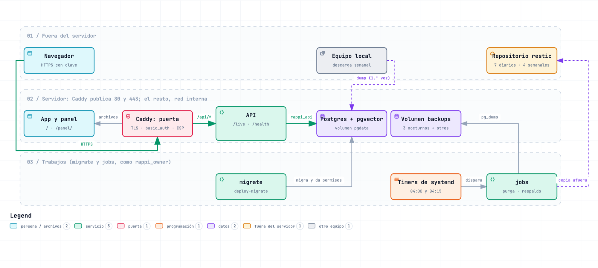

# Despliegue en un servidor

Cómo dejar el MVP (la app, la API, el panel opcional y Postgres) en un servidor Linux con Docker Compose, detrás de Caddy con TLS y una puerta de acceso. Es una **demo cerrada**: todo el sitio pide usuario y clave. Abrirla al público exige autorización de Rappi por los datos ([§9](#9-riesgos)).

La demo local (`make mvp` en un Mac) está en [instalacion.md](instalacion.md#5-el-mvp), y la demo desde un Mac con Cloudflare Tunnel y la misma puerta de acceso, sin servidor, en [deploy/macos/](../deploy/macos/README.md). Todo lo de este documento vive en [`deploy/`](../deploy/).

## 0. Lo que hay que decidir o conseguir

Antes de empezar, quien despliega decide o consigue lo siguiente. Todos los valores van en el **archivo de entorno** del servidor, `/etc/rappi/rappi.env`, copiado de [`deploy/.env.example`](../deploy/.env.example) ([§3.2](#32-archivo-de-entorno)). Nunca va a git.

| Qué | Dónde va |
|---|---|
| **Dominio y DNS:** un registro A (y AAAA si hay IPv6) hacia el servidor. Caddy pide el certificado solo | `DOMAIN` |
| **Servidor:** mínimo 4 vCPU, 8 GB de RAM y 60 GB de SSD, con Docker Engine y el plugin compose ([§8](#8-tamaño-y-postgres)) | — |
| **Puerta de acceso:** un usuario y una clave. La clave se guarda solo como hash: `docker run --rm -it caddy:2.11.7-alpine caddy hash-password` (la pide dos veces y no queda en el historial) | `BASIC_AUTH_USER` y `BASIC_AUTH_HASH` (entre comillas simples) |
| **Claves de la base:** superusuario, dueño de las tablas y rol de la API, cada una con `openssl rand -hex 32` | `POSTGRES_PASSWORD`, `RAPPI_OWNER_PASSWORD` y `RAPPI_API_PASSWORD`, repetidas en `DATABASE_URL_OWNER` y `DATABASE_URL_API` |
| **Secreto de la sesión anónima:** `openssl rand -hex 32` | `API_SECRET` |
| **Copia de los respaldos fuera del servidor:** un repositorio de restic (S3, B2…), su clave y las credenciales del almacenamiento. El repositorio se crea una vez a mano con `restic init` ([§3.9](#39-respaldos-y-timers)) | `RESTIC_REPOSITORY`, `RESTIC_PASSWORD` y, por ejemplo, `AWS_ACCESS_KEY_ID`/`AWS_SECRET_ACCESS_KEY` o `B2_ACCOUNT_ID`/`B2_ACCOUNT_KEY`. Solo llegan al servicio `jobs` |
| **Claude (opcional):** sin clave, el agente responde con plantillas | `ANTHROPIC_API_KEY` |
| **Tope diario de redacciones con Claude** (por proceso de la API; alcanzado, responden las plantillas) | `LLM_DAILY_CALL_CAP` (300 por defecto) |
| **Jev (opcional, solo en `jobs`):** ver [jev.md](jev.md) | `TYPESAFE_API_KEY` |
| **Contacto del scraper** (solo si se activa la descarga semanal en el servidor): una URL o un correo para que Rappi sepa a quién escribir; va en el User-Agent | `RAPPI_UA_CONTACT` (y `RAPPI_UA_PROJECT`, el nombre) |

Decisiones para quien despliega:

- **`VITE_DEMO`:** con `VITE_DEMO=1` la app desplegada trae el interruptor "Prototipo final / Rappi hoy" (tecla D); vacío, no. Se aplica al construir `web`.
- **El panel:** `WITH_PANEL=1` lo construye en `/panel/` y `API_ENABLE_ANALYTICS=1` enciende `/analytics/*`, que el panel lee. Van juntos: con los dos en 0 se despliega solo la app.
- **La descarga semanal en el servidor** (`rappi-refresh.timer`, que viene apagado): solo después de poner el contacto del scraper (`RAPPI_UA_CONTACT`) y de aceptar que rappi.cl pueda frenar una IP de datacenter ([§9](#9-riesgos)). Hasta entonces la descarga semanal corre en el equipo local que ya la tiene programada.
- **Retención:** las personas del prototipo sin actividad se borran a los 180 días (`PROTOTYPE_USER_RETENTION_DAYS`) y el texto de las búsquedas, a los 90 ([§7](#qué-se-guarda-y-cuánto-tiempo)). Los 90 días no son una variable sino una constante del código (`QUERY_RETENTION_DAYS`); otro plazo exige `rappi-ia purge --dias N` en `rappi-purge.service`. Confirmar los dos plazos.

## 1. Arquitectura



Versión interactiva: [despliegue.html](diagramas/despliegue.html) (descargar y abrir). Fuente: [diagramas-fuente/despliegue.json](diagramas-fuente/despliegue.json).

Un solo servidor y un stack de Docker Compose ([`deploy/docker-compose.yml`](../deploy/docker-compose.yml), proyecto `rappi`):

| Servicio | Imagen | Qué hace |
|---|---|---|
| `web` | `rappi-web` (Caddy con la app, y el panel si `WITH_PANEL=1`) | El único con puertos: 80 y 443 (también 443/udp). TLS, la puerta sobre todo el sitio, cabeceras de seguridad, los archivos de la app en `/` y del panel en `/panel/`, y `/api/*` hacia la API sin el prefijo. Corre sin root (uid 10002) |
| `api` | `rappi-api` | FastAPI con 1 worker, conectada como `rappi_api`. Con `API_ENV=production`; el modelo de texto va dentro de la imagen |
| `db` | `pgvector/pgvector:0.8.7-pg17-trixie` | Postgres + pgvector en el volumen `pgdata`, sin puertos publicados |
| `migrate` | `rappi-jobs` | Corre una vez por despliegue, como `rappi_owner`: `rappi-ia deploy-migrate`. La API espera a que termine bien |
| `jobs` | `rappi-jobs` (perfil `jobs`) | Los trabajos del operador como `rappi_owner`: purga, respaldos, restauración, y la descarga semanal si se activa |

Volúmenes: `pgdata` (la base), `backups` (respaldos), `rappi-data` (registros, candados, `ultimo-estado.txt`), `caddy_data` y `caddy_config` (certificados).

La app llama a la API en su mismo origen (`/api`). La base y la API quedan en la red interna del stack. Cada contenedor recibe solo las claves que usa ([§7](#claves-por-contenedor)).

## 2. Variables de entorno

Todas van en `/etc/rappi/rappi.env`, salvo las que fija `docker-compose.yml` o la imagen (columna "Defecto"). "Servicio" es quien la usa. Una variable que no está en el archivo toma el defecto; no dejar vacía una numérica (`API_POOL_MAX=` sin valor impide arrancar).

**Rutas y archivo de entorno**

| Nombre | Servicio | Defecto | Ejemplo | ¿Secreto? |
|---|---|---|---|---|
| `RAPPI_ENV_FILE` | compose (`env_file`), timers de systemd, `restore-check.sh`, y `config.py` de rappi-ia y del scraper (carga ese archivo en vez del `.env` de la carpeta) | `/etc/rappi/rappi.env` | `/etc/rappi/rappi.env` | no |
| `RAPPI_DATA_DIR` | api, migrate, jobs (scraper: registros, candado, respaldos) | `/data` en la imagen (`rappi-scraper/data` fuera de ella) | `/data` | no |
| `RAPPI_IA_DATA_DIR` | api, migrate, jobs (rappi-ia: registros, reportes) | `/data/ia` en la imagen (`rappi-ia/data` fuera de ella) | `/data/ia` | no |
| `TZ` | migrate y jobs (lo fija compose) | `America/Santiago`; la API y Caddy, UTC | — | no |

**Caddy y construcción de `web`** (compose los lee al armar el stack; `web` no recibe el archivo de entorno)

| Nombre | Servicio | Defecto | Ejemplo | ¿Secreto? |
|---|---|---|---|---|
| `DOMAIN` | web; compose arma `API_CORS_ORIGINS=https://$DOMAIN` | obligatoria | `demo.ejemplo.cl` | no |
| `BASIC_AUTH_USER` | web | obligatoria | `demo` | no |
| `BASIC_AUTH_HASH` | web | obligatoria | `'$2a$14$…'` | sí (hash) |
| `VITE_DEMO` | web (al construir) | vacía | `1` | no |
| `WITH_PANEL` | web (al construir) | `0` | `1` | no |

**Base de datos**

| Nombre | Servicio | Defecto | Ejemplo | ¿Secreto? |
|---|---|---|---|---|
| `POSTGRES_PASSWORD` | db (superusuario `postgres`) | obligatoria | `openssl rand -hex 32` | sí |
| `POSTGRES_DB` | db | `rappi` en `.env.example` (las URL terminan en `/rappi`) | `rappi` | no |
| `RAPPI_OWNER_PASSWORD` | db (`init-roles.sh`) | obligatoria | `openssl rand -hex 32` | sí |
| `RAPPI_API_PASSWORD` | db (`init-roles.sh`, `smoke.sh`) | obligatoria | `openssl rand -hex 32` | sí |
| `DATABASE_URL_OWNER` | migrate y jobs (como `DATABASE_URL`) | obligatoria | `postgresql://rappi_owner:<clave>@db:5432/rappi` | sí |
| `DATABASE_URL_API` | api (como `DATABASE_URL`) | obligatoria | `postgresql://rappi_api:<clave>@db:5432/rappi` | sí |
| `DB_API_ROLE` | migrate (lo fija compose) | `rappi_api` | — | no |
| `MIGRATE_LOCK_TIMEOUT` | migrate, jobs | `10s` | `30s` | no |
| `HNSW_MAINTENANCE_WORK_MEM` | jobs (`embed`) | `1GB` | `512MB` | no |

**API**

| Nombre | Servicio | Defecto | Ejemplo | ¿Secreto? |
|---|---|---|---|---|
| `API_ENV` | api y jobs (lo fija compose) | `production` (fuera del stack, `local`) | — | no |
| `API_SECRET` | api; jobs (`rappi-ia token`) | obligatoria en producción (mínimo 32 bytes) | `openssl rand -hex 32` | sí |
| `API_CORS_ORIGINS` | api (lo fija compose) | `https://$DOMAIN` | — | no |
| `API_REQUIRE_SEMANTIC` | api (lo fija compose) | `1`: sin el modelo, `/health` da 503 | — | no |
| `API_ENABLE_ANALYTICS` | api | `0` en producción | `1` (con `WITH_PANEL=1`) | no |
| `API_DOCS` | api (`/docs`, `/redoc`, `/openapi.json`) | `0` en producción | `1` | no |
| `API_WORKERS` | api (uvicorn) | `1` | `1` | no |
| `API_POOL_MIN` / `API_POOL_MAX` | api (conexiones por worker) | `2` / `10` | `2` / `10` | no |
| `API_POOL_TIMEOUT_S` | api (espera por una conexión; luego 503) | `3` | `3` | no |
| `API_MAX_CONCURRENT_ASK` / `_SEARCH` / `_OFFER` / `_ORDERS` / `_ANALYTICS` | api (cupos por ruta cara) | `4` / `8` / `4` / `4` / `2` | — | no |
| `API_CAP_WAIT_S` | api (fila de `/agent/ask` y `/agent/offer` sin cupo; luego 503) | `1.5` | — | no |
| `API_MAX_BODY_BYTES` | api (413 si se pasa) | `524288` | — | no |
| `API_RATE_PER_MIN` / `API_RATE_WRITE_PER_MIN` | api (por IP; 429; `0` = sin tope) | `120` / `60` | — | no |
| `API_NEW_USERS_PER_IP_DAY` | api (`POST /session`; `0` = sin tope) | `20` | `200` para un evento | no |
| `API_TIMEOUT_INTERACTIVE_MS` / `API_TIMEOUT_ANALYTICS_MS` | api (tope por consulta; 504) | `5000` / `30000` | — | no |
| `API_PREWARM` | api (precarga en segundo plano de los índices de la búsqueda al arrancar y mantención de la caché del catálogo cada minuto; `0` = sin ninguna de las dos) | `1` | — | no |
| `API_ALLOW_LAN` | api | se ignora en producción | — | no |
| `LOG_LEVEL` | api | `INFO` | `DEBUG` | no |
| `ANTHROPIC_API_KEY` | api | vacía: plantillas | `sk-…` | sí |
| `AGENT_LLM_MODEL` | api | `claude-sonnet-5` | — | no |
| `LLM_DAILY_CALL_CAP` | api (por proceso; `0` = nunca Claude) | `300` | `300` | no |
| `AGENT_NAME` | api | `Mochi` | — | no |
| `MVP_HOME_LAT` / `MVP_HOME_LNG` | api ("Cerca de ti") | `-33.4263` / `-70.6106` | — | no |
| `PROFILE_CITY` | api (la ciudad de la demo: las listas de restaurantes y de tiendas, y los restaurantes de un perfil de gusto si la persona no tiene ciudad) | `Santiago de Chile` | `Viña del Mar` | no |
| `MOTOR_POBLACION` | api (la población de la que aprende el motor multivertical: `synthetic` o `prototype`; nunca se mezclan, y otro valor no deja arrancar) | `synthetic` (simulada: no es evidencia) | `prototype` | no |
| `OFFERS_CONTROL_PCT` | api (el porcentaje de personas del grupo de control `ofertas_control`, de 0 a 50: no ven lo que Mochi propone solo y queda `offer_withheld`) | `0` (apagado) | `10` | no |
| `TEXT_EMBEDDING_MODEL` | api, jobs | `intfloat/multilingual-e5-base` | — | no |
| `TEXT_EMBEDDING_REVISION` | api, jobs, y al construir la imagen | `d128750597153bb5987e10b1c3493a34e5a4502a` (con el modelo por defecto) | — | no |
| `HF_HUB_OFFLINE` / `HF_HOME` | api, jobs (los fija la imagen) | `1` / `/opt/hf` | — | no |

**Trabajos (`jobs`)**

| Nombre | Servicio | Defecto | Ejemplo | ¿Secreto? |
|---|---|---|---|---|
| `RESTIC_REPOSITORY` | jobs | vacía: el respaldo nocturno queda solo en el volumen y sale con 2 | `s3:s3.amazonaws.com/mi-bucket/rappi` | sí |
| `RESTIC_PASSWORD` | jobs | — | `openssl rand -hex 32` | sí |
| `AWS_ACCESS_KEY_ID`, `AWS_SECRET_ACCESS_KEY`, `B2_ACCOUNT_ID`, `B2_ACCOUNT_KEY` | jobs (credenciales de restic). Otro proveedor: agregar sus variables también a `x-sin-claves-de-respaldo` en `docker-compose.yml` | — | — | sí |
| `TYPESAFE_API_KEY` | jobs ([jev.md](jev.md)) | vacía: Jev no se llama | — | sí |
| `JEV_MODEL`, `JEV_MAX_REQUESTS`, `JEV_PARALLEL`, `JEV_PRICE_PER_MTOK_INPUT` | jobs | `jev-1.13.0`, `3000`, `16`, `0.042` | — | no |
| `PROTOTYPE_USER_RETENTION_DAYS` | jobs (`rappi-ia purge`) | `180` | `180` | no |
| — (texto de las búsquedas) | jobs (`rappi-ia purge`) | 90 días: constante `QUERY_RETENTION_DAYS`, no variable; `rappi-ia purge --dias N` lo cambia | — | no |
| `LOG_RETENTION_WEEKS` | jobs (registros de cada comando del scraper) | `8` | `8` | no |
| `PG_DUMP`, `RAPPI_BIN`, `RAPPI_IA_PY` | jobs (los fija la imagen) | `/usr/lib/postgresql/17/bin/pg_dump`, `rappi`, `python` | — | no |
| `RAPPI_UA_PROJECT`, `RAPPI_UA_CONTACT` | jobs (solo la descarga: el User-Agent; el proyecto es también su nombre en robots.txt) | `rappi-dlab-scraper`, vacío | —, `https://…` o un correo | no |
| `RAPPI_DELAY_MIN`, `RAPPI_DELAY_MAX`, `RAPPI_TIMEOUT`, `RAPPI_MAX_RETRIES`, `RAPPI_RETRY_BACKOFF` | jobs (solo la descarga) | `1.5`, `3.0`, `30`, `3`, `10` | — | no |

Las claves de la base van dentro de URLs: usar solo letras y números (`openssl rand -hex 32`). Un valor con `$` va entre comillas simples.

## 3. Primer despliegue desde un dump

Todos los comandos van **como root** (o con `sudo`), en **bash**, desde la carpeta del repositorio (`/opt/rappi`). Así corren también los timers de systemd. En zsh, `$COMPOSE` no se separa en palabras y los comandos fallan ("no such file or directory"): abrir `bash` antes.

### 3.1 Servidor y código

1. Docker Engine con el plugin compose (`docker compose version`) y git.
2. Firewall: abiertos 22/tcp, 80/tcp, 443/tcp y 443/udp. Nada más: solo Caddy publica puertos.
3. El DNS de `DOMAIN` ya apunta al servidor (Caddy pide el certificado al arrancar).
4. El código en `/opt/rappi` (el repositorio es privado: `gh repo clone yungzyx/rappi-dlab-mvp /opt/rappi`, o con una deploy key). Otra carpeta sirve, pero hay que cambiar `WorkingDirectory` en las unidades de systemd ([§3.9](#39-respaldos-y-timers)).

### 3.2 Archivo de entorno

```bash
install -d -m 700 /etc/rappi
install -m 600 /opt/rappi/deploy/.env.example /etc/rappi/rappi.env
docker run --rm -it caddy:2.11.7-alpine caddy hash-password   # pide la clave de la puerta y escribe su hash
openssl rand -hex 32                              # una vez por cada clave y para API_SECRET
```

Editar `/etc/rappi/rappi.env` y reemplazar cada `cambiar-esto` ([§0](#0-lo-que-hay-que-decidir-o-conseguir)). `DATABASE_URL_OWNER` y `DATABASE_URL_API` llevan las mismas claves que `RAPPI_OWNER_PASSWORD` y `RAPPI_API_PASSWORD`. `BASIC_AUTH_HASH` va entre comillas simples.

docker compose usa este archivo dos veces, y las dos tienen que ser el mismo: para armar `docker-compose.yml` (`DOMAIN`, la puerta, las URL de cada servicio) y como `env_file` de `db`, `migrate`, `api` y `jobs`. Desde aquí, cada comando usa esta variable:

```bash
cd /opt/rappi
export COMPOSE="docker compose --env-file /etc/rappi/rappi.env -f deploy/docker-compose.yml"
```

Si el archivo está en otra ruta, exportar además `RAPPI_ENV_FILE` con esa ruta (es la que reciben los contenedores) y cambiarla en las unidades de systemd. En vez de `--env-file` también sirve un enlace: `ln -s /etc/rappi/rappi.env deploy/.env` (git lo ignora).

### 3.3 Imágenes

```bash
$COMPOSE build
```

La primera vez tarda (torch y el modelo de texto, ~1 GB, que queda dentro de la imagen). Construye `rappi-api`, `rappi-jobs` y `rappi-web`.

### 3.4 La base, con sus roles

```bash
$COMPOSE up -d --wait db
$COMPOSE logs db | grep init-roles   # "init-roles: rappi_owner y rappi_api creados en rappi." (si no está, esperar unos segundos)
```

Con el volumen `pgdata` vacío, la imagen de Postgres corre una vez [`deploy/db/init-roles.sh`](../deploy/db/init-roles.sh): crea `rappi_owner` (dueño de la base) y `rappi_api` (solo `CONNECT`), y las extensiones `vector`, `unaccent` y `pg_prewarm` (la precarga de los índices de la búsqueda al arrancar la API, migración 034). Si la línea no aparece, ver [§3.10](#310-si-algo-falla).

### 3.5 Restaurar el catálogo

El catálogo llega en un respaldo de la base: el de entrega (`make dump-entrega`, sin el uso del MVP; ver [rappi-ia/README.md](../rappi-ia/README.md#respaldo-de-entrega)) o uno del equipo de la descarga semanal (`make backup` en `rappi-scraper/` deja `data/backups/rappi_<fecha>.dump`). Se copia al servidor (`scp`) y se restaura **como `rappi_owner`**, dentro del contenedor de la base.

**El respaldo de entrega** (la carpeta `entrega_<fecha>/`, con `catalogo.dump` y `poblacion-simulada.sql`) va en tres pasos, como dice su `LEEME.txt`: las tablas y el catálogo, la población simulada, y al final los índices, las claves foráneas y los triggers:

```bash
$COMPOSE cp ruta/a/entrega_<fecha>/catalogo.dump db:/tmp/catalogo.dump
$COMPOSE cp ruta/a/entrega_<fecha>/poblacion-simulada.sql db:/tmp/poblacion.sql
$COMPOSE exec -T db sh -c 'export PGPASSWORD="$RAPPI_OWNER_PASSWORD" \
  && pg_restore -l /tmp/catalogo.dump | grep -v "COMMENT - EXTENSION" > /tmp/catalogo.list \
  && pg_restore -h 127.0.0.1 -U rappi_owner -d "$POSTGRES_DB" --no-owner --no-privileges --exit-on-error \
       --section=pre-data --section=data -L /tmp/catalogo.list /tmp/catalogo.dump \
  && psql -h 127.0.0.1 -U rappi_owner -d "$POSTGRES_DB" -v ON_ERROR_STOP=1 -q -f /tmp/poblacion.sql \
  && PGOPTIONS="-c maintenance_work_mem=1GB" pg_restore -h 127.0.0.1 -U rappi_owner -d "$POSTGRES_DB" \
       --no-owner --no-privileges --exit-on-error --section=post-data /tmp/catalogo.dump \
  && vacuumdb -h 127.0.0.1 -U rappi_owner -d "$POSTGRES_DB" --analyze-only'
$COMPOSE exec -T db rm /tmp/catalogo.dump /tmp/catalogo.list /tmp/poblacion.sql
```

**Un respaldo de `make backup`** (un solo `.dump`) va en un paso:

```bash
$COMPOSE cp ruta/al/rappi_<fecha>.dump db:/tmp/catalogo.dump
$COMPOSE exec -T db sh -c 'pg_restore -l /tmp/catalogo.dump | grep -v "COMMENT - EXTENSION" > /tmp/catalogo.list \
  && PGOPTIONS="-c maintenance_work_mem=1GB" PGPASSWORD="$RAPPI_OWNER_PASSWORD" \
     pg_restore -h 127.0.0.1 -U rappi_owner -d "$POSTGRES_DB" --no-owner --no-privileges --exit-on-error \
       -L /tmp/catalogo.list /tmp/catalogo.dump'
$COMPOSE exec -T db rm /tmp/catalogo.dump /tmp/catalogo.list
```

- **`--no-owner --no-privileges`:** las tablas quedan de `rappi_owner`, no del rol que hizo el respaldo. Los permisos de la API los pone el paso siguiente.
- **Sin `COMMENT - EXTENSION`:** las extensiones las creó el superusuario y `rappi_owner` no puede cambiar su comentario; sin el filtro, `pg_restore` falla con "must be owner of extension".
- **`maintenance_work_mem=1GB`:** solo para esta sesión; acelera los índices HNSW. Usa la memoria compartida del contenedor, por eso `db` tiene `shm_size: 2g` (con los 64 MB de Docker falla con "No space left on device").
- Tarda unos minutos (con el catálogo del 11-10-2026, ~250 mil documentos, unos 2 a 3 min). La clave no pasa por la línea de comandos: el contenedor ya la tiene en su entorno.
- Un respaldo de `make backup` trae también el uso del MVP (personas `prototype` y sus eventos) y los datos simulados; el de entrega trae los simulados y no el uso del MVP.
- El catálogo del servidor queda con la fecha de ese respaldo. Restaurar uno más nuevo encima no es una actualización parcial: reemplaza la base entera y borra también las personas `prototype` y lo que hicieron en el servidor (ver [§9](#9-riesgos)).

### 3.6 Migrar

```bash
$COMPOSE run --rm migrate
```

`rappi-ia deploy-migrate`, como `rappi_owner`: si hay migraciones pendientes, **primero respalda** en el volumen `backups` (`pre-migracion_<fecha>.dump`; si el respaldo falla, no migra), después migra y aplica los permisos de `rappi_api` ([`deploy/db/grants.sql`](../deploy/db/grants.sql)). Dice qué hizo en cada paso. Sale con un mensaje claro si una tabla está ocupada ("Intenta de nuevo en unos minutos") o si una migración falla.

### 3.7 Levantar el stack

```bash
$COMPOSE up -d --wait
$COMPOSE ps
```

`up` vuelve a correr `migrate` (ya no hay nada pendiente: solo los permisos) y después levanta `api` y `web`. La API tarda en quedar sana porque carga el modelo (hasta 2 min de gracia). `ps` debe mostrar `api`, `db` y `web` como `(healthy)`.

### 3.8 Prueba de humo

```bash
read -rs BASIC_AUTH_PASSWORD && export BASIC_AUTH_PASSWORD   # la clave de la puerta, en claro (no queda en el historial)
deploy/smoke.sh https://<dominio>                             # el valor de DOMAIN, p. ej. https://demo.ejemplo.cl
```

[`deploy/smoke.sh`](../deploy/smoke.sh) usa `$COMPOSE` y revisa: la puerta (401 sin credenciales en `/`, `/api/health`, `/panel` y `/panel/`), `/api/health` 200 con la búsqueda semántica, las cabeceras de seguridad y de caché, que lo servido no apunte a `:8000` ni traiga scripts en línea o de otro origen, que la app lleve el aviso de demo ("Prototipo dLab con Rappi · demo, no es la app oficial"), que `rappi_api` no pueda borrar tablas ni crear objetos, que ningún servicio tenga un `cambiar-esto` (`jobs` también, en un contenedor desechable; si un entorno no se puede leer, falla) y que todo esté sano. Con `WITH_PANEL=1` (el panel construido y `API_ENABLE_ANALYTICS=1`) pide además, con credenciales, `/panel/`, un archivo de `/panel/assets/` y `/api/analytics/kpis`, y espera 200. Termina con "smoke: todo bien." (código 0) o lista lo que falló. Con `DOMAIN=localhost` acepta la CA interna de Caddy.

### 3.9 Respaldos y timers

Crear el repositorio de restic una sola vez (el respaldo nocturno nunca lo crea solo: con un `RESTIC_REPOSITORY` mal escrito, falla en vez de abrir uno nuevo):

```bash
$COMPOSE --profile jobs run --rm jobs restic init
```

Instalar los timers. Si el repositorio no está en `/opt/rappi`, cambiar antes `WorkingDirectory` en las tres unidades `.service`:

```bash
cp deploy/systemd/rappi-*.service deploy/systemd/rappi-*.timer /etc/systemd/system/
systemctl daemon-reload
systemctl enable --now rappi-purge.timer rappi-backup.timer
systemctl list-timers 'rappi-*'
```

`rappi-refresh.timer` se copia pero **no se activa** ([§0](#0-lo-que-hay-que-decidir-o-conseguir), [§9](#9-riesgos)).

### 3.10 Si algo falla

- **`init-roles.sh` falló** (falta una clave, un error de sintaxis): la imagen de Postgres lo corre solo con el volumen vacío, así que el volumen queda inicializado **sin roles** y nunca lo vuelve a correr. Si la base todavía no tiene nada, borrar el volumen y empezar de nuevo: `$COMPOSE down` y `docker volume rm rappi_pgdata` (solo ese volumen). Si ya tiene datos, crear los roles a mano como superusuario, con el mismo SQL de `init-roles.sh`.
- **Cambiar una clave de la base después:** `init-roles.sh` no vuelve a correr, así que cambiar `RAPPI_OWNER_PASSWORD` o `RAPPI_API_PASSWORD` en el archivo no cambia nada en Postgres. Primero `ALTER ROLE rappi_api PASSWORD '…'` (o `rappi_owner`) como superusuario (`$COMPOSE exec db psql -U postgres -d rappi`), después el archivo (también la URL) y `$COMPOSE up -d`.
- **Caddy no puede escribir en sus volúmenes:** Caddy corre como uid 10002. Un `caddy_data` o `caddy_config` creado por un Caddy que corría como root queda de root. Si solo tiene certificados, borrarlo (`docker volume rm rappi_caddy_data rappi_caddy_config` con `web` detenido): Caddy los vuelve a pedir.
- **`/api/health` da 503:** el cuerpo dice el motivo (`base`, `saturada`, `sin_documentos`, `migraciones_pendientes`, `busqueda_semantica`). `migraciones_pendientes`: correr `$COMPOSE run --rm migrate`. `sin_documentos`: la restauración no trajo el catálogo.
- **Registros:** `$COMPOSE logs migrate`, `$COMPOSE logs api`.

## 4. Actualizar

```bash
cd /opt/rappi
for i in api jobs web; do docker tag rappi-$i rappi-$i:anterior; done   # para volver atrás (§5)
git pull
$COMPOSE build
$COMPOSE run --rm migrate
$COMPOSE up -d --wait
deploy/smoke.sh https://<dominio>    # con BASIC_AUTH_PASSWORD exportada (§3.8)
```

- **En producción ni la API ni la tarea semanal migran.** Solo `migrate` lo hace, con respaldo antes. Si la API arranca con migraciones pendientes, `/health` responde 503 `migraciones_pendientes` hasta que corre `migrate`.
- `up -d` recrea solo los servicios cuya imagen o configuración cambió. Durante el cambio de la API hay unos segundos sin servicio (1 worker, sin réplica).
- Un cambio de `VITE_DEMO` o `WITH_PANEL` exige `$COMPOSE build web` y `up -d`.
- **El motor multivertical en el servidor.** Sus tablas de población (transiciones, combinaciones, compra cruzada y tendencias) llegan con el dump y no se recalculan solas: `jobs` solo purga y respalda, y `rappi-refresh.timer` (cuya capa de IA incluye el motor) viene apagado. La afinidad y la recompra de cada persona del prototipo las recalcula la API después de cada pedido y de "Olvidar". Para recalcular la población: `$COMPOSE --profile jobs run --rm jobs rappi-ia motor` ([capa-de-datos.md](capa-de-datos.md#motor-multivertical)).
- **`pg_prewarm` en un volumen de antes de la migración 034:** `init-roles.sh` no vuelve a correr y `rappi_owner` no puede crear la extensión, así que `migrate` la salta sin fallar (el aviso de Postgres no aparece en su salida). La señal está en el registro de la API al arrancar: `$COMPOSE logs api | grep -i precarga` muestra "Precarga de la búsqueda: falta la extensión pg_prewarm…", y la API funciona igual, sin precarga (la primera búsqueda de cada vertical lee sus índices del disco). Crearla una vez como superusuario: `$COMPOSE exec db psql -U postgres -d rappi -c 'CREATE EXTENSION IF NOT EXISTS pg_prewarm'` y `$COMPOSE restart api`; el registro dice entonces "Precarga de la búsqueda: N índices en X s". También hace falta antes de restaurar ahí un dump que ya la trae (uno de una instalación local después de la 034): sin ella, `pg_restore` como `rappi_owner` falla. En producción la extensión queda sin el comentario de la 034: solo su dueño (el superusuario que la creó) puede ponerlo, y la migración lo salta.
- **`rappi_api` precarga solo con Postgres 17.7 o más nuevo:** desde esa versión `pg_prewarm` revisa el permiso SELECT sobre la tabla del índice, que da `grants.sql`; antes lo pedía sobre el índice, y un índice no tiene permisos que dar. La imagen fijada (`pgvector/pgvector:0.8.7-pg17-trixie`) trae un 17.x reciente; para revisar la versión, `$COMPOSE exec db postgres --version`, y para subirla, cambiar la etiqueta en `docker-compose.yml`, `$COMPOSE pull db` y `$COMPOSE up -d db`. Con una anterior, la API anota "No se pudo precargar los índices de la búsqueda (0 leídos): permission denied…" y sigue sin precarga.

## 5. Volver atrás

**Sin migración nueva** (el `migrate` de la actualización dijo "Sin migraciones pendientes"): basta la imagen anterior.

```bash
for i in api jobs web; do docker tag rappi-$i:anterior rappi-$i:latest; done
git checkout <commit anterior>       # el compose y los scripts de esa versión
$COMPOSE up -d --wait                # sin build: usa las imágenes recién etiquetadas
```

Con el commit anterior puesto, git queda fuera de la rama: antes de la próxima actualización ([§4](#4-actualizar)), `git checkout main` y recién después `git pull`.

**Con migración nueva:** además, restaurar el respaldo que `migrate` hizo antes de aplicarla (el `pre-migracion_<fecha>.dump` más nuevo). Se pierde lo que la gente haya hecho desde entonces. Con las imágenes y el commit anteriores ya puestos (bloque de arriba, sin el `up`):

```bash
$COMPOSE stop api
$COMPOSE --profile jobs run --rm jobs ls -lt /data/backups          # el pre-migracion_ más nuevo es el de antes de migrar
$COMPOSE exec -T db sh -c 'psql -v ON_ERROR_STOP=1 -U postgres -d postgres -v db="$POSTGRES_DB"' <<'SQL'
DROP DATABASE :"db" WITH (FORCE);
CREATE DATABASE :"db" OWNER rappi_owner;
REVOKE ALL ON DATABASE :"db" FROM PUBLIC;
GRANT CONNECT ON DATABASE :"db" TO rappi_api;
\connect :"db"
CREATE EXTENSION vector;
CREATE EXTENSION unaccent;
CREATE EXTENSION pg_prewarm;
SQL
$COMPOSE --profile jobs run --rm -T jobs bash -s <<'EN_JOBS'
set -euo pipefail
. deploy/scripts/pgpass.sh
pgpass_from_database_url
dump=$(ls -t /data/backups/pre-migracion_*.dump | head -n 1)
echo "restaurando $dump"
pg_restore --list "$dump" | grep -v "COMMENT - EXTENSION" > /tmp/lista
PGOPTIONS="-c maintenance_work_mem=1GB" pg_restore --dbname="$PG_URL" --no-owner --no-privileges --exit-on-error \
  --use-list=/tmp/lista "$dump"
EN_JOBS
$COMPOSE run --rm migrate
$COMPOSE up -d --wait
```

La base (la de `POSTGRES_DB`, que el contenedor `db` ya conoce) se vuelve a crear vacía como la deja `init-roles.sh` (dueño, `CONNECT` de la API y extensiones), se restaura como `rappi_owner` igual que en [§3.5](#35-restaurar-el-catálogo), pero desde el volumen de respaldos, y `migrate` vuelve a dar los permisos.

Los respaldos del volumen `backups`, por prefijo:

| Prefijo | Quién lo hace | Cuántos quedan |
|---|---|---|
| `pre-migracion_*.dump` | `migrate`, solo si hay migraciones pendientes | 4 (por fecha de modificación) |
| `nocturno_*.dump` | `rappi-backup.timer`, cada noche a las 04:15 | 3 en el volumen (por fecha de modificación); en restic, 7 diarios y 4 semanales |
| `rappi_*.dump` | la descarga semanal (`rappi refresh`), si se activa en el servidor | 4 (por fecha de modificación) |

Cada prefijo rota aparte: un despliegue no expulsa un respaldo semanal ni uno nocturno.

## 6. Operación

### Registros

- `$COMPOSE logs -f api` (y `web`, `db`, `migrate`). Docker guarda 5 archivos de 10 MB por contenedor.
- La API escribe texto: hora, nivel, módulo, `[X-Request-ID]` y el mensaje. Una línea por request con método, **plantilla de la ruta** (`/profile/{user_id}`, nunca el id), estado y milisegundos; sin query, sin IP. Cada request lleva un id: el `X-Request-ID` que traiga (si está bien formado) o uno nuevo; vuelve en la respuesta y une las líneas de ese request. `/live` y `/health` sanos no se registran en `INFO`.
- Caddy no lleva registro de accesos (no hay directiva `log`).
- Las horas de `jobs` y `migrate` van en hora de Chile; las de la API, en UTC.

### `/live` y `/health`

Detrás de la puerta: desde afuera, `https://<dominio>/api/live` y `/api/health` piden usuario y clave.

| Ruta | Qué dice | Códigos |
|---|---|---|
| `/live` | El proceso responde (no mira la base) | 200 `{"ok": true}` |
| `/health` | La API puede atender: base, conexiones libres, documentos, migraciones al día y el modelo cargado | 200 `{ok, documentos, capacidades}` o 503 `{"ok": false, "motivos": [...]}` |

El healthcheck de `api` usa `/health`. Una alerta externa (opcional) puede mirar `/api/health` con las credenciales de la puerta.

- `/health` usa el mismo pool de conexiones que las demás rutas: con la API saturada responde 503 `saturada` y Docker la marca `unhealthy`. Nada la reinicia por eso (`restart` solo actúa si el proceso termina), pero un `$COMPOSE up -d --wait` en plena carga puede fallar: reintentar cuando baje.
- Una consulta que pasa su tope (`API_TIMEOUT_INTERACTIVE_MS`, 5 s) responde 504 "La consulta tardó demasiado", también en `/agent/ask`. Es distinto de 429 (cupo por IP) y 503 (sin conexiones libres).

### Timers

| Timer | Cuándo | Qué corre (en `jobs`) |
|---|---|---|
| `rappi-purge.timer` | todos los días 04:00 (America/Santiago) | `rappi-ia purge`: texto de búsquedas de más de 90 días y personas del prototipo sin actividad en 180 |
| `rappi-backup.timer` | todos los días 04:15 | [`deploy/scripts/backup-nightly.sh`](../deploy/scripts/backup-nightly.sh): `pg_dump` revisado, 3 en el volumen y restic (`forget --keep-daily 7 --keep-weekly 4 --prune`) |
| `rappi-refresh.timer` | domingos 03:00 | la descarga y la capa de IA ([`refresh-semanal.sh`](../rappi-scraper/scripts/refresh-semanal.sh)). **Viene apagado.** No migra: si falta una migración se detiene (`exit=1`) y pide `$COMPOSE run --rm migrate` |

Los dos diarios son independientes: si la purga falla, el respaldo corre igual. Se activan con `systemctl enable --now` ([§3.9](#39-respaldos-y-timers)) y se revisan con `systemctl list-timers 'rappi-*'`, `systemctl status rappi-backup` y `journalctl -u rappi-backup`. Sin `RESTIC_REPOSITORY`, el respaldo deja el dump en el volumen y sale con 2: el servicio queda en rojo hasta que haya copia afuera.

`ultimo-estado.txt` lo escribe solo la tarea semanal (una línea por ejecución: `exit=N`, "omitida", "interrumpida"), en el volumen `rappi-data`: `$COMPOSE --profile jobs run --rm jobs cat /data/logs/ultimo-estado.txt`.

### Prueba de restauración (una vez al mes)

```bash
deploy/scripts/restore-check.sh
```

Corre **en el servidor**, no en un contenedor: crear y borrar una base exige al superusuario, porque `rappi_owner` no puede crear bases. Restaura el respaldo más nuevo del volumen en `rappi_restore_check`, corre `rappi-ia doctor` contra ella y la borra; la base de la app no se toca. Termina con "prueba de restauración bien". Usa `RAPPI_ENV_FILE` (por defecto `/etc/rappi/rappi.env`).

### Candados

Nunca dos descargas, dos migraciones ni dos armados de la búsqueda a la vez:

- **Archivo:** `flock` sobre `scraper.lock` en el volumen `rappi-data`, para todos los comandos que descargan. La tarea semanal tiene además su propio candado (`refresh-semanal.lock`).
- **Postgres** (candados advisory, valen entre contenedores y equipos con la misma base): 72000, de sesión, lo toma `migrate` y `deploy-migrate` mientras respalda y migra; 72001, de transacción (`pg_advisory_xact_lock`), el armado de `search_documents`; 72002, de sesión y en una conexión propia, cualquier descarga ("Ya hay una descarga en curso (en otro proceso o equipo).").

## 7. Seguridad y datos

### La puerta

Caddy pide usuario y clave (`basic_auth`) en **todo** el sitio: la app, `/api/*` y `/panel/*`, también en los errores. No hay rutas abiertas: el manifiesto y los íconos también pasan por la puerta (la app pide el manifiesto con credenciales, `crossorigin="use-credentials"`; sin eso el navegador lo pide sin ellas y recibe 401). Antes de llegar a la API, Caddy corta los cuerpos de más de 1 MB (la API corta en 512 KB).

### Cabeceras

En todas las respuestas, también las de la API y los errores: `Strict-Transport-Security: max-age=31536000`, `X-Content-Type-Options: nosniff`, `Referrer-Policy: no-referrer`, `X-Robots-Tag: noindex, nofollow`, `Permissions-Policy: camera=(), microphone=(), geolocation=()`, sin `Server`. CSP estricta: `default-src 'self'; img-src 'self' https://images.rappi.cl data:; connect-src 'self'; frame-ancestors 'none'` (nada en línea; solo las fotos vienen de afuera).

El mapa del panel (`/panel/presentacion/mapa-multivertical.html`) lleva su propia CSP, que permite script y estilos en línea y nada más (ni otros orígenes ni fotos de afuera): es una página estática que genera este proyecto (`rappi-ia multivertical`, que escapa `</` en los datos que mete en el script) y se sirve detrás de la puerta. El resto del panel y la app cumplen la estricta.

Caché: `/assets/*` (con huella en el nombre) `private, max-age=31536000, immutable`; lo demás, `no-cache`; los errores, `no-store`.

### Identidad firmada

- La app pide una sesión con `POST /session` y recibe un id seudónimo (`proto-…`) y su token, firmado con `API_SECRET` (HMAC-SHA256). Lo manda en la cabecera `X-User-Token`.
- Toda ruta con datos de una persona (`/profile/{user_id}`, un `user_id` en la query o el cuerpo) exige el token de ese id: sin token, 401 (la app pide una sesión nueva); con el de otro, 403. Sin `user_id`, la ruta sigue anónima.
- **Ids anteriores:** un navegador que ya tenía un id `proto-…` lo manda como `legacy_user_id` y lo recibe firmado. Cada id se reclama **una sola vez y el primero gana**: quien vio un id en un registro antiguo podría reclamarlo antes que su dueño. Solo afecta a bases con personas `prototype` de antes del despliegue (por ejemplo, las de un dump completo de una instalación local; el respaldo de entrega no las trae).
- **Cambiar `API_SECRET`** invalida todos los tokens: cada persona recibe un id nuevo y su historial anterior queda huérfano hasta que la purga de 180 días lo borra.
- **Personas nuevas por IP:** `POST /session` crea a lo más 20 personas nuevas por IP al día (429 después). En una demo con muchos teléfonos en el mismo wifi o detrás de un NAT, todos comparten la IP pública y el 21.º ve "Sin conexión": para un evento, subir `API_NEW_USERS_PER_IP_DAY` (o `0`, sin tope) y `$COMPOSE up -d api`. Lo mismo vale para `API_RATE_PER_MIN` y `API_RATE_WRITE_PER_MIN`.
- Los contadores por IP viven en la memoria del proceso: se reinician al reiniciar la API y, con `API_WORKERS > 1`, cada worker lleva su cuenta (el tope efectivo se multiplica).

### La IP del cliente

uvicorn toma la IP de `X-Forwarded-For` (`--proxy-headers --forwarded-allow-ips='*'`). Es seguro solo porque Caddy **reemplaza** el `X-Forwarded-For` que mande el cliente por la IP real de la conexión (no se configura `trusted_proxies`) y porque el puerto de la API no se publica: nadie más que Caddy le habla. No publicar el puerto 8000 ni poner otro proxy delante sin revisar esto.

### Roles de la base

- **`rappi_api`** (la API): solo `CONNECT` en la base; lee todo (`public` y `capa`) y escribe solo los datos de las personas (sesión, eventos y lo que dejaron a la vista, sesiones de la app, variantes de los experimentos, pedidos, preferencias y permiso de "Pedir por mí", segmentos, y la afinidad y la recompra que recalcula tras un pedido o "Olvidar") y `segment_defs` (el recálculo de segmentos tras un pedido la vuelve a sembrar si cambiaron las reglas). La lista de tablas, con sus secuencias, está una sola vez en [`grants.sql`](../deploy/db/grants.sql): es la fuente única, y un test de `deploy-migrate` falla si una tabla de personas que la API escribe (`PERSON_TABLES` de `rappi_ia/delivery.py`) no está ahí. No es dueña de ninguna tabla ni puede crear objetos. Los permisos los aplica `migrate` en cada despliegue (idempotente).
- **`rappi_owner`** (migrate y jobs): dueño de la base y de las tablas; migra, restaura y corre los trabajos. No es superusuario.
- **`postgres`** (superusuario): solo el contenedor `db` (roles, extensiones, crear y borrar bases).

### Claves por contenedor

Cada contenedor recibe solo las claves que usa (`docker-compose.yml` vacía las demás):

| Servicio | Claves |
|---|---|
| `web` | sin `env_file`: solo `DOMAIN`, `BASIC_AUTH_USER` y `BASIC_AUTH_HASH` |
| `api` | `API_SECRET`, `DATABASE_URL` (`rappi_api`) y `ANTHROPIC_API_KEY` si hay |
| `migrate` | `DATABASE_URL` (`rappi_owner`) |
| `jobs` | `DATABASE_URL` (`rappi_owner`), `API_SECRET`, restic y su almacenamiento, `TYPESAFE_API_KEY` y `ANTHROPIC_API_KEY` si hay |
| `db` | sus claves de Postgres y de los roles |

Una clave nueva en el archivo va también en la lista `x-sin-claves-…` que corresponda.

### Qué se guarda y cuánto tiempo

| Qué | Dónde | Cuánto tiempo |
|---|---|---|
| La persona del prototipo: id seudónimo, fecha de alta y de su sesión | `app_users` | hasta "Borrar mis datos" o 180 días sin actividad (`PROTOTYPE_USER_RETENTION_DAYS`) |
| Eventos de uso, con el texto de búsquedas y preguntas (datos personales redactados antes de guardar: RUT, teléfonos, correos, direcciones, tarjetas) | `app_events` | el texto, 90 días; el evento, lo que dure la persona |
| Pedidos (líneas, tienda, vertical; sin dirección), segmentos, afinidad por vertical y recompra | `app_orders`, `app_order_lines`, `user_segments`, `user_vertical_affinity`, `replenishment` | lo que dure la persona (se borran en cascada) |
| Registros de la API (sin ids, sin IP, sin query) | Docker | 5 × 10 MB por contenedor |
| Respaldos (traen todo lo anterior) | volumen `backups`: 3 `nocturno_*`, 4 `pre-migracion_*` y 4 `rappi_*` (si la descarga corre en el servidor); restic | en restic, hasta unas 3 semanas (7 diarios y 4 semanales, que se solapan); en el volumen, 3 días los nocturnos, unas 4 semanas los `rappi_*` y los `pre-migracion_*` hasta 4 despliegues con migración, sin plazo. Lo borrado sigue en ellos hasta que rotan |

Ni IPs ni cuentas en la base: la cuenta de personas nuevas por IP vive solo en memoria. Claude, si hay clave, recibe hechos estructurados, nunca la consulta. Jev nunca recibe datos de personas.

## 8. Tamaño y Postgres

- **Postgres:** `shared_buffers=1GB` y `max_connections=50` (en `command` de `db`). Conexiones: `API_WORKERS × API_POOL_MAX` + 1 (`migrate`) + ~3 (un trabajo de `jobs`) + 3 (reservadas al superusuario) = 1 × 10 + 1 + 3 + 3 = 17. Con más workers, bajar `API_POOL_MAX` para quedar bajo 50 (3 × 10 = 30, total 37).
- **`shm_size: 2g`** en `db`, para los índices HNSW al restaurar y en `embed`.
- **1 worker:** cada worker carga el modelo (la API con él usa ~0,9 GB de RAM, medido con `docker stats` tras unas búsquedas) y la inferencia ya va en serie. Con 8 GB, 1 worker; 2 solo con 16 GB, y entonces los límites por IP son por worker ([§7](#identidad-firmada)).
- **Modelo:** `intfloat/multilingual-e5-base` en la revisión `d128750597153bb5987e10b1c3493a34e5a4502a`, horneado en la imagen (`BAKE_MODEL=1`, en `/opt/hf`) y cargado sin red (`HF_HUB_OFFLINE=1`).
- **Imágenes:** `rappi-api` ~3,7 GB, `rappi-jobs` ~3,9 GB y `rappi-web` ~0,1 GB. La base con el catálogo, ~6 GB; cada respaldo, ~2 GB.
- **Por qué 8 GB de RAM:** Postgres ~1 GB (`shared_buffers`) más hasta 1 GB al armar un índice HNSW (`maintenance_work_mem`, en el `shm_size` de `db`), la API ~0,9 GB, Caddy ~0,1 GB y un trabajo de `jobs` que carga el modelo (`embed`, la tarea semanal) otros ~0,9 GB: unos 4 GB en el peor momento, más el sistema y el caché de disco de Postgres.
- **Por qué 60 GB de disco:** imágenes ~7,7 GB; la base ~6 GB; los respaldos del volumen, ~2 GB cada uno, hasta 11 (3 nocturnos, 4 `pre-migracion_*` y 4 `rappi_*` si la descarga corre aquí): ~22 GB; la prueba de restauración crea una copia de la base mientras corre (~6 GB). Suman ~42 GB; el resto queda para el sistema, los registros y el caché de `docker build` (puede pasar de 10 GB: `docker builder prune` lo libera).

## 9. Riesgos

- **IP de datacenter:** rappi.cl puede frenar o bloquear descargas desde una IP de un proveedor de nube más rápido que desde una casa. Por eso la descarga semanal sigue en un equipo local y `rappi-refresh.timer` viene apagado; activarlo lo decide quien despliega. Nunca dos descargas a la vez: si se activa en el servidor, antes `make unschedule` en el equipo local.
- **User-Agent y robots.txt:** el scraper se identifica como `rappi-dlab-scraper/<versión>` (`RAPPI_UA_PROJECT`) y, antes de cada página, consulta robots.txt para ese nombre. Si una página no está permitida (o robots.txt no responde), la descarga se detiene, la corrida queda abierta y `rappi refresh` sale con el código 7; mientras robots.txt no cambie, la próxima se detiene en la misma página ([rappi-scraper/README.md](../rappi-scraper/README.md)). `RAPPI_UA_CONTACT` suma una URL o un correo de contacto: antes de descargar desde un servidor, conviene ponerlo.
- **El catálogo del servidor no se actualiza solo:** sin la descarga semanal en el servidor, queda con la fecha del respaldo restaurado. Traer uno más nuevo exige restaurar la base entera, que borra las personas `prototype` y su uso; una sincronización parcial (solo catálogo) no está hecha.
- **Sin lanzamiento abierto:** los datos son de rappi.cl y de sus comercios, y se usan solo para investigación y demostración. Abrir la demo sin puerta o a cualquiera exige autorización de Rappi; por eso no hay cuentas, pagos ni rutas abiertas.
- **`make mvp` no es para un servidor:** es la demo local. Migra la base directamente, **sin respaldo**, aunque `API_ENV=production`. En el servidor se migra solo con `$COMPOSE run --rm migrate`.
- **Un solo servidor:** sin réplica de la API ni de la base. Si el servidor se pierde, se vuelve a desplegar desde el último respaldo de restic ([§3](#3-primer-despliegue-desde-un-dump) con ese dump).
