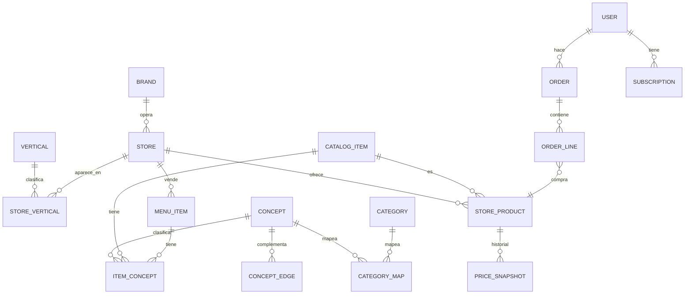

# Ecosistema Rappi Chile: research y modelo de datos

> Cómo está armado el ecosistema de Rappi en Chile, cómo modelan sus datos las super-apps comparables y qué modelo de datos proponemos para conectar todos los servicios y verticales.
> Research con fuentes públicas al 26-09-2026; última actualización: 28-09-2026. No tenemos datos internos de Rappi: todo lo que no tiene fuente es **inferencia** y está marcado así.
> Contexto del proyecto: [contexto-y-problema.md](contexto-y-problema.md) · Diseño del RAG, agente y panel: [diseno-ia.md](diseno-ia.md) · Decisiones: [decisiones.md](decisiones.md).

## Resumen

1. **Rappi es una sola cuenta con muchos servicios.** La suscripción **Rappi Pro / Pro Black** conecta verticales (envío gratis en restaurantes, market, farmacia y Turbo) y concentra más del 60% de los pedidos. Alrededor hay Turbo, Rappi Travel, RappiFavor, retiro en tienda, Rappi Ads y el Portal Partners para comercios.
2. **El diseño sigue patrones que otras super-apps han publicado:** Instacart movió su búsqueda híbrida a Postgres + pgvector; iFood usa un índice por vertical con fusión RRF; Uber Eats separa índices de restaurantes y de retail.
3. **De las cuatro piezas que faltaban para modelar el ecosistema, tres están construidas** (capa 2): una taxonomía común de conceptos mapeada a las categorías de Rappi, conceptos por producto y plato, y trazabilidad de los datos derivados. La geografía (H3) queda para después.
4. **Alcance: solo Rappi Chile.** Otras apps de delivery quedan fuera de alcance (§4).

---

## 1. El ecosistema de Rappi en Chile

> Snapshot del 26-09-2026 (research con fuentes públicas); estado actual del proyecto en [README → Resultados](../README.md#resultados).

### Servicios

| Servicio | Qué es | Estado en Chile | Fuente |
|---|---|---|---|
| **Verticales de catálogo** | Restaurantes, supermercado, conveniencia, Turbo, Rappi Mall, farmacia, licores, chocolatería | Activos | rappi.cl (páginas públicas, sep-2026) |
| **Rappi Pro / Pro Black** | Suscripción mensual: envío gratis en restaurantes, market, farmacia y Turbo; ≥20% de descuento en tarifa de servicio; "Pro Rewards"; Black suma prioridad, soporte VIP, créditos en Rappi Travel y beneficios con partners (Cabify, LATAM Pass, Marriott, Iberia, ChatGPT Go). CLP 4.990 / 7.990 | Activo; reemplazó a Rappi Prime en feb-2024. >60% de los pedidos son de miembros Pro | [pro.rappi.com/chile](https://pro.rappi.com/chile); [chocale.cl, feb-2024](https://chocale.cl/2024/02/rappi-pro-rappi-pro-black-membresias-rappi-prime-chile/); El Dínamo, ago-2025 |
| **Turbo** | Market en ~10 min desde dark stores; Turbo Restaurantes en ~15 min | Activo en 5 ciudades; 20% de los pedidos donde opera; 9 dark stores, plan de 5 más al 2027 | La Tercera, 19-sep-2026; El Dínamo, ago-2025 |
| **Rappi Travel** | Vuelos, hoteles, autos, seguros, tours | Activo (travel.rappi.cl) | [chocale.cl, feb-2022](https://chocale.cl/2022/02/rappi-travel-venta-vuelos-hoteles/) |
| **RappiFavor / Antojo** | "Compra o lleva lo que sea" | Probablemente activo; no confirmado para 2025–26 | rappi.cl/p/rappifavor |
| **Retiro en tienda** | Pickup activable por el comercio | Activo | [merchants.rappi.com](https://merchants.rappi.com/es-cl/recoger-en-tienda) |
| **Rappi Ads** | Retail media: anuncios en la app, audiencias, clean rooms; campañas desde el Portal Partners | Activo para comercios en Chile | produ.com, oct-2025; merchants.rappi.com/es-cl |
| **Portal Partners / Rappi Aliados** | Gestión de menú/catálogo, promociones, Ads, reportes, "RappiScore" (calidad) y métricas operativas | Activo | merchants.rappi.com/es-cl |
| **Promociones bancarias y de partners** | Descuentos mensuales con bancos (p. ej. Banco de Chile), cross-promo con Cabify | Activas 2025 | promos.rappi.com/chile |
| **RappiCard (Itaú)** | Tarjeta de crédito con cashback | **Descontinuada** (sin nuevas tarjetas desde dic-2024; cashback terminó ene-2025) | T13, 27-dic-2024 |
| **RappiPay (Chile)** | Pagos QR y billetera | Lanzada en 2018; no se encontró información reciente sobre su estado | DF, dic-2018 |

**No encontrado para Chile:** reservas, marcas propias de supermercado, gift card propia de Rappi, vínculo Amazon Prime ↔ Rappi Pro (solo México).

### Cómo se conectan

- **Hechos:** una sola cuenta y app para todos los verticales; los beneficios Pro aplican transversalmente y con partners externos. Los comercios usan Rappi Aliados (recibir pedidos) y el Portal Partners (catálogo, promociones, Ads, métricas). Los repartidores son independientes bajo la Ley 21.431 (~6.500 activos, ~20 pedidos/día cada uno según El Dínamo, ago-2025).
- **Tecnología (pública):** hacia 2021 usaban Snowflake, Fivetran, Amplitude y Looker, con más de 1.000 tipos de eventos ([rakam.io, 2021](https://rakam.io/blog/rappi-case-study)). Forbes (nov-2024) describe búsqueda y buena parte del catálogo impulsados por IA. El rediseño de ene-2025 trajo búsqueda con IA, recomendaciones "filtradas por categoría", favoritos unificados y ofertas diarias personalizadas ([marketing4ecommerce.cl, ene-2025](https://marketing4ecommerce.cl/rappi-chile-inteligencia-artificial-social/)).
- **Sobre los silos de recomendación:** no hay nada público que lo confirme o lo desmienta. "Recomendaciones filtradas por categoría" es coherente con silos por vertical; los favoritos unificados y la búsqueda transversal sugieren al menos algunas superficies compartidas (inferencia).

### Escala en Chile

23 ciudades, más de 10.000 restaurantes, ~1 millón de pedidos al mes (El Dínamo, ago-2025). Chile es el 6.º mercado de Rappi de 9; rentable cinco trimestres seguidos; crecimiento fuerte en regiones (Temuco +176%, Puerto Montt +132%) (La Tercera, sep-2026).

---

## 2. Cómo modelan sus datos las super-apps

> Snapshot del 26-09-2026 (research con fuentes públicas); estado actual del proyecto en [README → Resultados](../README.md#resultados). La columna de la derecha está al día al 28-09-2026.

| Patrón | Quién lo usa | Qué significa para nosotros |
|---|---|---|
| **Producto maestro ≠ oferta de tienda** | Instacart ("product" universal vs "item" por tienda, 2021), DoorDash (catálogo vs inventario), Meituan (SKU del comercio vs producto estándar, 2021) | Construido: `catalog_items` vs `store_products` + `price_snapshots` |
| **Conceptos de plato** | Meituan (nombre de plato estándar que agrupa decenas de miles de variantes; 300+ subcategorías), Swiggy (300+ familias de platos), Uber Eats (grafo cocina → plato) | Construido (capa 2): `item_concepts` agrupa platos de distintos restaurantes, y también productos, bajo un mismo concepto |
| **Dos taxonomías + mapeo** | Meituan (capas objetivas compartidas + categoría comercial por negocio), DoorDash (taxonomía retail L1–L4, 2026) | Construido (capa 2): taxonomía propia (`concepts`) mapeada a las categorías de Rappi, que cambian (`category_map`) |
| **Trazabilidad de datos derivados** | Instacart (prioridad de fuente por atributo), DoorDash ("jurados" de LLM que votan etiquetas) | Construido (capa 2): método, modelo, confianza y fecha en cada dato inferido |
| **Precios como hechos históricos** | Instacart (disponibilidad como probabilidad), práctica general | Construido: snapshots por corrida |
| **Índices de búsqueda por vertical** | Uber Eats (un modelo de embeddings, índices separados de restaurantes y retail, 2025), iFood (índice por unidad de negocio + intención + RRF + HNSW, 2026) | Construido: una partición por vertical, con su índice HNSW |
| **Búsqueda híbrida en Postgres + pgvector** | Instacart (reemplazó Elasticsearch y FAISS, 2025) | Valida el stack elegido; construido con fusión RRF |
| **Geografía de primera clase** | iFood y Uber (celdas H3 para cobertura de despacho) | **Pendiente:** celda H3 por tienda |
| **Personalización entre verticales** | DoorDash ("memoria unificada del consumidor", 2026), Grab (modelo base de usuario entre comida, movilidad y finanzas, 2025) | La industria tiende a cruzar verticales. Es lo que propone el prototipo: el aislamiento es una **regla de búsqueda**, no un límite del esquema, y los intereses cruzan verticales como conceptos |

Fuentes principales: [Instacart catálogo (2021)](https://company.instacart.com/how-its-made/the-story-behind-an-instacart-order-part-1-building-a-digital-catalog), [Instacart búsqueda en Postgres (2025)](https://company.instacart.com/tech-innovation/how-instacart-built-a-modern-search-infrastructure-on-postgres), [Uber delivery search (2025)](https://www.uber.com/blog/evolution-and-scale-of-ubers-delivery-search-platform), [iFood búsqueda (2026)](https://tech.ifood.com.br/engenharia/como-funciona-a-busca-do-ifood/), [Meituan producto (2021)](https://tech.meituan.com/2021/09/02/meituan-commodity-nlp-practice.html), [Meituan grafo de comida (2021)](https://tech.meituan.com/2021/05/27/food-knowledge-graph.html), [DoorDash grafo de productos (2024)](https://careersatdoordash.com/blog/building-doordashs-product-knowledge-graph-with-large-language-models/), [Grab user foundation model (2025)](https://engineering.grab.com/user-foundation-models-for-grab), [schema.org MenuItem](https://schema.org/MenuItem), [GS1 GPC](https://www.gs1.org/sites/default/files/gpc_development_and_implementation_0.pdf). Algunas páginas de DoorDash, Swiggy y Delivery Hero no se pudieron abrir y se citan desde extractos.

---

## 3. Modelo de datos del ecosistema (propuesta)

Tres capas. Las dos primeras están construidas con datos públicos. De la tercera, usuarios, eventos y pedidos tienen tablas con datos **simulados**; el resto queda como diseño hasta contar con datos internos.

### Capa 1: contenido público (construida, `rappi-scraper`)

`verticals`, `brands`, `stores`, `store_verticals`, `aisles`, `categories`, `catalog_items`, `store_products`, `price_snapshots`, restaurantes y menús (`restaurant_details`, `cuisines`, `menu_sections`, `menu_items`, `menu_price_snapshots`), `search_documents` particionado por vertical.

Con el catálogo del 04-10-2026: 253.945 documentos de búsqueda (84.024 productos, 165.623 platos y 4.298 tiendas); cifras vigentes y detalle por vertical en [README → Resultados](../README.md#resultados).

### Capa 2: conceptos y trazabilidad (construida, `rappi-ia`)

Se llena solo con datos públicos.

| Pieza | Qué agrega | Para qué |
|---|---|---|
| **`concepts`** (taxonomía común) | Árbol propio y estable de conceptos, 136 al 16-10-2026 ("lácteos > yogur", "comida > pizza"), enlazable después a Google Product Taxonomy | Análisis entre verticales que no dependa de cómo cada tienda nombra sus pasillos |
| **`category_map`** | Categorías, secciones de menú y cocinas de Rappi → concepto, con fecha de vigencia (las categorías nuevas de cada semana se exportan con `rappi-ia map-categories` para revisarlas) | Las categorías de Rappi cambian; el concepto no |
| **`item_concepts`** | Un concepto principal por producto o plato | Un plato y un producto del súper se conectan al compartir concepto (pizza ↔ pizza congelada). Reemplaza a la idea inicial de una tabla de platos estándar |
| **`concept_edges`** | Complementos entre conceptos: 240 curados (contados el 16-10-2026; cada concepto que se puede ofrecer tiene al menos dos), más los aprendidos por co-ocurrencia | La recomendación cruzada: cerveza → snacks |
| **Trazabilidad** en todo dato inferido | `method` (`curado`, `llm`, `regla`, `embedding`; en complementos, `curado` o `coocurrencia`; ver [diseno-ia.md](diseno-ia.md#6-modelo-de-datos-nuevo)), `model_version`, `confidence` y fecha | Poder auditar y rehacer lo que generen modelos o reglas |
| **Geografía H3** | `h3_cell` (y comuna) en `stores` | **Pendiente:** análisis por zona y, más adelante, cobertura de despacho |

Las etiquetas se generan offline, siempre con trazabilidad: primero por categoría (mapa de categorías generado con LLM y versionado en el repositorio), luego por reglas sobre el nombre y por vecinos cercanos con embeddings (kNN). Es el "enriquecimiento del catálogo" del flujo del RAG. Cobertura por vertical y precisión estimada en [README → Resultados](../README.md#resultados).

### Capa 3: datos internos (diseño; usuarios, eventos y pedidos con datos simulados)

Entidades que existen en el ecosistema pero **no se pueden obtener públicamente**. Se documentan para que el esquema actual no las bloquee (IDs globales, `vertical` como dato, precios versionados):

| Entidad | Descripción (inferida del research) |
|---|---|
| `user`, `address` | Cliente y direcciones |
| `subscription` | Pro / Pro Black: plan, vigencia, beneficios por vertical y partners |
| `order`, `order_line` | Pedido con vertical y tipo (incluye Favor/Antojo); cada línea referencia un `store_product` y guarda el precio del momento |
| `payment_method`, `credits` | Medios de pago y créditos Rappi |
| `promotion` | Descuentos con quién los financia: Rappi, comercio, banco o partner |
| `ad_campaign`, `ad_impression` | Rappi Ads: campañas de comercios y de marcas (retail media) |
| `courier`, `trip` | Repartidores y viajes |
| `merchant_score` | RappiScore y métricas operativas del comercio |
| `travel_booking`, `loyalty_partner` | Rappi Travel y partners de Pro |
| `event` | Eventos de uso de la app (vistas, búsquedas, clics) por vertical |

Con datos internos, estas entidades permitirían **medir directamente** el problema de los silos: qué hace un mismo usuario en distintos verticales y cómo cambian sus recomendaciones.

**Construido con datos simulados:** `app_users`, `app_events`, `app_orders` y `app_order_lines`.

- Los datos vienen del generador `events/synth.py` (3.000 usuarios × 26 semanas, semilla 7; `source = 'synthetic'`) o del prototipo (`source = 'prototype'`).
- Las líneas de pedido apuntan a un producto (`catalog_item`) o a un plato (`menu_item`).
- Alimentan los segmentos y las métricas de negocio (las muestra el panel de negocio, parte del MVP: [diseno-ia.md §5](diseno-ia.md#5-panel-para-la-empresa-vale-la-pena)): muestran la mecánica, no son evidencia.

---

## 4. Alcance: solo Rappi

Este proyecto trabaja solo con el contenido público de Rappi Chile. Otras apps de delivery (por ejemplo, Uber Eats o PedidosYa) quedan fuera de alcance: la pregunta del proyecto es cómo conectar entre sí los verticales de Rappi.

---

## 5. Próximos pasos

1. **Mejorar la capa 2:** etiquetar con un LLM (o con Jev, el modelo de juicios tipados de TypeSafe) los ítems de baja confianza, revisar a mano los de mayor tráfico (la precisión ya se midió sobre el catálogo completo con una muestra versionada el 06-10-2026: [resultados](resultados/capas-precision-2026-10-06-nueva-muestra.md)).
2. **Evaluación de búsqueda:** juzgar a mano la planilla de 200 pares (`rappi-ia jev-planillas`, ver [jev.md](jev.md)) y medirlo con `rappi-ia eval-human`, para saber si el refuerzo por concepto mejora de verdad.
3. **Geografía H3** en `stores`, cuando una vista la necesite.
4. **Con datos internos de Rappi:** medir el silo y validar las palancas del panel con un grupo de control.

Flujo de datos completo: [diagramas/rag-datos.png](diagramas/rag-datos.png) ([versión interactiva](diagramas/rag-datos.html): descargar y abrir en el navegador). Vista por carriles: [diagramas/arquitectura-ia.png](diagramas/arquitectura-ia.png) ([versión interactiva](diagramas/arquitectura-ia.html)).
