# Prototipo de la app

Maqueta navegable de la app de Rappi Chile, hecha a partir de capturas y videos del iPhone, para **mostrar la propuesta del proyecto**. Desde fuera, lo que un usuario hace en un vertical no parece influir en lo que se le recomienda en los demás. Aquí el asistente **Mochi** aprende de lo que haces y recomienda **entre verticales** (cerveza → snacks, pizza → gaseosas, pan → fiambres).

> Imágenes, logos y marcas pertenecen a Rappi y a sus dueños; se usan solo como maqueta de demostración. Proyecto independiente, no afiliado ni respaldado por Rappi. Los banners y promociones de terceros que traían las capturas (bancos, aerolíneas, hoteles, restaurantes) se reemplazaron por contenido genérico o de ejemplo.

Hecho con Vite + React 19. **Necesita la API de [`rappi-ia`](../rappi-ia/)**: sin ella no abre y muestra «Sin conexión con Mochi» con un botón «Reintentar». Con la API, Mochi busca en el catálogo real. Las imágenes que no cargan muestran un respaldo neutro.

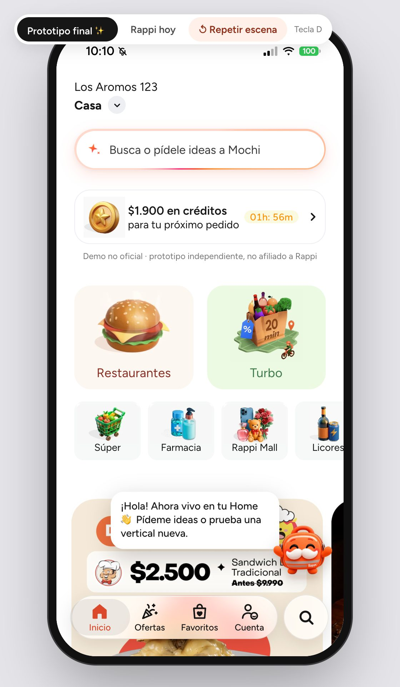

*Las capturas de las pantallas se tomaron el 24-10-2026 con la API corriendo sobre una copia de la base (`rappi_staging`) y el catálogo real (`npm run screenshots`); solo la ficha de Mochi es anterior. «¿Repetimos?» sale de la respuesta de ejemplo del contrato con un café real del catálogo: es una ilustración, no un hábito medido. Como el recorrido paga una compra y deja un pedido y sus eventos (`source = 'prototype'`) en la base que use la API, `npm run screenshots` se niega a correr sin `SCREENSHOTS_ALLOW_WRITES=1`: se corre con la API sobre `rappi_staging`, nunca sobre `rappi`.*

## Cómo correrlo

Requiere Node 22.22+ o 24.15+ (ver `.nvmrc` en la raíz). Como la app no abre sin la API, se levanta con el resto del MVP, desde la raíz del repositorio:

```bash
make mvp              # API :8000, app http://localhost:5174 y panel :5175; Ctrl-C detiene los tres
make mvp LAN=1        # abre la API y la app a la red local, para el iPhone (misma red wifi o su hotspot)
make mvp-check        # recorre el MVP con Chrome contra un catálogo inventado, sin tocar la base real (8 revisiones)
```

Requisitos, qué revisa `make mvp-check` y qué hacer si falla algo: [docs/instalacion.md](../docs/instalacion.md#5-el-mvp). Para correr solo la app, con la API ya levantada por su cuenta (`cd rappi-ia && make serve`):

```bash
cd prototipo-app
npm ci
npm run dev              # http://localhost:5174
npm run dev -- --host    # para abrirlo en el iPhone
```

En el iPhone, desde Safari: **Compartir → Agregar a pantalla de inicio**. Se abre a pantalla completa con el ícono de Mochi y el gesto "volver" funciona.

### La API de `rappi-ia`

La API (puerto 8000) carga los modelos antes de aceptar peticiones: `make mvp` espera a que responda y, si la app se abrió antes, «Reintentar» vuelve a probar. Con ella, Mochi:

- da las **pantallas de catálogo** (ver «De dónde salen las pantallas»);
- busca en el **catálogo real** con búsqueda híbrida en todas las verticales (un grupo por vertical, la de la pantalla primero), con precios vigentes;
- sugiere un complemento **de otra tienda** en un bloque aparte;
- suma **«Para ti»** al saludo del buscador con Mochi con lo que aprendió de ti (productos reales de otra vertical, con aviso +18 si corresponde);
- registra eventos seudónimos y pedidos (uno por vertical) en la API, para medir las sugerencias (mostradas, aceptadas y convertidas).

Si la API se cae con la app ya abierta, el buscador con Mochi dice «Sin conexión» con «Reintentar» (repite la misma búsqueda) y las ofertas que Mochi hace solo callan.

- **Dónde busca la API:** en el mismo host desde el que se abrió la página, puerto 8000; desde el iPhone no hace falta configurar nada. Para apuntar a otra API, crea `.env.local` con `VITE_API_URL=http://localhost:8001`.
- **Desde el iPhone:** `make mvp LAN=1` (abre la API, la app y el panel a la red; solo en una red de confianza). Sirve en la wifi de casa, con el hotspot del iPhone y con `http://nombre-del-mac.local:5174`. macOS pedirá permiso de red la primera vez.
- **Sesión:** al abrir, la app pide una sesión (`POST /session`) y manda su token en la cabecera `X-User-Token`; sin él la API no deja leer ni borrar los datos de una persona.
- **En un servidor:** el build de producción (`npm run build` con `VITE_API_URL=/api`) habla con la API en el mismo origen y no trae los textos de desarrollo; con `VITE_DEMO=1` conserva el interruptor de la demo (tecla D). Ver [docs/despliegue.md](../docs/despliegue.md).

### Comandos

| Comando | Para qué |
|---|---|
| `npm test` | Tests (Vitest): Mochi, buscador, carrito, perfil, navegación, precios, seguimiento, pedidos, hoja de producto, cliente de la API, accesibilidad del buscador |
| `npm run lint` | ESLint (reglas de React Hooks) |
| `npm run format` | Formato con Prettier |
| `npm run format:check` | Revisa el formato sin cambiar nada (lo que corre el CI) |
| `npm run build` | Build de producción en `dist/` |
| `npm run screenshots` | Regenera las capturas de este README con el Chrome instalado (`CHROME_PATH` o `PLAYWRIGHT_CHANNEL` eligen otro). Necesita el MVP corriendo sobre una copia de la base (`DATABASE_URL=postgresql:///rappi_staging make mvp`), o una API sobre la copia en otro puerto (`VITE_API_URL`), y `SCREENSHOTS_ALLOW_WRITES=1`, porque paga una compra: sin la variable se niega |
| `npm run demo:snapshot` | Graba la muestra del catálogo para la demo sin conexión desde una API sobre una copia de la base (ver «Demo sin conexión») |
| `npm run demo:html` | Arma «Prototipo MVP.html»: la app en un solo archivo, sin la API (ver «Demo sin conexión») |
| `./scripts/make-icons.sh` | Regenera los íconos de pantalla de inicio desde `scripts/icon.svg` (solo en macOS: usa `qlmanage` y `sips`) |

Tests: las cifras vigentes están en [README.md#resultados](../README.md#resultados) (fila «Calidad»). CI en GitHub Actions: lint, tests y build.

**Accesibilidad:** el buscador con Mochi y las hojas inferiores se usan con teclado y VoiceOver (el foco entra al abrir, Escape cierra, Tab no se sale y el foco vuelve al cerrar), cada respuesta de Mochi se anuncia completa al lector de pantalla y las áreas táctiles miden al menos 40 px.

## Demo sin conexión: «Prototipo MVP.html»

Un solo HTML que abre con doble clic (`file://`), sin la API ni el MVP corriendo, para mostrar lo que hace hoy el proyecto: Mochi en la Home y sus ofertas con «¿Por qué?», la Home que reordena los 6 accesos chicos, la escalera multivertical (Restaurantes → Turbo → Súper → otras de Retail → RappiFavor → RappiTravel; nunca Farmacia ni Licores), «¿Repetimos?» y «¿Volvemos a…?», el buscador con Mochi (también «qué me recomiendas»), el complemento del checkout, los pedidos y el seguimiento, y el interruptor «Rappi hoy» / prototipo (tecla D). Las fotos van adentro del HTML: funciona sin internet.

Cómo funciona: el build de la demo (`vite build --mode demo`; sus variables están en `vite.config.js`) instala una API simulada en el navegador (`src/api/offline/`) que responde los mismos formatos que la real. Lee una muestra del catálogo grabada de la API real (`src/api/offline/snapshot.json`: listas, tiendas, menús, búsquedas, preguntas a Mochi, kits, complementos y la oferta real de cada paso de la escalera) y guarda lo que hace la persona en `localStorage` («Empezar de cero», bajo el aviso de la Home, lo borra). El orden de la Home, la escalera y las guardias de las ofertas son una copia simplificada del backend (los archivos que replica están al inicio de `src/api/offline/index.js`): sin población que aprenda y sin búsqueda semántica (las búsquedas y preguntas no grabadas se buscan por palabras en la muestra, con el foco de la búsqueda real: si la consulta nombra un concepto, en cada vertical solo ese concepto o lo que lo dice en su nombre). La recompra y «¿Volvemos a…?» siguen el ritmo de los pedidos como el backend, salvo lo pedido en la demo, que se repite sin esperar su ritmo (dos pedidos en las últimas dos semanas). «Qué me recomiendas» busca los intereses de la persona (nunca en Farmacia ni Licores) y, sin ellos, responde los ejemplos grabados; los complementos se alternan por persona como en el backend (los dos están grabados). Los builds normales no la llevan: Vite pliega `VITE_OFFLINE_DEMO` y `src/api/offline/` no entra a `dist/`.

**Panel de la demo** (solo en este HTML, junto al interruptor de modo):

- **Persona:** borra lo de ahora y siembra un historial en la API simulada, de un clic: «Nueva (sin historial)», «Solo Restaurantes», «Restaurantes + Turbo», «Restaurantes + Turbo + Súper», «Todo el catálogo» (Mochi ofrece RappiFavor y, abierto RappiFavor, RappiTravel), «Usa mucho Farmacia» (Farmacia sube primera en la Home y Mochi igual nunca la ofrece), «Dejó de pedir su plato de siempre» y «Dejó Turbo hace 40 días» (semanas de pedidos: la Home muestra «¿Volvemos a…?»; con dos «Después» no vuelve) y los cinco perfiles de gusto (asiático, café, italiano, mascotero y carrete sin alcohol: tres pedidos de un concepto del perfil lo activan, y el buscador con Mochi muestra su perfil y su escalera, grabados de la API real).
- **Mover la Home:** «+1 visita a Súper», Farmacia, Rappi Mall, Licores, Express o Chocolates registra un toque a ese acceso en el prototipo (no en «Rappi hoy») y la Home se reordena en vivo; «Borrar historial» la deja en su orden fijo.
- Una línea con la combinación de la persona y el paso que Mochi propondría («Hoy: restaurantes+turbo → siguiente: supermercado»).

La muestra son datos descargados del catálogo, así que no va a git (`.gitignore`). Para regenerarla y armar el HTML:

```bash
# 1. Una API sobre una COPIA de la base, en otro puerto (la muestra crea personas y pedidos de prueba y los borra)
cd rappi-ia
DATABASE_URL=postgresql:///rappi_staging .venv/bin/python -m rappi_ia migrate
DATABASE_URL=postgresql:///rappi_staging HF_HUB_OFFLINE=1 API_PREWARM=0 \
  .venv/bin/python -m uvicorn rappi_ia.api.app:app --host 127.0.0.1 --port 8020
# 2. En otra terminal: la muestra (~1,6 MB) y el HTML (~14,5 MB, con las fotos), con una copia en el Escritorio
cd prototipo-app
SNAPSHOT_ALLOW_WRITES=1 DEMO_API_URL=http://127.0.0.1:8020 npm run demo:snapshot
DEMO_HTML_COPY="$HOME/Desktop/Prototipo MVP.html" npm run demo:html
```

`demo:snapshot` muestra la API que va a usar antes de escribir nada y se niega con el puerto 8000 (la API de `make mvp`, sobre `rappi`) o con un host que no sea de este equipo; `SNAPSHOT_ALLOW_MAIN_API=1` lo permite, solo si esa API corre sobre una copia.

`demo:html` baja primero una miniatura de cada foto de la muestra (~5.200) del CDN de Rappi, 4 a la vez y con pausa: la primera vez tarda unos 30 minutos; después quedan en `.demo-cache/` y solo baja las nuevas. Las mete en el HTML como data URI (`src/api/offline/photos.json`); una foto que no se puede bajar queda con el cuadro gris. Con la muestra ya grabada, `npm run demo:html` basta para volver a armar el HTML tras un cambio en la app.

## Modo demo: Rappi hoy y Prototipo final

La app es el **Prototipo final**. **Rappi hoy** es solo de la demo: una réplica de la app como es hoy, sin Mochi, para compararlas en una presentación. El interruptor junto al teléfono (tecla **D**, o Cuenta → Configuración → Modo demo en el celular) cambia entre los dos, y solo existe en desarrollo o en un build con `VITE_DEMO=1`: en cualquier otro build la app es siempre el prototipo final, aunque el navegador tenga guardado «Rappi hoy» (`src/state/DemoContext.jsx`).

| Rappi hoy | Prototipo final |
|:---:|:---:|
| 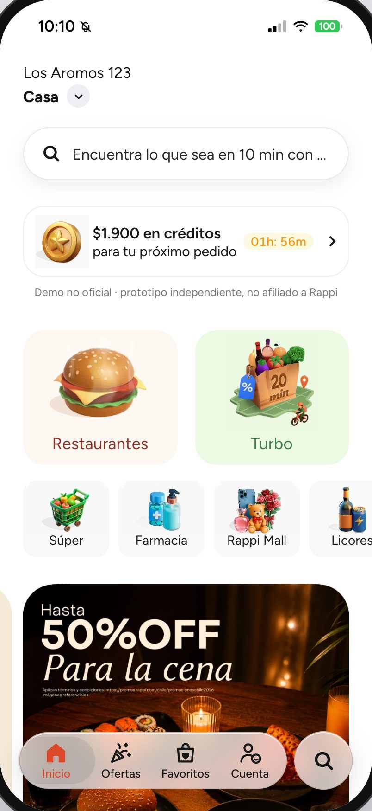 | 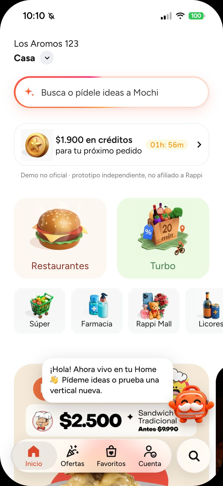 |
| Buscador original | Mochi vive en la Home y la misma barra abre su buscador |

En el **prototipo final** Mochi de cuerpo entero vive en la Home (`src/screens/home/live/`), sin canal aparte para escribirle. Al entrar saluda y, la primera vez, hace una guía de 2 pasos (el buscador y qué pasa al tocarlo, con «Siguiente» y «Saltar»; no vuelve a aparecer, salvo con «Repetir escena»); no sugiere productos. La Home suma «¿Qué plan tienes hoy?» (un kit de varias verticales) y, al tocar a Mochi, una vertical por probar. Mochi saluda al llegar, salta, apunta y gira según lo que dice, y en espera mira alrededor, baila o se estira; sin nada que decir se asoma desde el borde y al hacer scroll se esconde, para no tapar la Home. Lo que se agrega al carro fuera de la Home lo comenta al volver, si combina con algo de otra vertical. La barra de la Home y la lupa de abajo abren el buscador con Mochi (ver más abajo), y al entregar un pedido ofrece armar el próximo. En el celular, «Repetir escena de Mochi» está en Cuenta. «↺ Repetir escena», junto al interruptor, vuelve a empezar. Respeta «reducir movimiento» del sistema.

## Lo nuevo de la propuesta

### La Home que aprende

La Home del prototipo final se ordena según cada persona, con el [motor multivertical](../docs/capa-de-datos.md#motor-multivertical) de la API:

- **Accesos ordenados por el uso propio:** los 6 accesos pequeños siguen lo que la persona más pide y abre (`GET /profile/{id}/verticales`; cada toque a una vertical es un evento `vertical_open`) y, cuando el orden es suyo, la fila dice «Ordenadas según lo que más usas». Restaurantes y Turbo no se mueven, Lealtad y Beneficios Pro van al final y, sin historial, queda el orden de siempre. En «Rappi hoy» no cambia nada.
- **«¿Repetimos …?»:** cuando la persona pide un concepto con ritmo y ya le toca, aparece un bloque con lo último que llevó («Pides cada 7 días»), «Ver producto» y «Después» (la oferta `recompra`). Cuenta como aceptada al agregar el producto al carro.
- **Tocar a Mochi:** propone el siguiente paso de la escalera de combinaciones (Restaurantes → Turbo → Retail), por ejemplo «¿Y si pruebas algo de Súper?», con «¿Por qué?» para ver la razón.

| Home que aprende | Mochi propone una vertical | ¿Repetimos? |
|:---:|:---:|:---:|
| 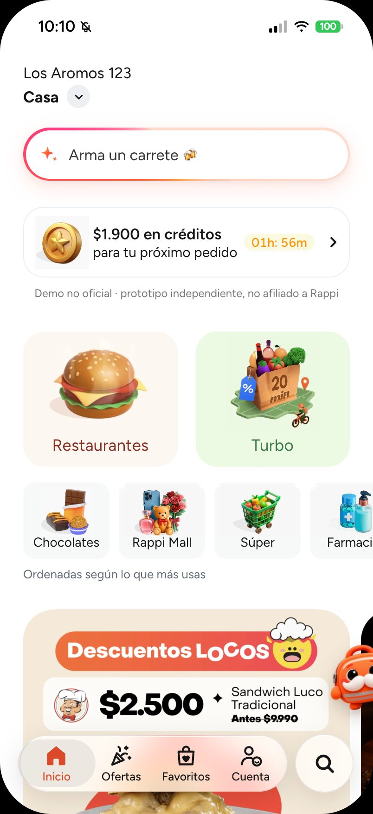 | 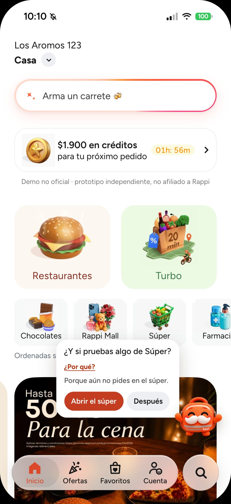 | 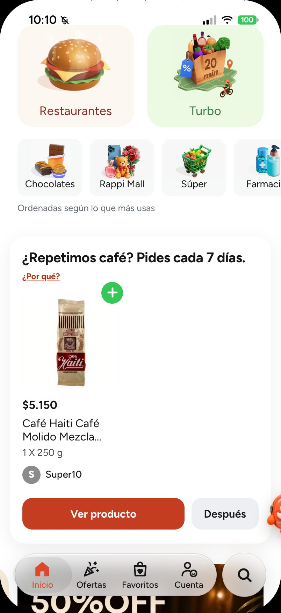 |
| Tras abrir dos veces Chocolates y una vez Rappi Mall, esos accesos suben. | Esa persona nunca pidió: Mochi le propone el súper y dice por qué. | Ilustración con la respuesta de ejemplo del contrato y un café real del catálogo; no es un hábito medido. |

### Mochi, el buscador

En el prototipo final la barra de la Home («¿Qué se te antoja hoy?») abre el buscador con Mochi, que reúne el buscador de siempre y lo que Mochi sabe de ti:

- **Aprendiendo de ti:** arriba muestra lo que va aprendiendo («🍺 Cerveza · 🥃 Copete») y un botón **Olvidar** (siempre visible) que, tras la misma confirmación de **Borrar mis datos**, lo borra, también en la API.
- **Toca y te armo algo:** botones con ideas fijas («¿Qué almuerzo hoy?», «Arma un carrete», «Algo dulce»). Al tocar uno, Mochi responde con productos y tiendas; si abres una tienda desde ahí y vuelves, la búsqueda sigue donde estaba.
- **El campo de búsqueda** consulta la API y muestra los productos en un grupo por vertical, con la de la pantalla primero y «Ver más» en cada uno; sin resultados, Mochi dice dónde sí hay lo buscado. Debajo siguen «Ideas para buscar», que son ideas fijas y no un historial, y «Tiendas populares», como en la app.
- **Descubre con Mochi:** complementos de lo que le gusta a la persona, de `/recommendations`, cada uno con su vertical para abrirla.
- **Tu perfil:** si la persona tiene un perfil de gusto (`GET /profile/{id}/gustos`: asiático, café, italiano, mascotero o carrete, de `rappi-ia/src/rappi_ia/offers/perfiles.toml`), Mochi lo muestra con su nivel y su porqué, y debajo «Para ti en otras verticales»: la escalera del perfil (el momento `perfil` de `/agent/offer`), un peldaño por vertical con sus productos, de lo más cercano a lo más lejano, y al final una idea para RappiTravel con dos datos y su fuente. Sin perfil, el panel queda como siempre.

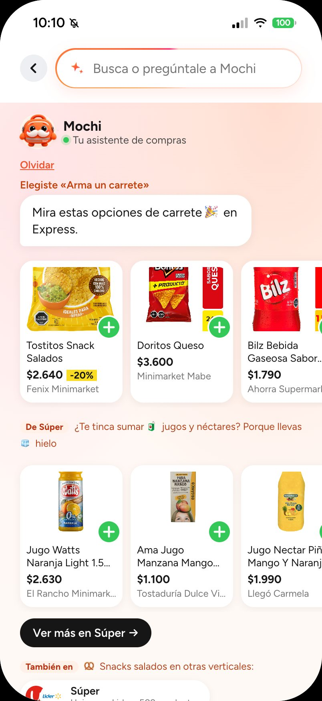

*Buscador con Mochi tras tocar «Arma un carrete» (con el MVP corriendo).*

Mochi es la mochila Rappi con bigote. En la app usa 4 poses de una sola imagen (`src/assets/mochi-poses.webp`): frontal (quieto), feliz (saluda o lo señalas con el mouse), tímido (piensa o escucha) y saltando (al tocarlo). Respira, se inclina hacia el mouse y, en la Home, salta, gira y baila según lo que dice.

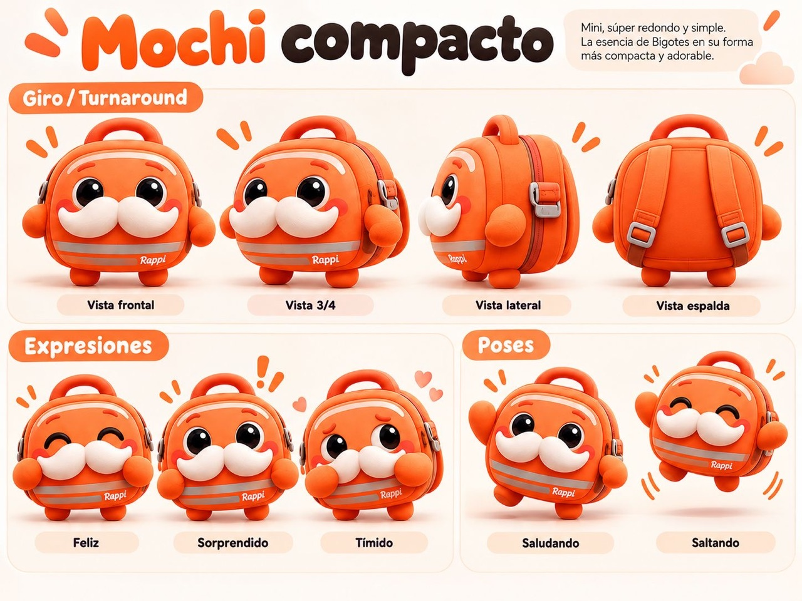

*Ficha del personaje: giro, expresiones y poses.*

### Recomendaciones entre verticales

En el prototipo final no hay filas de sugerencias al entrar a una vertical ni en la Home: Mochi recomienda entre verticales cuando se le pide (el buscador con Mochi, «Preguntarle a Mochi» en un producto, «¿Me falta algo?» en el checkout) y, en la Home, comenta lo agregado si combina con algo de otra vertical.

### Mochi en los momentos clave

- **Sin resultados:** si el buscador con Mochi no encuentra nada pero la consulta es de un tema conocido («chela» → cerveza), Mochi dice «Aquí no hay «chela», pero en Licores sí» y lleva ahí. Si no reconoce el tema, invita a buscar con otras palabras. Nunca ofrece Farmacia ni cosas de bebé por su cuenta.
- **Pedido en camino:** en el mapa, Mochi está tímido mientras se prepara el pedido, de frente en camino y feliz con «¡Ya casi!» en el tramo final; al llegar, salta.
- **¿Me falta algo?:** en el checkout, un botón «¿Me falta algo? Pregúntale a Mochi». Solo al tocarlo, Mochi sugiere UNA cosa de otra vertical con su razón («Llevas 🍺 Cerveza → 🥩 Carnes»), «Agregar» y «Deshacer». Nada aparece por su cuenta.

### Mochi fuera de la Home

En el prototipo final, Mochi flota a un costado en las demás pantallas (no en la Home, el buscador con Mochi, el checkout ni el seguimiento), sobre la barra inferior o la del carrito, y se achica al hacer scroll:

- **Tocarlo:** salta y abre un menú: «Buscar con Mochi», «Revisar mi carrito · $total» (o «¿Qué puedo probar?» con el carro vacío), «Mover al otro lado» y «Silenciar por hoy». Escape o tocar fuera lo cierran.
- **Moverlo:** arrastrarlo lo deja en el lado más cercano; el lado se recuerda en el navegador.
- **Al agregar al carro:** «¡Listo! … está en tu carrito» con «Deshacer», 4 s. No sugiere nada: eso queda para la Home al volver.
- **Preguntarle por un producto:** mantener presionada una tarjeta muestra «Preguntarle a Mochi» (abre el buscador con «¿Con qué acompaño …?»). En escritorio también se puede arrastrar la tarjeta hasta Mochi.
- **Silencio:** «Silenciar por hoy» lo deja como una pestañita en el borde hasta mañana (tocarla lo despierta). Si se cierran dos globos seguidos, no habla por su cuenta el resto de la sesión. «Repetir escena» lo despierta.

### Compra completa

| Checkout | Seguimiento | Entregado |
|:---:|:---:|:---:|
| 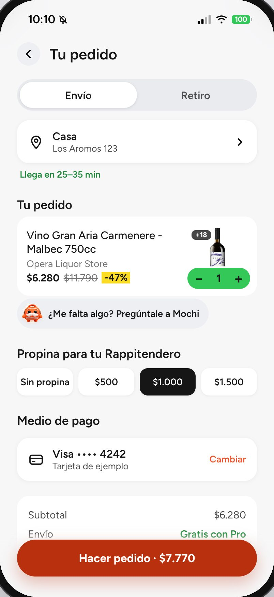 | 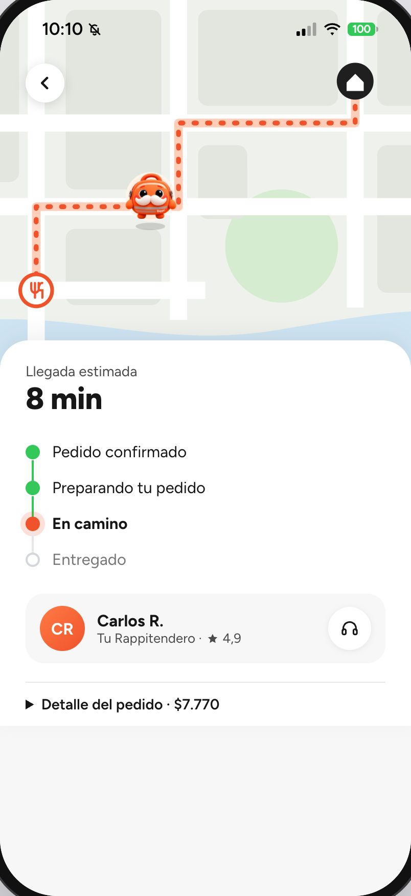 | 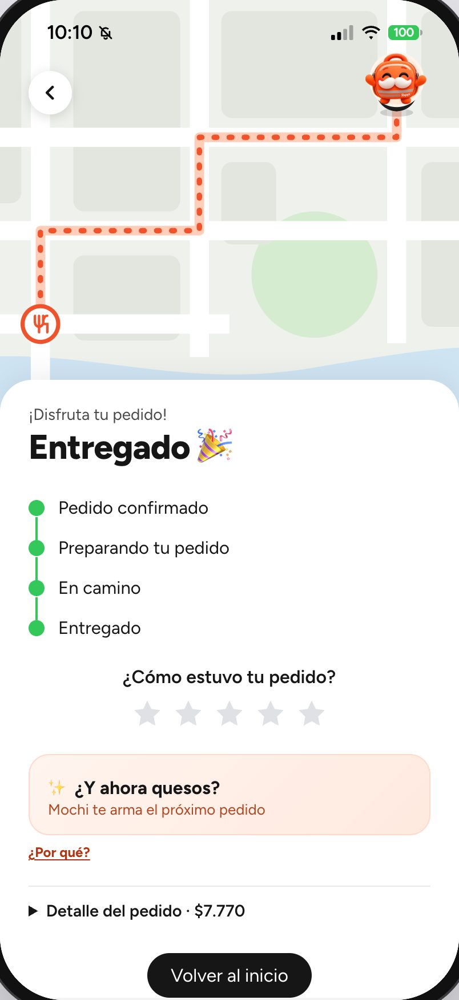 |
| Envío o retiro, propina y desglose (envío gratis con Pro). El medio de pago es un texto de ejemplo. | Simulado: los pasos avanzan solos y Mochi recorre la ruta en el mapa. | Calificación y la siguiente sugerencia cruzada. |

También:

- **Hoja de producto:** al tocar un producto se abre una hoja con la cantidad, notas para la tienda y el total, y desde ahí se puede ir a la tienda.
- **Mis pedidos** (en Cuenta): cada pedido hecho en el prototipo abre su seguimiento, en curso o entregado; el carro (líneas y notas), los favoritos, la dirección y el programa de lealtad se guardan en este navegador y sobreviven a una recarga (los pedidos y los eventos del carro además van a la API: ver Privacidad).
- **Turbo** con los pasillos de su tienda con más productos vigentes (pestañas arriba y en Categorías), con sus productos y «Ver más», que se agregan al carro, además de las pestañas Favoritos y Ofertas.
- **Menús reales** de los restaurantes, con pestañas por sección: salen de la API (`/catalog`), el catálogo que descarga el scraper. La portada es la foto de un plato popular: la base no guarda los logos de los restaurantes.
- **Lealtad**, con tres programas de ejemplo (ficticios) para vincular uno.
- **Si algo falla:** una pantalla con error muestra «Algo salió mal» y «Volver al inicio» sin cerrar la app, y una imagen que no carga muestra un respaldo neutro.

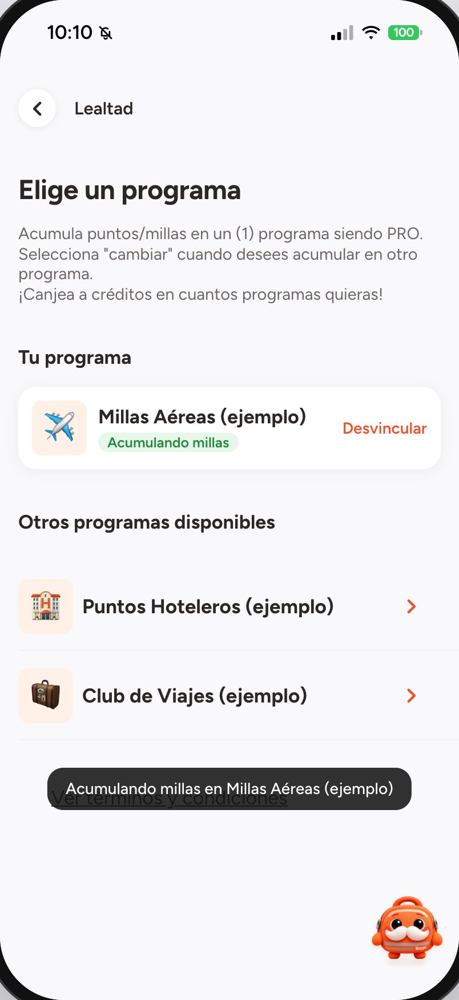

*Lealtad con un programa de ejemplo vinculado (con el MVP corriendo).*

## Pantallas replicadas de Rappi

Calcadas de las capturas del iPhone, en modo "Rappi hoy" (sin agregados de la propuesta). El diseño es de las capturas, con los textos en español como la app de Rappi Chile y sin promociones de terceros; las tiendas, los productos y los precios son del catálogo real (ver «De dónde salen las pantallas»).

| Restaurantes | Turbo | Ofertas | Favoritos |
|:---:|:---:|:---:|:---:|
| 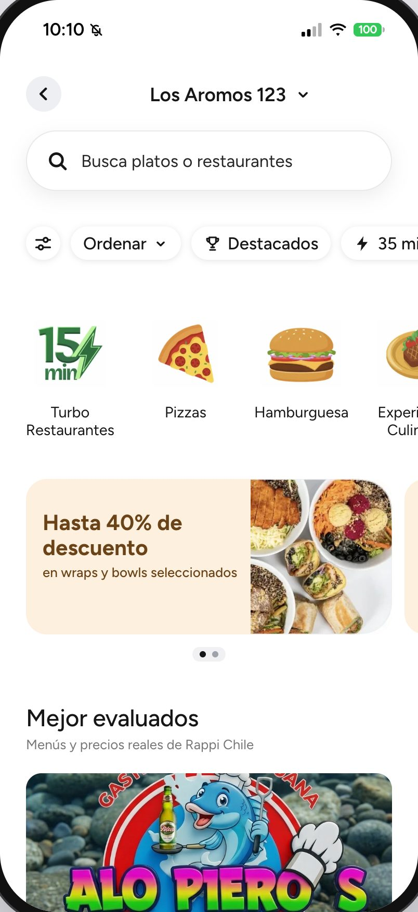 | 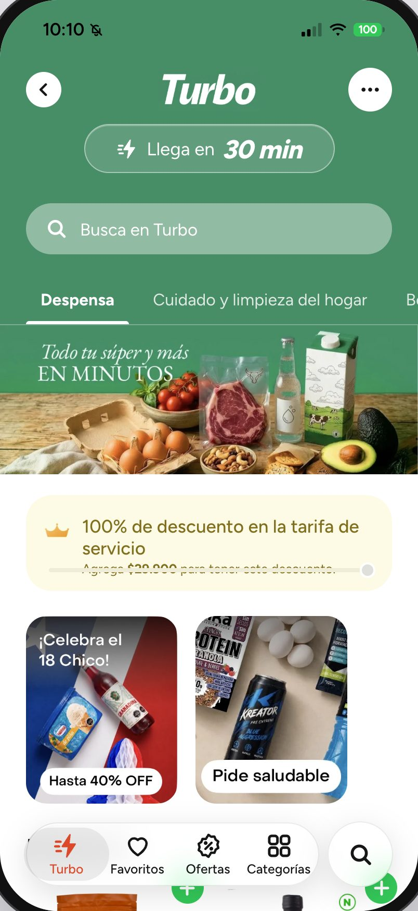 | 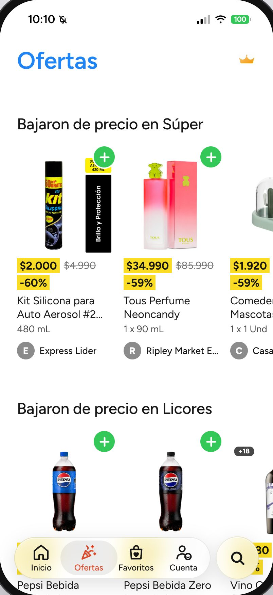 | 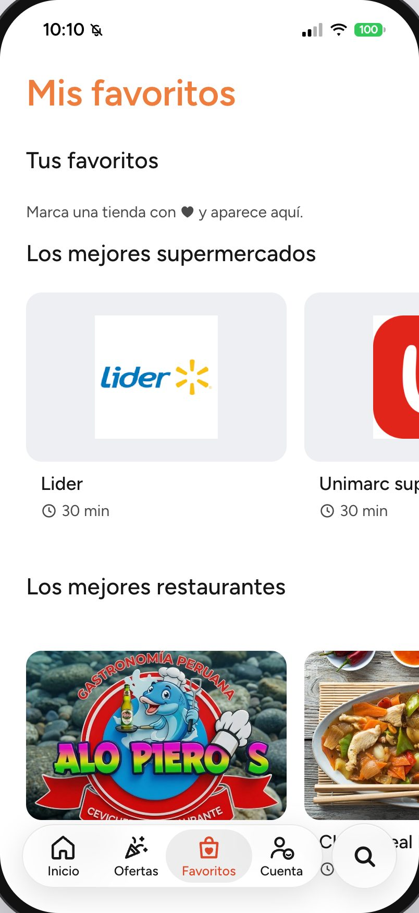 |

| Cuenta | Súper | Licores | RappiTravel |
|:---:|:---:|:---:|:---:|
| 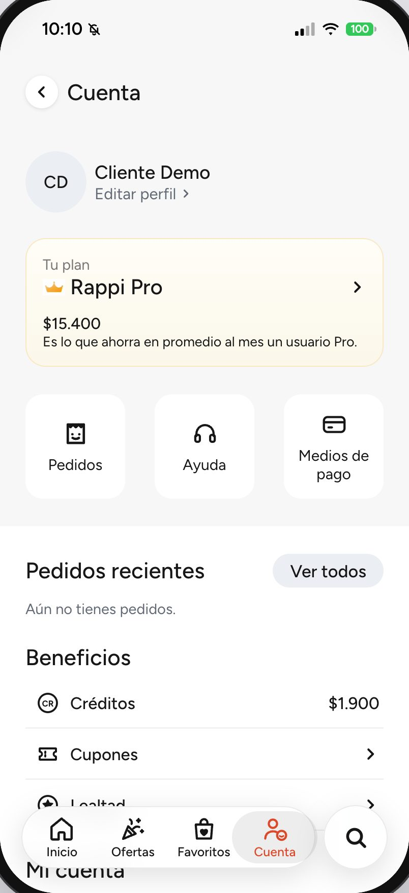 | 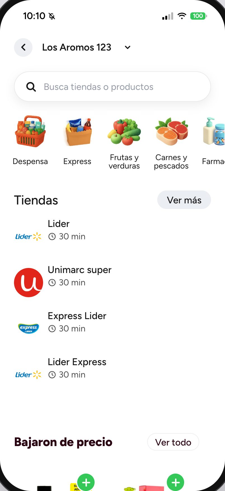 | 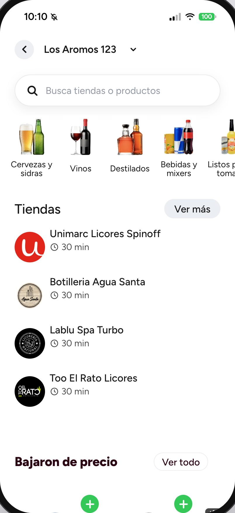 |  |

Además: Farmacia, Rappi Mall, Express, Chocolates, Lealtad, buscador, página de tienda y carrito.

## De dónde salen las pantallas

Las pantallas de catálogo leen la API (`/catalog`, `src/api/catalog.js`) y la app solo pone el diseño:

| Pantalla | Qué viene de la API |
|---|---|
| Verticales (Súper, Farmacia, Rappi Mall, Licores, Express, Chocolates) | Las tiendas (una tarjeta por formato) y «Bajaron de precio» |
| Tienda | Sus pasillos, de a una página de productos (24, con «Ver más») y el precio vigente de cada uno |
| Restaurante | Su menú con precios; la portada es la foto de un plato popular |
| Turbo | Los pasillos de la tienda Turbo con más productos vigentes y sus productos |
| Ofertas | «Bajaron de precio» por vertical (se excluyen las bajas de más de 60 %: en la base real eran graneles, precio por kilo contra precio por unidad) y «Mejor evaluados» |
| Favoritos e Inicio | «Los mejores» y las listas de la Home (restaurantes rápidos, «Cerca de ti», «Mejor evaluados») |

- **Un producto muestra el precio y la tienda de su oferta vigente más barata entre las tiendas que se pueden abrir**, para que el precio y la tienda nunca se contradigan. Si ninguna tienda abrible lo vende, no ofrece «Ver tienda».
- **Sin «Envío más barato»:** el costo de envío es $0 en el 91 % de la base, casi seguro «sin dato», así que la Home y Ofertas muestran «Mejor evaluados» y un envío de $0 no se presenta como gratis.
- **Si la API falla** en una pantalla, esa pantalla muestra «Sin conexión» con «Reintentar» y el resto de la app sigue usable; una tienda que no está en la base muestra «Esta tienda no está en el catálogo».
- **Nada local:** el buscador (`/search`), las preguntas a Mochi (`/agent/ask`), sus kits y comentarios (`/agent/plans`, `/agent/offer`), «Para ti» y «Descubre» (`/recommendations`) y lo aprendido (`/profile`) salen de la API: nada se responde en el navegador. Mochi no propone por su cuenta alcohol, farmacia, bebé ni salud: solo el kit de una ocasión elegida puede traer alcohol, con +18.

## Qué es real y qué es simulado

- **Real:** las tiendas, productos, precios, menús y ofertas que muestran las pantallas (vienen de la API, que lee la base que descarga el scraper), el carrito, los pedidos y el historial del navegador.
  - **De la API** vienen también la búsqueda y los productos y precios que muestra Mochi.
- **De las capturas:** el diseño (títulos, filas de categorías, íconos). Los banners y promociones son genéricos o de ejemplo, y los programas de lealtad, ficticios. No son catálogo: no apuntan a ninguna tienda ni producto.
- **Simulado:** el pago y el seguimiento (el pedido «llega» a los 20 s).
- **Privacidad:** el id de usuario es seudónimo (`proto-…`, guardado en este navegador). La API lo entrega firmado (`POST /session`). **Al servidor** (con ese id y su token) van las búsquedas y lo que le preguntas a Mochi (el texto que escribes), los eventos de uso (carro con su `cart_id`, sugerencias vistas y aceptadas: `POST /events`), y los pedidos (`POST /orders`: líneas, tienda y vertical, sin la dirección). **Solo en este navegador** quedan las líneas del carro y sus notas, los favoritos, la dirección elegida, el programa de lealtad, y una copia de cada pedido (con la dirección) para su seguimiento. La primera visita muestra un aviso de qué se guarda; **Cuenta → Borrar mis datos** (y **Olvidar** en el buscador con Mochi, que aparece siempre y pide la misma confirmación) borra en la API el perfil, los eventos y los pedidos, vacía las claves `rappi-proto-*` del navegador, genera un id nuevo y recarga la app en la Home. En modo "Rappi hoy" no se aprende.
- **Supuestos:** textos cortados en el borde de las capturas, marcados como "supuesto" en los archivos `data.js`. Lo que la API no sabe (tiempo de entrega de un producto, nota, costo de envío: un $0 es un dato que falta, no «envío gratis») no se muestra.

## Estructura

```text
src/
├── api/            Cliente de la API de rappi-ia (catálogo, agente, "Para ti", pedidos, eventos), con tiempo límite y errores tipados; fixtures/ guarda las respuestas de ejemplo que escribe el backend (`make contract` en rappi-ia)
├── agent/          El nombre visible del agente (`name.js`: `AGENT_NAME`, hoy «Mochi»)
├── assistant/      El texto con que se le pregunta a Mochi por un producto (`¿Con qué acompaño…?`)
├── assets/         Recortes de las capturas
├── components/     Piezas compartidas; assistant/ tiene la mascota, la barra de la Home, el buscador con Mochi y Descubre
├── data/           Accesos y verticales de la Home
├── hooks/          Navegación con historial, scroll
├── screens/        Una carpeta por pantalla (home, deals, vertical, checkout, tracking…)
├── state/          Carrito, perfil, pedidos, hoja de producto, modo demo, dirección… (varios persisten en localStorage)
├── styles/         Tokens de diseño y estilos globales
├── test/           Ayudas de los tests: la API falsa (`api.js`: `stubApi` y `fixture`) y la muestra mínima de la demo sin conexión (`offlineMeta.js`)
└── utils/          Utilidades sueltas (`today`: la fecha local; `typed`: cortar un texto sin partir un emoji)
docs/screenshots/   Capturas de este README
public/             Íconos y manifiesto para "Agregar a pantalla de inicio"
scripts/            Íconos, capturas y el recorrido de `make mvp-check` (Home, compra, kit de Mochi, preguntarle a Mochi, Home dinámica, combinación, panel y API caída: 8 revisiones)
```
