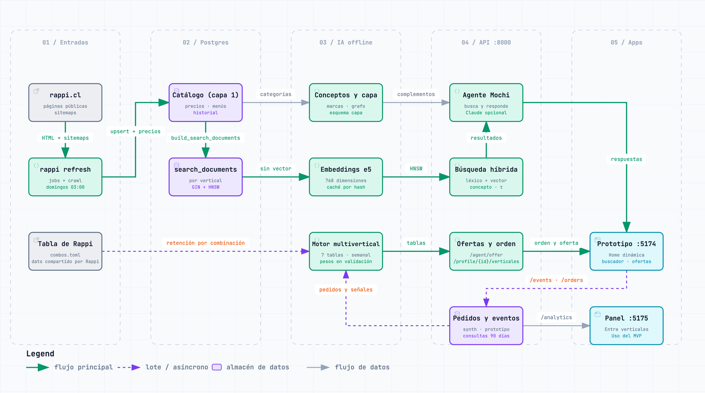

# rappi-ia

Conecta el catálogo que descarga [`rappi-scraper`](../rappi-scraper/) con el asistente **Mochi** del [prototipo](../prototipo-app/). Diseño completo en [docs/diseno-ia.md](../docs/diseno-ia.md).

**Regla:** *buscar dentro del vertical, entender al usuario a través de los verticales*. La búsqueda nunca mezcla verticales. El puente entre ellos son los **conceptos**: una taxonomía propia de 136 conceptos (116 tipos de producto en 20 grupos), con 240 complementos curados entre sí (contados el 16-10-2026; cada concepto que se puede ofrecer tiene al menos dos). Una recomendación cruzada va del concepto que le interesa al usuario a su complemento, y de ahí a una búsqueda en el otro vertical (p. ej., cerveza en licores → snacks salados de otra tienda).



Versión interactiva: [rag-datos.html](../docs/diagramas/rag-datos.html). Vista por carriles: [arquitectura-ia.png](../docs/diagramas/arquitectura-ia.png) ([interactiva](../docs/diagramas/arquitectura-ia.html)). Los HTML se descargan y se abren en el navegador.

| Pieza | Qué hace | Dónde |
|---|---|---|
| Conceptos (capa 2) | Cada producto y plato → un concepto, con procedencia: categoría (mapa de categorías revisadas, cuántas en [README.md#resultados](../README.md#resultados), generado con LLM: dos etiquetadores trabajan por separado y un juez decide cuando no coinciden; 21 ajustes a mano; versionado en `category_map.csv`), reglas por palabra o vecinos cercanos (kNN) | `concepts/` |
| Jev (opcional) | Etiqueta categorías nuevas y juzga la búsqueda, solo fuera de línea y solo con clave, adopción y piloto aprobado; sin ellos nada cambia | `jev.py`, `concepts/jev_map.py`, `eval/judge.py`, `eval/jev_pilot.py` |
| Embeddings | Texto con `intfloat/multilingual-e5-base` (768 dim, caché por contenido, índice HNSW por vertical) | `embeddings/` |
| Búsqueda híbrida | Léxico (sin tildes ni ñ, IDF) + vectorial → RRF → refuerzo por concepto, con filtros dentro de cada lista y regla de "sin resultado" | `retrieval/hybrid.py` |
| Mochi | Entender → buscar → sugerir un complemento de otro vertical → redactar (plantillas o Claude) → verificar | `agent/` |
| Eventos y analítica | Usuarios y eventos (**simulados** o del prototipo, nunca mezclados), métricas de frecuencia, abandono, oportunidades y afinidad | `events/`, `analytics/` |
| Capa de datos | Atributos, medidas, marcas, grafo y segmentos en el esquema `capa` ([docs/capa-de-datos.md](../docs/capa-de-datos.md)) | `layers/` |
| Motor multivertical | Afinidad de cada persona por vertical, transiciones, combinaciones con su retención (la tabla de Rappi en `combos.toml`), compra cruzada, tendencias y recompra; el orden de la Home y la evaluación por fechas ([docs/capa-de-datos.md](../docs/capa-de-datos.md#motor-multivertical)) | `motor/` |
| Ofertas | Lo que Mochi propone en cada momento de la app, con su razón y su fuente (`basis`), las guardias (sin alcohol, Farmacia, bebé ni salud por iniciativa propia) y los perfiles de gusto | `offers/` |

## Instalar

Desde la raíz del repositorio (requiere la base de [`rappi-scraper`](../rappi-scraper/)):

```bash
cd rappi-ia
make install      # .venv + rappi-scraper (esquema) + API + tests
make install-ml   # modelo local de texto: e5 (y Claude opcional)
make db-test      # base rappi_ia_test (los tests no tocan rappi ni rappi_test)
make migrate
```

Las versiones de las librerías están fijadas en `requirements.lock.txt` (las del equipo que calculó los embeddings de la base): `make install` e `install-ml` no instalan otras. Un job de CI semanal (`.github/workflows/modelos-semanal.yml`) instala los modelos con esas versiones y comprueba que e5 embebe. El modelo de texto (e5, ~1 GB) se descarga de Hugging Face la primera vez que se usa. La API lo carga al arrancar: hay que esperar a "Application startup complete" (con el modelo ya en caché, `make serve` arranca sin consultar Hugging Face; `RAPPI_IA_LIGHT=1` arranca sin modelos). Para que Claude redacte las respuestas, agrega `ANTHROPIC_API_KEY` en `.env`; sin clave, el agente responde con plantillas y las mismas reglas. El nombre que ve el usuario sale de `AGENT_NAME` (por defecto, Mochi). Otras variables en `.env.example`.

## Correr

Después de cada `rappi refresh` del scraper:

```bash
make post-refresh                 # migrate + purge + jev-categorias + concepts + embed + eval + synth + layers + prune-embeddings + purge
./scripts/despues-del-refresh.sh  # lo mismo, pero espera a que termine un `rappi refresh` lanzado a mano
```

La tarea semanal del scraper (`make schedule` en `rappi-scraper/`) ya lo hace sola. Ninguno de los dos guarda τ: eso es a mano, con `make eval GUARDAR_TAU=1`.

| Objetivo | Qué hace |
|---|---|
| `make jev-categorias` | Jev etiqueta las categorías nuevas (`map-categories --jev --solo-nuevas`). Opcional: sin `TYPESAFE_API_KEY` o sin `eval/jev-adopcion.json` no hace nada y termina bien. Va antes de `concepts` en `post-refresh` (guía en [docs/jev.md](../docs/jev.md)) |
| `make concepts` | Capa 2: conceptos por producto y plato (con kNN si está el extra `ml`) |
| `make embed` | Embeddings de texto (incrementales) + índices HNSW por vertical. No corre si hay una descarga del scraper en curso |
| `make prune-embeddings` | Borra del caché `text_embeddings` los vectores de más de 7 días que no usa ningún documento de búsqueda ni el kNN de conceptos (los nombres de productos y platos). Un hash en uso conserva sus vectores de todos los modelos, también los de un modelo viejo. Va al final de `post-refresh` (después de `layers`: si falla, lo demás ya quedó al día). Corre `ANALYZE`; el espacio lo reusa autovacuum, y para devolverlo al disco hay que correr `VACUUM FULL text_embeddings` a mano (la salida lo sugiere desde 10.000 borrados) |
| `make eval` | Evalúa la búsqueda (léxico, vectorial, híbrido y ablación sin refuerzo), propone τ y deja el reporte en `data/eval/busqueda.md`. `make eval GUARDAR_TAU=1` además guarda τ en `src/rappi_ia/eval/thresholds.json` (solo en verticales con negativas que dependen de τ; los demás conservan el suyo): está en git, así que después se revisa el cambio y se hace commit. Con `--jev-auto` (lo que usa `make eval`) suma a Jev como tercer juez solo si hay clave y adopción |
| `make synth` | Usuarios y eventos **simulados** para métricas y segmentos (3.000 usuarios × 26 semanas, semilla 7; reemplaza los anteriores) |
| `make purge` | Borra el texto de las consultas y los elementos vistos de las impresiones (`app_event_items`; queda el evento `list_view`) con más de 90 días, y a las personas del prototipo sin actividad en 180 (`PROTOTYPE_USER_RETENTION_DAYS`) |
| `make layers` / `make layer-report` | Capa de datos (medidas, marcas, canónicos, atributos, grafo, segmentos y motor) / su reporte de calidad |
| `make motor` | Motor multivertical (`rappi-ia motor --source synthetic` o `prototype`; sin `--source`, las dos): transiciones entre verticales, combinaciones de grupos con su retención, compra cruzada, tendencias, y la afinidad y la recompra de cada persona; además evalúa por fechas contra líneas base, elige solo los pesos del próximo vertical y escribe un informe por fuente en `data/eval/motor-{fuente}.md` (`--sin-evaluar` lo salta y deja los pesos anteriores). La población de la que aprende la predicción es `MOTOR_POBLACION` (por defecto `synthetic`). La afinidad y la recompra de una persona del prototipo se recalculan solas después de cada pedido y de "Olvidar" ([docs/capa-de-datos.md](../docs/capa-de-datos.md#motor-multivertical)) |
| `make migrate` / `make db-test` | Aplica las migraciones pendientes / crea la base de tests `rappi_ia_test` |
| `make dump-entrega` | Respaldo para pasarle la base a otro equipo, sin las personas del prototipo (ver [Respaldo de entrega](#respaldo-de-entrega)) |
| `make deploy-migrate` | El paso de migrar de un despliegue: respalda si hay pendientes (`pre-migracion_<fecha>.dump`), migra y, con `DB_API_ROLE`, aplica los permisos de la API ([docs/despliegue.md](../docs/despliegue.md)) |
| `make analytics` | Resumen de las métricas de negocio en la terminal |
| `make contract` | Reescribe las respuestas de ejemplo de la API para la app y el panel (el CI falla si quedan desactualizadas) |
| `make warm` | Calienta la API antes de una demo |
| `make probar-agente` | Prueba al agente con frases de usuarios ([docs/probar-agente.md](../docs/probar-agente.md)) |
| `make serve` / `make serve-lan` | API local / abierta a la red local (ver Seguridad) |
| `make test`, `make lint`, `make format` | Tests, revisión de estilo y formato |

`make help` lista todos los objetivos. Otros comandos:

- `rappi-ia search "algo para el carrete" --vertical licores`
- `rappi-ia concepts --solo-reporte`: cobertura sin recalcular; también lista las categorías sin mapeo revisado (las nuevas de cada semana). Las revisadas sin concepto (filas "ninguno" de `category_map.csv`) no vuelven a aparecer.
- `rappi-ia map-categories`: exporta las categorías sin mapeo revisado a `data/concepts/categorias-sin-mapear.csv`, con el formato de `category_map.csv` y un concepto sugerido cuando al menos la mitad de sus productos ya lo tiene (reglas o kNN). Se revisa cada fila, se cambia el método a "curado" y se copia al mapa versionado.
- `rappi-ia eval-sample`: arma la muestra de 200 pares (consulta, producto) para juzgar a mano (`src/rappi_ia/eval/judgments-sample.json`, con semilla fija): 120 donde el híbrido con y sin refuerzo por concepto difieren en el top 10 y 80 al azar. Se juzga a ciegas en una página privada del autor (sin mostrar el juez automático ni el modo); los juicios se copian a `src/rappi_ia/eval/judgments.json`, que todavía no existe. Desde el 11-10-2026 el camino recomendado es la planilla de `jev-planillas` (CSV, sin página aparte), que `eval-human` lee primero; `judgments.json` queda para la muestra antigua.
- `rappi-ia jev-planillas`: deja en `data/eval/` dos planillas CSV para juzgar a mano (200 pares de búsqueda y 100 categorías) con su `LEEME-planillas.md`; los textos no van a git, solo los ids. `--forzar` pisa planillas ya llenas.
- `rappi-ia jev-piloto`: con `TYPESAFE_API_KEY` y las planillas juzgadas, mide a Jev como etiquetador de categorías y como juez, escribe `data/eval/jev-piloto.md` y, si pasa, la propuesta `eval/jev-adopcion.propuesta.json` (se adopta renombrándola a `jev-adopcion.json` y subiéndola a git).
- `rappi-ia map-categories --jev [--solo-nuevas] [--exportar]`: Jev propone el concepto de las categorías sin mapeo revisado (solo con clave y adopción); `--exportar` lista sus mapeos y su cola de revisión en un CSV para pasarlos a `category_map.csv`.
- `rappi-ia eval-search --juez-jev`: suma a Jev como juez (exige la clave). `--jev-auto` lo suma solo si hay clave y adopción, y si no sigue sin él.
- `rappi-ia eval-typos`: los errores de tipeo de `src/rappi_ia/eval/typos.json`, buscados sin corregir y corrigiendo, y las negativas de `queries.json` con la corrección; también mide a Mochi (`/agent/ask` en la vertical del caso: "antes" es `RappiAgent(correct_typos=False)`); escribe `data/eval/tipeo.md`.
- `rappi-ia eval-graded`: lo que ve la persona (`/search` de una vertical) en las consultas con pares juzgados, puntuado con el juicio LLM de tres niveles (no humano; `src/rappi_ia/eval/graded.py`): nDCG@10, P@3 "sirve", útil@3 y lo mostrado que no sirve; escribe `data/eval/tres-niveles.md` y deja en `data/eval/pendientes-tres-niveles.csv` los pares mostrados sin juicio (sin el concepto ni la posición, para juzgarlos a ciegas). `--importar` suma esa planilla juzgada a `eval/juicio-llm-complemento.json` (solo ids), `--guardar-listas` guarda lo que mostró la búsqueda y `--listas` lo vuelve a puntuar ([reporte del 25-10](../docs/resultados/busqueda-2026-10-25.md)). `eval-search` suma la misma tabla al final de su reporte. Si faltan juicios, el reporte lo avisa primero ("N productos sin juicio: la cifra total no es comparable") y da aparte las consultas juzgadas completas.
- `make eval-check` (`rappi-ia eval-graded --revisar` y después `rappi-ia eval-mochi --revisar`): compara lo que muestra hoy la búsqueda con las últimas listas guardadas (`src/rappi_ia/eval/tres-niveles-listas-*.json`, la más reciente por la fecha del nombre) y falla si una consulta pierde un "sirve" de sus 3 primeros (uno sin juicio cuenta como que no sirve: se juzga y se suma con `--importar`) o muestra menos productos. **Se corre antes de fusionar un cambio en `retrieval/` o `agent/`**: el CI no tiene el catálogo real. Va sobre la misma copia con que se guardaron las listas (`DATABASE_URL=postgresql:///rappi_staging make eval-check`); en otra base, las diferencias pueden ser del catálogo. Si el cambio mejora algo a propósito, se guardan las listas nuevas con `--guardar-listas src/rappi_ia/eval/tres-niveles-listas-AAAA-MM-DD.json`. Mochi se compara igual con su última corrida guardada (`src/rappi_ia/eval/mochi-listas-*.json`, siempre con plantillas): lo mismo en las necesidades; en las otras frases, caso por caso, si una muestra menos productos, y en todas, si una pasa a menos de la mitad de lo anunciado. Además falla si un texto contradice lo mostrado, dice un "No hay" falso o repite un producto (tienen que ser 0), o si suben en total las respuestas con menos de 4 productos, con menos de la mitad de lo anunciado o sin productos (la corrida del 06-11 tiene 3, 2 y 5: las cortas y los consejos médicos son a propósito; ver el [reporte del 05-11](../docs/resultados/mochi-2026-11-05.md)). Su corrida nueva se guarda con `rappi-ia eval-mochi --guardar-listas src/rappi_ia/eval/mochi-listas-AAAA-MM-DD.json`.
- `rappi-ia eval-mochi`: Mochi (`/agent/ask`, primer turno) en las necesidades de `queries.json`, las preguntas libres, el primer turno de las conversaciones y un set apartado que no se usa para ajustar (`src/rappi_ia/eval/mochi-heldout.json`): revisiones automáticas sin juez (que el texto anuncie lo que se muestra, que no diga "En X no hay…" si la búsqueda de X lo trae, duplicados y cuántos productos muestra) y, en las necesidades, el juicio LLM de tres niveles de Mochi y de `/search` (nDCG@6, P@3, con la diferencia consulta por consulta y su IC 95 % por bootstrap); solo lee la base y escribe `data/eval/mochi.md`, con los pares sin juicio en `data/eval/pendientes-mochi.csv` ([reporte del 05-11](../docs/resultados/mochi-2026-11-05.md)).
- `rappi-ia eval-human`: con esos juicios, cuánto acierta el juez automático (precisión, recall, acuerdo) y si los ítems que solo trae el refuerzo son relevantes más o menos seguido que los que solo trae sin él.
- `rappi-ia resumen-api --log ~/rappi-tunel/logs/api.log [--dia AAAA-MM-DD]`: el resumen de un día de la API (por defecto, ayer en Chile) desde su registro: peticiones por ruta con promedio, máximo y las de más de 1 s, los errores 5xx con su `request_id` y las personas nuevas del prototipo. Solo lee. Lo corre cada mañana `deploy/macos/resumen.sh`.
- `rappi-ia resumen-prueba proto-… [proto-…]` o `--desde AAAA-MM-DD[THH:MM]` (hora de Santiago): para una prueba con personas, un Markdown por persona del prototipo en `data/prueba-usuarios/` (`--salida` cambia la carpeta) con sus sesiones, búsquedas (sin resultado o corregidas), ofertas de Mochi (mostradas, aceptadas o rechazadas, con su momento), el recorrido por verticales (la primera que tocó y cada una nueva, con la hora y el camino: acceso de la Home, Mochi o buscador; si llegó por otro, la oferta de Mochi de esa vertical que vio en los 30 minutos anteriores), verticales abiertas y con pedido, si ocultó a Mochi y sus pedidos. Solo lee (la conexión es de solo lectura) y solo personas `prototype`: un id simulado se salta. Con `--desde`, las creadas desde esa hora con algún evento. "Borrar mis datos" borra a la persona en el servidor, así que el resumen va antes ([docs/prueba-usuarios.md](../docs/prueba-usuarios.md#6-cómo-anotar-a-cada-participante)).
- `rappi-ia olvidar proto-… [proto-…] [--si]`: borra a personas del prototipo por id, lo mismo que "Borrar mis datos" de la app (DELETE /profile): dice cuántos eventos, pedidos y sesiones tiene cada una y pide confirmación (`--si` no la pide). Si un id es de una simulada o no existe, no borra a ninguna. Es el último paso de una prueba con personas, después de los resúmenes.
- `rappi-ia multivertical`: regenera el mapa multivertical (`docs/mapas/mapa-multivertical.html` y la copia que sirve el panel, `dashboard-empresa/public/presentacion/`): productos compartidos entre verticales, conceptos junto a la vertical donde son más típicos (la regla de Mochi) y los productos y cadenas en más verticales. Página autocontenida, sin internet. La imagen `mapa-conceptos.jpg` se captura de esa página con `#figura` al final de la URL.

## API (`make serve` → http://localhost:8000/docs)

| Endpoint | Para qué |
|---|---|
| `GET /live` · `GET /health` | El proceso responde (sin mirar la base) · lista para atender: 200 con capacidades y documentos, o 503 con `motivos` (`base`, `saturada`, `sin_documentos`, `migraciones_pendientes`, `busqueda_semantica`) |
| `POST /session` | Sesión anónima: `{legacy_user_id?}` → `{user_id, token}`. El token va en la cabecera `X-User-Token` de toda ruta con datos de una persona (401 sin él, 403 con el de otra) |
| `POST /agent/ask` | El agente (Mochi): `{message, vertical?, user_id?, session_id?, profile?, shown_topics?, mode, previous?}`. Acepta los ids de vertical del prototipo (`liquor`, `grocery`…). `previous` es el turno anterior que la app manda al tocar un chip (la API no guarda la conversación). Si Mochi corrigió el tipeo, la respuesta trae `corrected_query` y el texto empieza con `Busqué "…".` |
| `POST /agent/offer` · `GET /agent/plans` | Lo que el agente propone en cada momento de la app (`plan`, `carrito`, `checkout`, `proximo_pedido`, `sin_resultado`, `vertical_por_probar` (el siguiente paso de la escalera de combinaciones, Restaurantes → Turbo → Retail, con su razón en `basis`), `recompra` ("¿Repetimos …?", cuando le toca a un concepto que la persona pide con ritmo), `volver` ("¿Volvemos a …?", lo que pedía con ritmo y dejó: un concepto atrasado más de un intervalo o una vertical que dejó; `offers/winback.py`) `perfil`: la escalera de un perfil de gusto, y `ontop`: lo que se suma de Turbo mientras llega un pedido de otra vertical; 204 si no hay una buena oferta, 422 con un perfil desconocido) · las ocasiones de la Home con su kit |
| `GET /catalog/home` · `/catalog/verticals/{vertical}/stores` · `/catalog/stores/{store_id}` · `/catalog/products/{entity_type}/{entity_id}` · `/catalog/restaurants` · `/catalog/restaurants/{store_id}/menu` · `/catalog/deals` | Las pantallas de catálogo del prototipo (Home, verticales, tienda, producto, restaurantes, menú, ofertas), con el precio vigente. El listado de una tienda dice qué está agotado (`available`, `stock`); `/catalog/restaurants` filtra (`max_eta`, `min_rating`, `top`, `promo`), ordena y dice si cada uno está abierto según su horario publicado. `/catalog/home` dice además de qué fecha son los precios (`catalogo`: el día del más antiguo y del más nuevo, en hora de Chile, en todo el catálogo y por vertical; los mismos precios vigentes que muestra la app) |
| `GET /catalog/terms?stores=…` | Las condiciones de compra de cada tienda: envío, compra mínima y tarifa del catálogo (null si la descarga no las trae), y el horario de hoy y mañana para programar |
| `POST /catalog/availability` | "Pídelo de nuevo": qué líneas de un pedido anterior siguen a la venta en la misma tienda, con el precio de hoy |
| `GET /catalog/products/{entity_type}/{entity_id}/stores` | "Disponible en N tiendas": el mismo producto en otras tiendas de la ciudad de la demo (`PROFILE_CITY`), más la tienda abierta aunque sea de otra ciudad, con precio, tiempo y envío publicados; con `store_id` y `sustitutos=true`, los similares del mismo concepto en esa tienda (el agotado de la ficha y los cambios en vivo) |
| `GET /catalog/stores/{store_id}/para-ti` | "Para ti" dentro de una tienda (solo en la propuesta): lo que tiene de los intereses de la persona, con las guardias de las ofertas y su dieta y alergias |
| `GET /search` | Búsqueda híbrida en un vertical, con precios vigentes. Con `user_id` (y su token), la dieta y las alergias de la persona filtran (`preferences_notice`) |
| `GET /recommendations` | "Para ti, de otras tiendas": intereses → complementos → otro vertical |
| `GET /profile/{id}` · `DELETE /profile/{id}` | Lo aprendido (sin sensibles) · "Olvidar" (todo o un concepto) |
| `GET /profile/{id}/verticales` | El orden de los accesos de la Home: `{fixed, order: [{id, score, reason}], personalized}`. Restaurantes y Turbo van fijos; los otros seis, por lo que la persona más usa (sin historial, el orden de siempre) |
| `GET /profile/{id}/busquedas` | Las búsquedas recientes de la persona y "Lo más buscado" de `MOTOR_POBLACION` (al menos 3 personas, sin lo que las guardias no proponen), con la población declarada |
| `GET /profile/{id}/gustos` | Los perfiles de gusto de la persona (por ejemplo "🥢 Amante de lo asiático"): `{perfiles: [{id, nombre, emoji, nivel, principal, por_que, basis}]}`, o la lista vacía. Salen de sus segmentos y "Olvidar" los quita |
| `GET /profile/{id}/preferencias` · `PUT /profile/{id}/preferencias` | Las preferencias explícitas con Mochi (migración 045): `{preferencias: [{tipo, valor, nombre}], opciones}`; el PUT reemplaza la lista (vacía, las borra). La dieta y las alergias solo filtran lo que Mochi muestra y ofrece, y lo que encuentra `/search` con `user_id` (`preferences_notice` lo dice); las cocinas y tiendas favoritas solo ordenan (en `/search`, tampoco eso). La app las elige en una hoja; si llegan escritas por el buscador ("soy vegetariano", "olvida mis preferencias"), `/agent/ask` también las entiende |
| `GET /profile/{id}/autonomia` · `PUT /profile/{id}/autonomia` · `DELETE /profile/{id}/autonomia` | "Pedir por mí" (migración 049): `{modo: 'revisar' \| 'pedir', tiendas, tope, opciones}`. El PUT lo enciende con las tiendas (de las que ya pidió) y el tope por pedido; el DELETE lo apaga. "Pide lo de siempre en…" (un botón de la recompra, o escrito en el buscador) trae `autopedido` (lo de siempre y si Mochi lo pide solo o deja revisar, con el motivo); el pedido llega a `POST /orders` con `autopedido` y la API vuelve a revisar cada límite (409 si no pasa) |
| `POST /events` · `POST /orders` | Eventos y pedidos del prototipo (`source = prototype`). Cada evento lleva su sobre (id, hora y orden del cliente, desde dónde y el `request_id` de la respuesta de donde salió) y un evento repetido (mismo `client_event_id`) no entra dos veces; el lote cuenta su sesión (`session`: versión, plataforma, modo y entrada, en `app_sessions`). Un pedido es de una sola tienda y lleva, si se programa, su franja (`scheduled_for`, hoy o mañana) y su tipo de entrega; un pedido sin vertical del catálogo o con líneas de dos tiendas es un 400. `order_cancelled` deja el pedido `cancelado` y deja de contar. Ya respondido, la API recalcula los segmentos, la afinidad y la recompra de esa persona |
| `POST /events/beacon` | Lo que queda en cola al cerrar la pestaña (`sendBeacon`, text/plain: sin preflight de CORS) |
| `GET /analytics/{kpis, weekly, opportunities, trends, funnel, cohorts, rhythm, at-risk, suggestions, multi-vertical, affinity, assortment, services, catalog, offers, volver, unmet, combos, motor, home, pro, ctr-posicion, embudo-sesion, presencia, experimentos}` | Métricas de negocio (las muestra el [panel](../dashboard-empresa/), parte del MVP). `pro`: Pro y sin Pro (`app_users.pro`) con pedidos, recompra, multi-vertical y retención, 20 personas como mínimo por grupo. Desde el 22-10-2026 el panel no lee `funnel`, `cohorts`, `rhythm`, `multi-vertical`, `affinity`, `catalog` ni `home`, que siguen en la API. `offers` (con los pedidos de "Pedir por mí" aparte, `autopedidos`), `volver` (a quién invitar a volver) y `unmet` muestran el uso del MVP con la fuente del prototipo; `unmet` trae además el abandono de búsqueda (`abandono`: con toque, rescatadas al reformular y abandonadas, por el `request_id` de cada búsqueda). `presencia`: si Mochi molesta, en 30 días (quién lo tiene oculto, qué % de las personas activas, quién lo trajo de vuelta y sus explicaciones de la Home). `experimentos`: por experimento y variante, dentro de una sola población, las personas asignadas, con pedido y las verticales por persona desde su asignación (lo lee la pestaña Experimentos del panel). `ctr-posicion` y `embudo-sesion` salen de las impresiones (`capa.v_ctr_posicion` y `capa.v_embudo_sesion`). Ninguna cuenta un pedido cancelado |
| `GET /concepts` | Taxonomía de conceptos (id, nombre, emoji, grupo y si es sensible) con su versión |

**Seguridad.** En local (`API_ENV=local`, por defecto) es una demo sin puerta de acceso:
- **Por defecto:** `make serve` escucha solo en el equipo local (`127.0.0.1`).
- **Para el iPhone:** `make serve-lan` abre la API a la red local. Solo en una red de confianza.
- **CORS:** por defecto solo acepta `localhost` y `127.0.0.1` en los puertos 51xx; con `serve-lan`, también 192.168/16, 10/8, 172.16/12 (el hotspot del iPhone) y nombres `.local`.
- **Identidad:** los datos de cada persona piden su token (`POST /session`, `X-User-Token`), también en local; sin `API_SECRET`, la API crea una vez `data/api-secret` (fuera de git).
- **Límites:** cupos por ruta cara (503), cuerpo máximo (413) y requests por IP (429; este equipo no tiene tope en local).
- **Tiempos:** Claude tiene 6 s (si no, responde la plantilla); la conexión a Postgres, 3 s, y cada consulta, 5 s (30 s en `/analytics/*`; `API_TIMEOUT_INTERACTIVE_MS` y `API_TIMEOUT_ANALYTICS_MS`). Con la base caída, la API responde 503, y con una consulta que pasa su tope, 504.
- **En un servidor** (`API_ENV=production`): detrás de Caddy con TLS y puerta de acceso, CORS exacto, sin `/docs` ni `/analytics` salvo que se enciendan, `API_SECRET` obligatorio y la API nunca migra. Ver [docs/despliegue.md](../docs/despliegue.md).

**Variables principales** (todas en `.env.example`; la lista completa, con servicio y si es secreta, en [docs/despliegue.md §2](../docs/despliegue.md#2-variables-de-entorno)):

| Variable | Local | Producción |
|---|---|---|
| `API_ENV` | `local` | `production` |
| `API_SECRET` | se crea en `data/api-secret` | obligatoria (`openssl rand -hex 32`) |
| `API_CORS_ORIGINS` | `localhost` y `127.0.0.1` en los puertos 51xx | exactamente estos orígenes (el stack pone `https://<dominio>`) |
| `API_ENABLE_ANALYTICS` / `API_DOCS` | `1` / `1` | `0` / `0` |
| `API_POOL_MAX` · `API_POOL_TIMEOUT_S` | `10` · `3` | igual |
| `API_PREWARM` | `1`: precarga los índices de la búsqueda al arrancar, sin esperarla, y mantiene caliente la caché del catálogo (la Home, las ofertas, las tiendas por vertical) renovándola antes de que venza | igual |
| `API_RATE_PER_MIN` · `API_RATE_WRITE_PER_MIN` · `API_NEW_USERS_PER_IP_DAY` | `120` · `60` · `20` (este equipo sin tope) | igual, para todas las IP |
| `API_REQUIRE_SEMANTIC` | `0` | `1` en el stack |
| `LLM_DAILY_CALL_CAP` | `300` | igual |
| `LOG_LEVEL` | `INFO` | igual |
| `PROFILE_CITY` | `Santiago de Chile`: la ciudad de la demo. Las listas de restaurantes y de tiendas (las de una vertical, "Cerca de ti", las ofertas de las pantallas y "Disponible en N tiendas") son de ella, y también las tiendas y los locales de lo que ofrece Mochi (`POST /agent/offer`) y los restaurantes de un perfil de gusto cuando la persona no tiene ciudad; la búsqueda y las respuestas de Mochi muestran un producto con la tienda de ella si alguna lo vende, y lo de ella antes que lo que solo se vende en otra ciudad. Tiene que ser una ciudad de `stores.city` como la escribe el scraper ("Viña del Mar", "Concepcion"; otra ciudad vale como su comuna); si ningún local calza, la API lo avisa al arrancar y esas listas salen vacías. Se cambia junto con `MVP_HOME_LAT` y `MVP_HOME_LNG`, que siguen midiendo "Cerca de ti" desde Providencia | igual |
| `PROTOTYPE_USER_RETENTION_DAYS` | `180` | igual |
| `RAPPI_ENV_FILE` · `RAPPI_IA_DATA_DIR` | `.env` · `data/` | `/etc/rappi/rappi.env` · `/data/ia` |

**Privacidad:**
- **Datos personales en consultas:** se redactan antes de guardarlas (RUT con dígito verificador, teléfonos, correos, direcciones y tarjetas) y el texto se borra a los 90 días (`make purge`).
- **"Olvidar" / "Borrar mis datos"** (`DELETE /profile/{id}`): borra a la persona entera, con su perfil, sus eventos y sus pedidos (en cascada).
- **Personas inactivas:** las del prototipo sin eventos ni pedidos en 180 días se borran (`make purge`, `PROTOTYPE_USER_RETENTION_DAYS`).
- **Sensibles:** los conceptos sensibles no entran al perfil ni a las métricas de negocio.
- **Claude:** si hay clave, recibe solo hechos estructurados, nunca la consulta del usuario.

## Resultados

Las cifras vigentes (catálogo, búsqueda, precisión de conceptos y de la capa de datos, tests) están en [README.md#resultados](../README.md#resultados); cada reporte fechado, en [docs/resultados/](../docs/resultados/). Aquí solo queda cómo leerlas. `make eval` regenera el reporte de la búsqueda.

### Búsqueda

**Set:** 131 consultas positivas en los 8 verticales y 58 negativas (al menos 5 por vertical, verificadas contra el catálogo completo el 29-09 y el 22-10), en [`src/rappi_ia/eval/queries.json`](src/rappi_ia/eval/queries.json). La relevancia se juzga automáticamente por concepto: un resultado es relevante si su concepto es uno de los esperados para la consulta. El reporte trae la comparación pareada completa (léxico, vectorial, híbrido y la ablación sin refuerzo por concepto), por tipo de consulta y por vertical.

**"Sin resultado"** (demanda no satisfecha), sobre las 58 consultas negativas y con los τ de `src/rappi_ia/eval/thresholds.json`. El reporte dice por qué se detecta o no cada una. Las cifras del reporte son de la búsqueda (`retrieve`); Mochi anota la demanda cuando la búsqueda la marca y no muestra ningún producto. Desde el 18-10-2026 tampoco muestra los pocos productos de un concepto con surtido testimonial bajo el 1 % del vertical (solían ser otra cosa con su etiqueta, como un cable HDMI para "televisor 55 pulgadas" en Turbo), así que las dos cifras casi coinciden.

- **Regla:** es un "sin resultado" cuando nada calza todas las palabras y, además, se cumple la condición que corresponda:
  - si la consulta nombra un concepto, ese concepto no tiene surtido real en el vertical;
  - si no nombra ninguno, el coseno queda bajo τ: el del vertical si nombra una ocasión ("regalo para mi polola"), y 0,85 (`UNNAMED_TAU`, el de la búsqueda agrupada) si no nombra concepto ni ocasión. Con el τ del vertical, "sofá de tres cuerpos" en Turbo (0,821 ≥ 0,79) mostraba pisco Tres Erres. Una consulta sin palabras que buscar, como "té", que es stopword, o "quiero té porfa", no se marca.
- **Coincidencias casuales:** "pizza familiar" encuentra un horno para pizza en Mall. Es un límite real de la regla léxica estricta.
- **Límite conocido:** "neumáticos" y "televisor 55 pulgadas" en conveniencia y "bicicleta aro 29" en el súper no cuentan como "sin resultado", porque el vertical tiene el concepto para otra cosa (artículos para el auto, una antena, bicicletas de equilibrio para niños).
- **Costo de la regla sin concepto ni ocasión, y su arreglo:** un error de tipeo que no nombra concepto ("cervezaaaa", "nutela") dejó de mostrar los vecinos vectoriales. Desde el 24-10-2026, si nada calza todas las palabras, `/search` corrige la consulta con el vocabulario del catálogo (`retrieval/spelling.py`, tabla `search_vocabulary` de la migración 041) y vuelve a buscar con estas mismas reglas; lo corregido se muestra solo si algún documento calza todas sus palabras, y la respuesta lo dice (`corrected_query`). `rappi-ia eval-typos` mide el set de [`src/rappi_ia/eval/typos.json`](src/rappi_ia/eval/typos.json) (53 errores de tipeo), por vertical y en la agrupada, y que las negativas sigan sin resultado ([reporte del 24-10](../docs/resultados/busqueda-2026-10-24.md)), y a Mochi desde el 04-11 ([reporte](../docs/resultados/tipeo-2026-11-04.md)).

**Salvedades:**

- **Refuerzo por concepto:** el híbrido recibe un refuerzo por el mismo concepto con que se juzga la relevancia; sin él, no se distingue del vectorial (la diferencia no es concluyente, con su intervalo en el reporte).
- **Juez automático:** la relevancia depende de la asignación de conceptos, cuya precisión es una estimación con jueces LLM. No hay juicio humano todavía: la planilla de 200 pares está en `jev-planillas` y faltan los juicios.
- **Set chico:** 131 consultas positivas, con pocas por vertical (8 en chocolatería).

### Conceptos (capa 2)

La cobertura por vertical sale de `rappi-ia concepts --solo-reporte`. La precisión de la asignación (por regla de nombre, por mapeo de categoría y por vecinos) es una **estimación** con jueces LLM sobre una muestra versionada del catálogo completo; los reportes están en [docs/resultados/](../docs/resultados/) y las cifras, en el README.

### Calidad

- **Revisión:** el 27-09-2026, tres rondas de revisión de lógica, seguridad y privacidad, frontend, rendimiento y contratos entre piezas: 66 hallazgos confirmados y corregidos, con tests de regresión. El 28-09 hubo una auditoría, cuyos 4 bloques de mejoras se aplicaron el 29 y 30-09, el 11-10 una revisión integral del MVP y el 26-10 una revisión de todo el repositorio, con sus correcciones en los PR #21 a #24 (ver [docs/decisiones.md](../docs/decisiones.md) y el [README](../README.md#cambios-desde-el-25-10-2026)).
- **Tests:** las cifras vigentes están en [README.md#resultados](../README.md#resultados) (fila "Tests"); los de integración corren contra la base `rappi_ia_test`. CI en GitHub Actions (`.github/workflows/ci.yml`) con Postgres + pgvector y las versiones de `requirements.lock.txt`, en tres partes con su propia base cada una (`RAPPI_IA_TEST_SHARD=N/3` reparte los archivos; sin la variable, `make test` corre todo); un job semanal (`modelos-semanal.yml`) instala los modelos.
- **Candado de la base de prueba:** `make test`, `make contract` y `make mvp-check` (raíz) toman `.git/rappi-ia-test-db.lock` (en la carpeta común de git: lo comparten los worktrees; fuera de git, `rappi-ia/.test-db.lock`) para no pisarse en `rappi_ia_test`; correr `pytest` directamente se salta el candado, así que no lo lances mientras corre alguno de ellos.
- **Optimizaciones del 28-09-2026:** textos por embeber ordenados por largo, índices HNSW con `maintenance_work_mem` de 1 GB (`HNSW_MAINTENANCE_WORK_MEM`) y kNN de conceptos que lee los vectores del caché en binario y por bloques.

## Respaldo de entrega

`make dump-entrega` arma, en `data/entrega/entrega_<fecha>/`, la base lista para entregar: el catálogo (tiendas, productos, menús y precios), los conceptos, las capas de datos, los embeddings y documentos de búsqueda, y la población simulada (`source = 'synthetic'`). **No** lleva a las personas del prototipo (`source = 'prototype'`), ni sus eventos, búsquedas y pedidos, ni lo que el motor y el grafo aprendieron de ellas (`data_source = 'prototype'`). Lee `DATABASE_URL` sin escribir en ella (para probarlo, `DATABASE_URL=postgresql:///rappi_staging make dump-entrega`).

Todo sale de una sola foto de la base: una transacción de solo lectura exporta su snapshot, `pg_dump` vuelca con él todo salvo los datos de las tablas de personas (`PERSON_TABLES` en `src/rappi_ia/delivery.py`) y la misma transacción copia de esas tablas solo las filas simuladas. Nada del prototipo pasa por un archivo. Si una migración agrega una tabla con `user_id`, `session_id` o `data_source`, o con una clave foránea hacia las tablas de personas, que no está en `PERSON_TABLES`, el comando se niega a armar el respaldo. Del registro de corridas de las capas (`layer_runs`) quedan fuera las del motor sobre el prototipo (sus conteos y pesos). La carpeta trae:

| Archivo | Qué es |
|---|---|
| `catalogo.dump` | `pg_dump` en formato custom, sin dueño ni permisos, con las tablas de personas vacías |
| `poblacion-simulada.sql` | Las filas simuladas de esas tablas, para `psql` |
| `LEEME.txt` | Qué trae (con los conteos), qué quedó fuera y cómo restaurarlo |

Para restaurarlo, en Postgres 17 con pgvector 0.8, en este orden: las tablas y el catálogo, la población, y al final los índices, las claves foráneas y los triggers (así validan todo junto):

```bash
createdb rappi
pg_restore --no-owner --no-privileges --section=pre-data --section=data --dbname=rappi catalogo.dump
psql --dbname=rappi --file=poblacion-simulada.sql
pg_restore --no-owner --no-privileges --section=post-data --dbname=rappi catalogo.dump
vacuumdb --analyze-only --dbname=rappi
```

Con un rol que no es superusuario se saltan los comentarios de las extensiones (`pg_restore --list catalogo.dump | grep -v 'COMMENT - EXTENSION' > lista.txt` y `--use-list=lista.txt` en el primer `pg_restore`). Después, en `rappi-ia/` con `DATABASE_URL` apuntando a esa base: `make migrate` (no debería quedar nada pendiente) y `make serve`. El respaldo se entrega por un canal acordado, nunca por git.

## Límites

- **Datos simulados:** usuarios, eventos y pedidos son **simulados** (`source = 'synthetic'`), con supuestos explícitos en `events/synth.py`. Las métricas, y lo que el motor aprende de esa población (`MOTOR_POBLACION`), muestran la mecánica, no evidencia.
- **Muestra pública:** el catálogo es la muestra pública (hasta 24 productos por sub-pasillo), así que "no está" no significa "Rappi no lo vende".
- **Contenido de terceros:** fotos, descripciones y marcas pertenecen a Rappi y a los comercios; se usan solo con fines de investigación y demostración. Ver [README.md#qué-es-real-y-qué-es-simulado](../README.md#qué-es-real-y-qué-es-simulado).

## Estructura

```text
rappi-ia/
├── Makefile, pyproject.toml, requirements.lock.txt, .env.example
├── scripts/
│   ├── despues-del-refresh.sh   espera a que termine una descarga y corre make post-refresh
│   ├── with-test-db-lock.sh     el candado de rappi_ia_test (make test, make contract, make mvp-check)
│   ├── probar_agente.py         make probar-agente: las frases de usuarios contra la API
│   ├── qa_motor.py              QA de las ofertas sobre una base real, en solo lectura
│   └── calibrar_simulados.py    mide (y ajusta) la mezcla de los simulados contra la tabla de Rappi, sin escribir
├── src/rappi_ia/
│   ├── cli.py         comandos de `rappi-ia`
│   ├── config.py      modelos, rutas y parámetros (por entorno)
│   ├── db.py          conexión a Postgres y migraciones (las de rappi-scraper)
│   ├── delivery.py    respaldo de entrega (`dump-entrega`), sin las personas del prototipo
│   ├── text.py        normalización de texto (sin tildes ni ñ)
│   ├── concepts/      taxonomía (taxonomy.toml), complementos (complements.toml), mapa de categorías (category_map.csv), reglas, kNN
│   ├── embeddings/    e5, caché de texto, índices HNSW
│   ├── retrieval/     búsqueda híbrida por vertical
│   ├── agent/         el agente (`RappiAgent`): entender, herramientas, redactar
│   ├── catalog/       pantallas de catálogo para la API (/catalog)
│   ├── offers/        ofertas del agente por momento (/agent/offer, /agent/plans) y perfiles de gusto (perfiles.toml, destinos.toml)
│   ├── layers/        capa de datos: medidas, marcas, atributos, grafo y segmentos (esquema capa)
│   ├── motor/         motor multivertical: modelo, tablas por fuente, predicción del próximo vertical, compra cruzada (recommend.py), orden de la Home (home.py) y evaluación
│   ├── demo/          catálogo inventado de `seed-demo` (solo bases _test)
│   ├── jev.py         cliente de Jev (opcional, fuera de línea)
│   ├── events/        eventos, perfil con decaimiento, "olvidar", generador simulado
│   ├── analytics/     métricas de negocio, mapa multivertical y resumen de la prueba con usuarios (participant_report.py)
│   ├── eval/          set de evaluación (queries.json), τ (thresholds.json) y muestra de juicio a mano (judgments-sample.json)
│   └── api/           FastAPI
├── tests/
│   ├── unit/          sin base de datos
│   └── integration/   contra rappi_ia_test
└── data/              fuera de git: reporte de evaluación, categorías sin mapear, logs
```

**Migraciones.** Viven en [`rappi-scraper/src/rappi_scraper/storage/migrations/`](../rappi-scraper/src/rappi_scraper/storage/migrations/), para que haya un solo historial. Las de esta capa:

| Migración | Qué agrega |
|---|---|
| `009_concepts.sql` | Taxonomía de conceptos, mapeo de categorías, complementos y concepto por ítem (con método, confianza y versión) |
| `010_embeddings.sql` | Caché de embeddings de texto, una tabla de embeddings de imágenes que nunca se usó (la 042 la borra) y búsqueda léxica sin tildes ni ñ |
| `011_app_events.sql` | Usuarios, eventos y pedidos de la app (`synthetic` o `prototype`, nunca mezclados), con ids seudónimos |
| `012_concept_assortment.sql` | Surtido materializado por concepto, índice de eventos por fuente y aristas aprendidas por fuente |
| `013_search_price.sql` | Precio de cada documento como columna indexada: el filtro de precio de la búsqueda vectorial revisa todos los documentos cuando el tope deja pocos |
| `016_concept_prepared_and_stores.sql` | Qué conceptos se piden hechos (restaurantes) y tiendas por concepto, para elegir la vertical del agente |
| `020_service_events.sql` | Eventos de servicios sin catálogo (`service_shown`, `service_opened`) |
| `022`–`026` | Capa de datos: medidas, atributos, marcas, canónicos, grafo, segmentos y vistas `capa` |
| `027_ask_events.sql` | Evento `ask` (antes `chat`, que se sigue aceptando) |
| `028_game.sql` · `029_game_events.sql` | Historia: tarjetas del juego y su progreso, y dos tipos de evento; la 035 los borra |
| `030_jev.sql` | Caché de juicios de Jev (`eval_judgments`) y método `jev` en el mapa de categorías |
| `031_order_mode.sql` | El modo de la app en que se hizo cada pedido (los de "Rappi hoy" no entran al perfil) |
| `033_user_tokens.sql` | `app_users.token_issued_at`: cuándo recibió la persona su token firmado (un id ya firmado no se puede reclamar con `legacy_user_id`) |
| `034_prewarm.sql` | Extensión `pg_prewarm`: al arrancar, la API lee en segundo plano los índices HNSW y de texto de la búsqueda (`API_PREWARM`). Si el rol no puede crearla (en producción la crea `init-roles.sh`), solo avisa |
| `035_sin_juego.sql` | El pasaporte y el juego salen del proyecto: borra `knowledge_cards`, `knowledge_card_concepts`, `game_state` y los eventos del juego |
| `036_motor.sql` | Motor multivertical: 7 tablas (`user_vertical_affinity`, `vertical_transitions`, `combo_stats`, `combo_steps`, `cross_sell_rules`, `trends`, `replenishment`) con sus vistas en `capa`, el evento `vertical_open` y la capa `motor` en `layer_runs`. Las de población llevan `data_source`; las de cada persona se borran con ella |
| `037_combos_finos.sql` | Escalera fina: `combo_stats` y `combo_steps` guardan dos niveles (`nivel`: `grueso`, los grupos de la tabla de Rappi, y `fino`, las verticales una por una más RappiFavor y RappiTravel) y sus vistas en `capa` lo exponen |
| `041_search_vocabulary.sql` | Vocabulario del catálogo por vertical (`search_vocabulary`, con `pg_trgm`) para corregir errores de tipeo en `/search` (`retrieval/spelling.py`) |
| `042_sin_image_embeddings.sql` | Borra `image_embeddings` (de la 010), que ningún código usaba |
| `043_sobre_eventos.sql` | El sobre de cada evento de la app: id, hora y orden del cliente (`client_event_id` único por persona, `client_ts`, `seq`), desde dónde (`surface`, `origin`, `position`) y la respuesta de la API que lo originó (`request_id`); y la tabla de personas `app_sessions` (ver [docs/capa-de-datos.md](../docs/capa-de-datos.md#eventos-de-la-app-y-su-sobre)) |
| `044_calificacion_pedidos.sql` | La calificación de cada pedido con sus motivos (`app_orders.rating`, `rating_reasons`, `rated_at`), la tienda de cada línea y los eventos `order_rated` y `reorder` |
| `045_preferencias_agente.sql` | `agent_preferences`: la dieta, las alergias, las cocinas y las tiendas favoritas de cada persona (tabla de personas) |
| `046_app_users_pro.sql` | `app_users.pro`: si la persona es Pro (en las simuladas, un supuesto del generador) |
| `047_impresiones_experimentos.sql` | El evento `list_view` y `app_event_items` (lo que una lista dejó a la vista), `experiments` y `experiment_assignments`, y `offer_withheld` |
| `048_capa_embudo_ctr.sql` | Vistas de `capa`: carros abandonados, embudo por sesión, CTR por posición y `v_eventos_amplitude` (el plan de tracking de Rappi) |
| `049_autonomia_agente.sql` | `agent_autonomy`: el permiso de "Pedir por mí", con sus tiendas y su tope (tabla de personas) |
| `050_flujos_pedido.sql` | El estado del pedido (`confirmado` o `cancelado`), la franja y el tipo de entrega, la preferencia de sustitución de cada línea y el evento `order_cancelled` |
| `051_capa_cancelados.sql` | Un pedido cancelado deja de contar en `capa.v_embudo_sesion`; `equivalente` de `v_eventos_amplitude` sale del prefijo `MVP_`; la población de `agent_preferences` se revisa con un trigger |
| `052_eventos_mochi.sql` | Los eventos `vertical_reorder_shown` (Mochi movió los accesos de la Home y explicó por qué) y `agent_visibility` (ocultar a Mochi o traerlo de vuelta, `payload.visible`) |
| `053_porque_abierto.sql` | El evento `offer_why_open` (abrir el "¿Por qué?" de una oferta de Mochi, con los tipos de su `basis`); la mostrada (`suggestion_shown`) suma los mismos tipos en `payload.basis` |
| `054_motivo_cancelacion.sql` | `app_orders.cancel_reason` con un CHECK: solo los códigos de `CANCEL_REASONS` (`events/store.py`) o nula |
| `055_amplitude_kind.sql` | `capa.v_eventos_amplitude` suma `KIND` (`payload.kind`: la oferta que se fue sola, `expirada`, ya no parece un rechazo) y `VISIBLE` (`payload.visible` de `agent_visibility`) a `event_properties` |

`014`–`015` (limpieza del HTML de los documentos de búsqueda), `017`–`019` y `021` (formatos de tienda, Turbo, vigencia y platos por local) y `032` (`latest_prices` y `latest_menu_prices`, el último precio mantenido por triggers, y la vista `v_latest_offers`, la definición única de oferta vigente, que esta capa también lee) `038`–`039` (`store_last_snapshot`, el último snapshot de cada tienda con su formato y la última corrida del formato, que es `v_store_format_runs`) y `040` (las otras secciones del menú donde aparece un plato, `extra_section_ids`) son del scraper.
