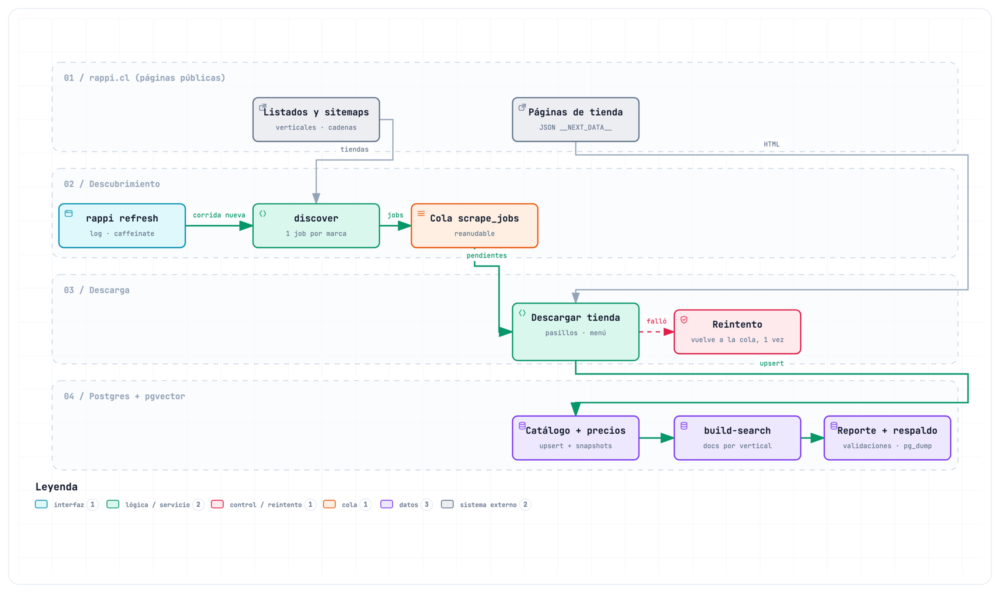

# rappi-scraper

Descarga el catálogo público de Rappi Chile de **todos los verticales** (productos, menús, tiendas y precios) y lo guarda en **Postgres + pgvector**. Con esa base arma los documentos de búsqueda por vertical que usa [`rappi-ia`](../rappi-ia/) para la búsqueda híbrida y el asistente Mochi.

**Fuentes:** solo páginas públicas de rappi.cl (el JSON `__NEXT_DATA__` que trae cada página), los sitemaps públicos de restaurantes y el JSON público de metadatos de tiendas. No usa APIs internas ni login, se presenta con su propio nombre y respeta robots.txt. Ver [Uso responsable](#uso-responsable).



Versión interactiva: [scraper-flujo.html](../docs/diagramas/scraper-flujo.html) (descargar y abrir en el navegador).

## Instalación

Requiere Python ≥ 3.13 y Postgres 17 con pgvector: con Homebrew (`make db`, macOS) o con Docker (`make db-docker`, sin Homebrew). Desde la raíz del repositorio:

```bash
cd rappi-scraper
make db        # Postgres 17 + pgvector (Homebrew), bases `rappi` y `rappi_test`
               # …o `make db-docker`: lo mismo en Docker, con la imagen del CI (y `rappi_ia_test`); la URL va en .env
make install   # .venv + proyecto en modo editable + herramientas de desarrollo (versiones del lock); crea .env
make migrate   # aplica el esquema
```

Queda disponible el comando `rappi` con el entorno activado (`source .venv/bin/activate`); sin activarlo, `.venv/bin/rappi` o `.venv/bin/python -m rappi_scraper`. Para instalar en otro equipo o partir desde un respaldo de la base: [docs/instalacion.md](../docs/instalacion.md).

## Uso

**Verticales:** `supermercado`, `conveniencia`, `turbo`, `mall` (subverticales: tecnología, belleza, hogar…), `farmacia`, `licores`, `chocolateria`, `restaurantes`.

```bash
rappi discover                          # 1. qué tiendas hay por vertical (todas las ciudades) y qué restaurantes; crea la cola
rappi scrape-stores --vertical mall     # 2. descarga tiendas (una sucursal por marca/formato), por vertical
rappi scrape-stores                     #    …o todas las pendientes
rappi scrape-restaurants                # 3. una sucursal por cadena + independientes
rappi build-search                      # 4. documentos de búsqueda por vertical
rappi search "pañales" --vertical supermercado
rappi status                            # avance de las corridas y resumen por vertical
rappi report                            # reporte de calidad de la última corrida de tiendas (--kind restaurants)
rappi refresh                           # todo de una vez: tiendas, restaurantes, búsqueda, reportes y respaldo (--no-backup)
rappi backup                            # respaldo de la base en data/backups/ (conserva los últimos 4)
rappi retry-failed --kind stores        # reencola los jobs fallidos (o --kind restaurants)
rappi export-csv                        # catálogo por vertical -> data/exports/
rappi migrate                           # aplica migraciones pendientes (lo mismo que make migrate)
```

- **Reanudable:** cada corrida es una cola de jobs en la base. Si se corta (Ctrl+C, error, corte de luz), basta con volver a ejecutar el mismo comando: sigue con lo pendiente. Para una corrida nueva (nueva foto de precios): `rappi discover --new-run`.
- **Historial:** cada corrida agrega un snapshot de precios; el catálogo no se duplica.
- **Una descarga a la vez:** dos en paralelo duplicarían la carga sobre rappi.cl.
- **Ritmo:** pausa aleatoria de 1,5–3 s entre páginas. Se ajusta con `RAPPI_DELAY_MIN` / `RAPPI_DELAY_MAX` en `.env` (ver `.env.example`).
- **Se identifica:** el User-Agent es `rappi-dlab-scraper/<versión> (+<contacto>; prototipo de investigacion dLab, no afiliado a Rappi)`, no el de un navegador. `RAPPI_UA_PROJECT` cambia el nombre (también el que se busca en robots.txt) y `RAPPI_UA_CONTACT` pone una URL o un correo para que Rappi sepa a quién escribir; sin contacto, el log lo avisa.
- **Respeta robots.txt:** antes de cada página consulta el robots.txt del sitio (RFC 9309, con comodines; `scraping/robots.py`) y lo guarda 24 horas. Busca el grupo de su nombre y, si no hay, el de `*`. Un sitio sin robots.txt (cualquier 4xx, como el bucket S3 de los metadatos) no tiene reglas; uno que no responde (5xx o red, tras los reintentos) no permite nada, salvo que ya se hubiera leído: entonces se sigue con esa copia y se vuelve a pedir en una hora. Las redirecciones se siguen a mano, revisando robots.txt antes de pedir cada destino. Si robots.txt no permite una página (también el destino de una redirección), la descarga no se la salta: se detiene, la corrida queda abierta y `rappi refresh` sale con el código 7. El robots.txt de rappi.cl del 24-10-2026 está en `tests/fixtures/robots.txt`: permite todo lo que el scraper pide (prohíbe la cuenta, el carro, las APIs y las páginas de una farmacia, Farmacias San Pablo, que hoy no está en el catálogo).

## Descarga completa

La primera descarga completa (24–27-09-2026) tomó **unos 3 días para las tiendas** (por las pausas entre páginas) y **unas 4 horas para los restaurantes**.

```bash
.venv/bin/rappi scrape-stores          # ~3 días
.venv/bin/rappi scrape-restaurants     # ~4 h
```

- **Sin supervisión:** en macOS el equipo no se duerme mientras corre (`caffeinate` automático) y todo queda en `data/logs/<comando>_<fecha>.log`. La terminal debe quedar abierta.
- **Progreso:** cada línea muestra `[i/N · transcurrido · faltan ~X]`.
- **Errores transitorios:** cada job fallido se reintenta una vez, automáticamente, al final de la corrida.
- **Ctrl+C:** detiene sin perder nada; se retoma con el mismo comando.
- **Ritmo y 429:** entre intentos se espera lo que pida rappi.cl en `Retry-After` (hasta 15 min) o un backoff exponencial (10, 20 s…), y no se espera después del último intento.
- **Posible bloqueo:** si 20 requests seguidos son rechazados (403, 429 o página de desafío) o 10 jobs seguidos fallan sin respuesta útil de rappi.cl (403, 429, red, página de desafío), la corrida se detiene: el reporte queda con la alerta ⛔ y la corrida abierta, para retomarla más tarde con el mismo comando (o en la próxima actualización semanal). `refresh` no sigue con restaurantes, búsqueda ni respaldo. Los jobs de la racha vuelven a la cola hasta su 4.º intento: si la misma racha se repite cada vez, es un error fijo de esos jobs (hay que revisarlo) y al 4.º intento quedan fallidos y la corrida sigue.
- **Reporte:** al terminar se imprime y se guarda en `data/reports/run_<id>_<tipo>.md` (y en `scrape_runs.report`): jobs por estado, errores frecuentes, productos por vertical, páginas omitidas y validaciones de calidad. Un `⚠` indica un posible cambio en el sitio o una respuesta anómala. Los jobs fallidos se cuentan sobre los intentados (hechos + fallidos), y los totales clave (ofertas; restaurantes y platos) se comparan con la última corrida terminada del mismo tipo: una caída de más del 25 % se marca.
- **Reintentar a mano:** `rappi retry-failed --kind stores` (o `restaurants`) y volver a correr el comando.
- **Ver el reporte de nuevo:** `rappi report` (o `rappi report --run N`).

Resultados de cada descarga y detalle por vertical en [README.md#resultados](../README.md#resultados).

## Páginas ilegibles y sucursales no disponibles

Una tienda se recorre así: portada → pasillos → sub-pasillos. Cuando algo falla a mitad del recorrido:

- **Página ilegible:** una página de pasillo o sub-pasillo que no se puede leer (error de red, página inexistente, JSON cortado o con otra forma, página sin datos de catálogo) se omite y queda en el resultado del job (`pasillos_omitidos`, `paginas_omitidas`, `paginas_intentadas`). La tienda queda hecha con el resto, y las ofertas de esos pasillos que estaban en la bajada anterior de su formato siguen vigentes en la búsqueda con ese precio (solo si esa bajada fue de la misma sucursal). Si se omite más del 5 % de las páginas, el job falla (pasa por el reintento) y no se guarda: la corrida anterior sigue siendo la del formato. El reporte muestra el % de páginas omitidas.
- **Ningún pasillo legible:** si no se pudo leer ningún pasillo, la tienda falla (`ningún pasillo se pudo leer`) en vez de quedar "hecha" solo con la portada.
- **Sucursal que deja de despachar:** si un pasillo redirige al listado de tiendas, no se guarda un catálogo a medias: se prueba la siguiente sucursal de la misma marca (hasta 3). Lo mismo si redirige la portada de la sucursal.
- **Restaurante dado de baja:** si Rappi redirige a `restaurantNotFound`, el job queda omitido ("ya no existe en Rappi").
- **Mensajes de error útiles:** cuando llega una página sin datos de catálogo, el error dice qué página llegó en su lugar.

## Actualización semanal automática

`rappi refresh` hace la actualización completa: retoma la corrida abierta (o descubre una nueva), descarga tiendas y restaurantes, arma la búsqueda, deja los reportes y respalda la base en `data/backups/` (últimos 4).

- **Retomar:** si una actualización se cortó con las tiendas ya terminadas, retoma en los restaurantes sin volver a bajar tiendas. Con `--resume-only` solo retoma las corridas abiertas (las que reabrió `retry-failed`) y nunca empieza una nueva.
- **Respaldo:** se escribe a un `.part`, se valida con `pg_restore --list` y recién entonces rota. Si falla, se conservan los anteriores y la actualización sigue, pero `rappi refresh` termina con código 3 (la tarea semanal lo anota como «respaldo fallido» y corre igual la capa de IA). La clave de la base va a `pg_dump` por `PGPASSWORD`, nunca en sus argumentos.
- **Sitemap de restaurantes caído o bloqueado:** si un sitemap no responde (un 403, un 429, una caída, un archivo ilegible), la corrida de restaurantes no se pierde: completa su cola con la lista de la última corrida de restaurantes terminada que empezó `rappi refresh` (no una de `discover` a mano; lo que se descubrió entonces, se haya bajado o no, sin los que ya no existían en Rappi) y baja esos menús y precios con los mismos jobs, pausas y detección de bloqueos de siempre (un bloqueo en la descarga sale con 4, como siempre). Si el que falló fue el de independientes, las cadenas recién descubiertas quedan y se suman los independientes de esa lista, salvo los que hoy son sucursales de esas cadenas. `--max-chains` y `--max-independents` también limitan la lista copiada. El log y el reporte lo dicen («⚠ sitemap bloqueado o caído: se usó la lista de la corrida N (X restaurantes)», con el error) y restaurantes nuevos no entran esa semana. Si la corrida termina, la próxima actualización vuelve a descubrir; si se detuvo por un bloqueo, la próxima la retoma con la misma lista. Un 403 a una parte numerada (-1, -2…) después de una parte que no llegó a las 50.000 URLs se toma como el final del sitemap, no como un error, con un aviso en el log (si fuera un bloqueo a mitad del sitemap, faltarían las partes siguientes): el 18-10 rappi.cl respondió 403, y no 404, a la parte -1 de cadenas (con la -0 muy lejos del tope), y lo más probable es que esa parte no exista.
- **Códigos de salida:** 4 = posible bloqueo (la corrida queda abierta, salvo si fue al descubrir, y la tarea semanal anota «detenida: posible bloqueo»); 7 = robots.txt no permite una página o no respondió (igual que el 4: se detiene y anota «detenida: robots.txt no permite una página o no respondió»; mientras robots.txt no cambie, la próxima se detiene en la misma página); 5 = falló el descubrimiento de restaurantes y no había una corrida anterior terminada de la que usar la lista: tiendas, búsqueda y respaldo sí se hicieron, la corrida de restaurantes queda cerrada como fallida con el error en su reporte, y la tarea semanal anota «restaurantes sin actualizar» y corre igual la capa de IA; 6 = eso y además el respaldo fallido (se anotan los dos). Con la lista anterior la corrida termina bien y sale con 0 (o 3 si falló el respaldo): el aviso queda en el reporte y, para la tarea semanal, `rappi refresh` deja la marca fija `restaurantes_con_lista_anterior` en el archivo de `RAPPI_REFRESH_NOTES` y `ultimo-estado.txt` anota «restaurantes con la lista de la corrida anterior».
- **Migraciones:** la tarea semanal aplica las pendientes (`rappi migrate`) antes de descargar, para que una migración que trajo un `git pull` no haga fallar la descarga al final.
- **Capa de IA:** la tarea semanal (`scripts/refresh-semanal.sh`) la corre los domingos a las 03:00 y, si la descarga terminó bien (aunque hayan fallado el respaldo o los restaurantes: códigos 3, 5 y 6) y `../rappi-ia` está instalado, sigue con `make -C ../rappi-ia post-refresh` (los pasos, en [rappi-ia/README.md](../rappi-ia/README.md#correr)).

```bash
make schedule          # instala la tarea en launchd (~/Library/LaunchAgents/cl.rappi.refresh.plist)
make schedule-status   # ¿está activa? ¿cómo terminaron las últimas semanas?
make unschedule        # quitarla
```

- **Equipo dormido o apagado:** si está dormido a esa hora, corre al despertar; si está apagado, esa semana se salta.
- **Una sola a la vez:** los comandos que descargan (`discover`, `scrape-stores`, `scrape-restaurants`, `refresh`) y `backup` toman el mismo candado de archivo (`data/scraper.lock`, con `flock`: el sistema lo suelta aunque el proceso muera) y se niegan a empezar si otra descarga lo tiene. Además, un candado (`data/refresh-semanal.pid`) impide que corran dos actualizaciones semanales; se borra aunque la tarea se corte con Ctrl+C o una señal. Si hay otra descarga (`discover`, `scrape-*`, `refresh`) o un `make post-refresh` en curso, la tarea se omite y lo anota.
- **Ubicación del proyecto:** debe estar fuera de Documentos, Escritorio y Descargas: macOS no deja que launchd lea esas carpetas (detalle en [docs/instalacion.md](../docs/instalacion.md)).
- **Logs:** cada ejecución deja una línea en `data/logs/ultimo-estado.txt` (`exit=N`, «omitida», «interrumpida», «respaldo fallido», «restaurantes sin actualizar», «restaurantes con la lista de la corrida anterior», «detenida: posible bloqueo» o «detenida: robots.txt no permite una página o no respondió»), que muestra `make schedule-status` junto con el respaldo más nuevo; la salida de launchd queda en `data/logs/launchd.*.log`, y el log detallado y el reporte, como en cualquier corrida.
- Programarla en **un solo** equipo.

## Objetivos del Makefile

`make help` los lista con su descripción.

| Objetivo | Qué hace |
|---|---|
| `make install` | Crea `.venv` e instala el proyecto con dependencias de desarrollo y las versiones de `rappi-ia/requirements.lock.txt` (como el CI); crea `.env` |
| `make db` | Instala y levanta Postgres 17 + pgvector (Homebrew) y crea `rappi` y `rappi_test` |
| `make db-docker` | Lo mismo sin Homebrew: Postgres 17 + pgvector en Docker (la imagen del CI y el despliegue), en `127.0.0.1:5432` (`DB_DOCKER_PORT`), con `rappi`, `rappi_test` y `rappi_ia_test` |
| `make migrate` | Aplica migraciones pendientes |
| `make test` | Todos los tests (unitarios + integración contra `rappi_test`) |
| `make test-unit` | Solo unitarios, sin base de datos |
| `make test-integration` | Solo integración, contra `rappi_test` |
| `make lint` | ruff: errores comunes + formato |
| `make format` | Aplica el formato |
| `make status` | Estado de las corridas y resumen por vertical |
| `make report` | Reporte de calidad de la última corrida de tiendas |
| `make refresh` | Actualización completa (`rappi refresh`) |
| `make backup` | Respaldo de la base en `data/backups/` |
| `make schedule` | Programa la tarea semanal (launchd, domingos 03:00) |
| `make schedule-status` | Muestra si la tarea semanal está activa y las últimas ejecuciones |
| `make unschedule` | Quita la tarea semanal |

## Estructura

```text
rappi-scraper/
├── pyproject.toml                dependencias, comando `rappi`, config de pytest y ruff
├── Makefile                      instalación, tests, operación y tarea semanal
├── .env.example                  conexión a Postgres, User-Agent y ritmo de requests
├── scripts/
│   ├── refresh-semanal.sh          tarea semanal: `rappi refresh` y luego la capa de IA
│   └── launchd/
│       └── cl.rappi.refresh.plist.template   plantilla de launchd (domingos 03:00)
├── src/rappi_scraper/
│   ├── __main__.py               `python -m rappi_scraper`
│   ├── cli.py                    comandos de `rappi`
│   ├── config.py                 URLs, User-Agent, ritmo de peticiones (configurable por entorno) y rutas
│   ├── keep_awake.py             evita que el equipo se duerma durante una corrida (`caffeinate`, macOS)
│   ├── lock.py                   candado de «una descarga a la vez» (`flock` sobre `data/scraper.lock`)
│   ├── pricing.py                cálculo de descuentos
│   ├── reporting.py              reporte de cada corrida: conteos, errores frecuentes y validaciones de calidad
│   ├── scraping/                 todo lo que habla con rappi.cl
│   │   ├── client.py               HTTP con pausas, reintentos, robots.txt y ubicación de despacho
│   │   ├── robots.py               reglas de robots.txt por sitio, con caché de 24 horas
│   │   ├── next_data.py            lectura del JSON __NEXT_DATA__
│   │   ├── store_parser.py         tienda, pasillos, sub-pasillos y productos
│   │   ├── listing_parser.py       listados por vertical y cadenas de restaurantes
│   │   ├── restaurant_parser.py    restaurante y menú
│   │   └── store_metadata.py       JSON público de metadatos de tiendas, con coordenadas
│   ├── pipeline/                 orquestación de las corridas
│   │   ├── discover.py             qué descargar (crea la cola de jobs)
│   │   ├── queue.py                procesa la cola: progreso, aislamiento de errores y una pasada de reintento
│   │   ├── progress.py             `[i/N · transcurrido · faltan ~X]`
│   │   ├── stores.py               descarga de tiendas (páginas ilegibles, cambio de sucursal)
│   │   ├── restaurants.py          descarga de restaurantes
│   │   └── refresh.py              actualización completa: tiendas → restaurantes → búsqueda → reportes → respaldo
│   ├── storage/                  Postgres
│   │   ├── db.py                   conexión y migraciones
│   │   ├── repository.py           escrituras idempotentes y consultas de estado
│   │   ├── search.py               documentos y búsqueda por vertical
│   │   ├── backup.py               respaldo con pg_dump, validación y rotación
│   │   ├── export.py               catálogo por vertical a CSV (`rappi export-csv`)
│   │   └── migrations/             esquema SQL versionado, un solo historial para toda la base (001–042; las de rappi-ia: 009–013, 016, 020, 022–031, 033–037, 041 y 042)
├── tests/
│   ├── unit/                     sin red ni base de datos
│   ├── integration/              contra la base `rappi_test`
│   └── fixtures/                 páginas reales de rappi.cl guardadas y su robots.txt
└── data/                         fuera de git
    ├── exports/                    salida de `rappi export-csv`
    ├── reports/, logs/             reportes y logs de cada corrida
    └── backups/                    respaldos de la base (`rappi backup` / `refresh`)
```

## Modelo de datos

| Tabla / vista | Qué tiene |
|---|---|
| `catalog_items` | **Contenido único** (un `master_product_id` = un producto en todo Rappi) |
| `store_products` + `price_snapshots` | El producto en cada tienda y su precio en cada corrida |
| `latest_prices`, `latest_menu_prices` | El último precio de cada oferta y de cada plato (los mantienen triggers sobre el historial) |
| `store_last_snapshot` | El último snapshot de precios de cada tienda, con su formato y la última corrida del formato: es `v_store_format_runs` (lo mantienen triggers sobre `price_snapshots` y `stores`) |
| `stores`, `brands`, `store_verticals` | Tiendas, marcas y en qué verticales aparece cada una (N:M) |
| `aisles`, `categories` | Pasillos por tienda y categorías globales de Rappi |
| `restaurant_details`, `cuisines`, `menu_sections`, `menu_items`, `menu_price_snapshots` | Restaurantes y menús |
| `search_documents` | Texto para búsqueda, **particionado por vertical**, con su `embedding` (lo llena `rappi-ia`) |
| `scrape_runs`, `scrape_jobs` | Corridas y cola de trabajo (permite reanudar) |
| `v_vertical_summary` | Tiendas, productos, marcas, categorías y platos por vertical |
| `v_item_verticals`, `v_cross_vertical_items` | En qué verticales está cada producto / productos en más de un vertical |
| `v_price_compare`, `v_price_changes` | Mismo producto entre cadenas / cambios de precio entre corridas |
| `v_coverage` | Productos declarados vs obtenidos por sub-pasillo |
| `v_store_format_runs` | Última corrida que bajó el formato de cada tienda (qué ofertas están vigentes) |
| `v_latest_offers` | El último precio de cada oferta y si está vigente: la única definición de oferta vigente |

Consultas de ejemplo y cómo conectarse: [docs/sql/](../docs/sql/).

**Aislamiento por vertical:** las búsquedas siempre llevan `vertical` y cada vertical es su propia partición, así que un índice vectorial nunca mezcla verticales. Los análisis cruzados se hacen sobre las tablas núcleo.

**Vigencia:** `search_documents` usa solo lo vigente. Una oferta o un plato cuenta si su último precio es de la última corrida que bajó su formato (`store_type`) o su cadena (`brand_id`); así salen las sucursales viejas y lo que ya no se vende. Un plato también sale si una corrida posterior ya no encontró su local o su cadena. Un formato que la última corrida no pudo bajar conserva su último dato. La corrida de cada formato sale de `v_store_format_runs`. Una oferta de un pasillo que esa corrida no pudo leer sigue vigente si su último precio es de la bajada anterior de su formato (el job `store_group` terminado anterior del mismo `store_type`): con B → A → B, la segunda bajada de B no revive los precios de la primera. La regla vive en una sola vista, `v_latest_offers` (migración 032), que también usa `rappi-ia` para el detalle, la página de la tienda, el precio del pedido y el precio que muestra Mochi: el tope de precio y el precio mostrado salen de las mismas ofertas. El último precio se lee de `latest_prices` y `latest_menu_prices`, y el último snapshot de cada tienda, de `store_last_snapshot` (migraciones 038 y 039, que también guarda la corrida de cada formato), sin ordenar ni recorrer el historial. Las tablas núcleo y las demás vistas `v_*` guardan todo el historial.

**Embeddings:** `search_documents.content` no incluye precios (un cambio de precio no obliga a regenerar el embedding) y `content_hash` invalida el embedding solo si cambia el texto. El modelo es `intfloat/multilingual-e5-base` (768 dimensiones): `rappi-ia` llena `embedding`/`embedding_model` y crea un índice HNSW por partición con `embedding::vector(768)`. El ejemplo con `vector(1536)` de `003_search.sql` es anterior a la elección del modelo. Diseño completo en [docs/diseno-ia.md](../docs/diseno-ia.md).

## Desarrollo

```bash
make test         # todos los tests (unitarios + integración contra rappi_test)
make test-unit    # solo unitarios, sin base de datos
make lint         # ruff: errores comunes + formato
make format       # aplica el formato
```

- **Tests:** las cifras vigentes están en [README.md#resultados](../README.md#resultados) (fila «Calidad»). Los de integración usan la base `rappi_test`, nunca `rappi`.
- **CI:** GitHub Actions (`.github/workflows/ci.yml`) corre lint y tests contra Postgres + pgvector.
- **Convención:** el código (funciones, variables, módulos) va en inglés; lo que ve el usuario (logs, CLI, columnas de CSV, valores de verticales) en español.

## Limitaciones

- **Cobertura parcial en tiendas:** las páginas públicas muestran como máximo 24 productos por sub-pasillo (el resto lo carga el navegador por otra vía). La cobertura real (obtenidos vs declarados) se ve en la vista `v_coverage`. Los restaurantes sí traen el menú completo.
- **`ean` casi siempre vacío:** Rappi no lo publica. Para comparar el mismo producto entre cadenas se usa `master_product_id`.
- **Jumbo y Tottus:** en septiembre de 2026 sus sucursales redirigían (inactivas en Rappi).
- **Cambios en el sitio:** si cambia el frontend de rappi.cl hay que ajustar `scraping/*_parser.py`. Los tests usan páginas reales guardadas en `tests/fixtures/`: si los tests pasan pero el scraper falla con las páginas actuales, la estructura cambió; guarda una página nueva y los tests muestran qué.

## Uso responsable

- Solo páginas públicas sin barreras técnicas, sitemaps públicos y el JSON público de metadatos de tiendas. Sin APIs internas, sin login y sin evasión de protecciones: se presenta con su propio User-Agent (no como un navegador) y respeta robots.txt; si una página no está permitida, se detiene.
- Una descarga a la vez, con pausas de 1,5–3 s entre páginas, y actualización semanal.
- Sin datos personales: catálogo, precios y datos públicos de tiendas y restaurantes.
- Fines de investigación y demostración. Un uso comercial requeriría autorización de Rappi. Los datos descargados no se suben al repositorio.
- Proyecto independiente: no está afiliado a Rappi ni cuenta con su respaldo. Las marcas y el contenido pertenecen a Rappi y a los comercios.

Detalle en [README.md#qué-es-real-y-qué-es-simulado](../README.md#qué-es-real-y-qué-es-simulado).
